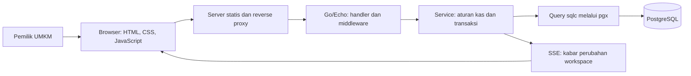
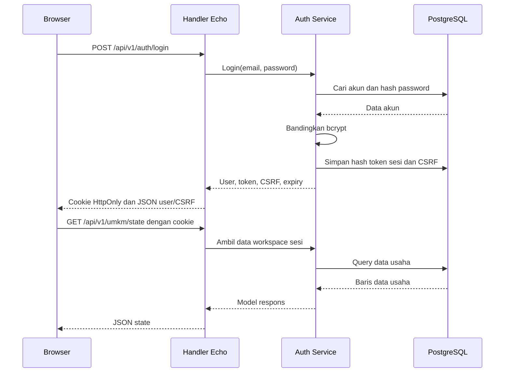

# Arsitektur Easy Financial Audit (EFA)

Nama tampilan baru: Easy Financial Audit, sebelumnya Temu Kas.
Folder temukas, ID aplikasi umkm, akun, data dan endpoint tidak diganti.
Pembaruan logo/palet dijelaskan di [BRAND.md](docs/BRAND.md).

Panduan ini menjelaskan cara kerja Temu Kas dari halaman yang kamu buka sampai data tersimpan di PostgreSQL. Mulai dari bagian 1–5 untuk memahami gambaran besar; bagian 8–10 menjadi referensi endpoint.

Dasar penjelasan: source integrasi lokal pada commit `ae2c08b`, termasuk backend dan SSE tim. Dokumen dibuat 27 Oktober 2026. Isi konfigurasi privat dan credential database tidak dicantumkan.

## Daftar isi

1. [Versi aplikasi dan alamatnya](#1-versi-aplikasi-dan-alamatnya)
2. [Gambaran arsitektur](#2-gambaran-arsitektur)
3. [Peta direktori](#3-peta-direktori)
4. [Fungsi file yang perlu kamu kenal](#4-fungsi-file-yang-perlu-kamu-kenal)
5. [Alur dari membuka aplikasi sampai logout](#5-alur-dari-membuka-aplikasi-sampai-logout)
6. [Data, tabel, dan perhitungan saldo](#6-data-tabel-dan-perhitungan-saldo)
7. [Aturan API yang berlaku bersama](#7-aturan-api-yang-berlaku-bersama)
8. [Daftar seluruh endpoint integrasi](#8-daftar-seluruh-endpoint-integrasi)
9. [Penjelasan setiap endpoint](#9-penjelasan-setiap-endpoint)
10. [Contoh mencoba API dari browser](#10-contoh-mencoba-api-dari-browser)
11. [Alur real-time dan kegagalan koneksi](#11-alur-real-time-dan-kegagalan-koneksi)
12. [Konfigurasi, menjalankan, dan menguji](#12-konfigurasi-menjalankan-dan-menguji)
13. [Kalau mau mengubah sesuatu, buka file mana?](#13-kalau-mau-mengubah-sesuatu-buka-file-mana)
14. [Perbedaan endpoint demo Vercel](#14-perbedaan-endpoint-demo-vercel)
15. [Istilah dan cara menjelaskan saat demo](#15-istilah-dan-cara-menjelaskan-saat-demo)

## 1. Versi aplikasi dan alamatnya

**Ada dua versi. Keduanya belum otomatis menjadi satu deployment.**

| Bagian | Versi yang dimaksud |
| --- | --- |
| Web demo https://efa.madgo.my.id/ | Prototipe yang sudah dideploy di Vercel; backend Go net/http, frontend HTML/CSS/JavaScript, endpoint /api/... |
| Folder PBL/temukas | Source integrasi: frontend milik Evan + backend tim Go/Echo/sqlc + SSE, endpoint /api/v1/... |
| https://temukas.madgo.my.id/ | Alamat server API yang dikelola tim; berbeda dari domain web demo efa |
| PR integrasi | https://github.com/AhmadKusumahDEV/rekonsiliasi-kas-umkm/pull/5 |
| Source prototipe lama | PBL/archives/three-go-prototypes |

Mengubah CNAME mengarahkan pengunjung ke deployment yang dipilih. Mengubah CNAME **tidak** menggabungkan kode, memindahkan database, atau memasang isi PR.

Contohnya: keberhasilan login di efa tidak membuktikan bahwa akun yang sama sudah ada di database backend tim. Database dan sesi mengikuti deployment yang diakses.

Bagian utama dokumen ini menjelaskan **source integrasi PBL/temukas**. Perbedaan prototipe Vercel ada di bagian 14.

## 2. Gambaran arsitektur

Browser menampilkan UI. Backend memeriksa aturan dan hak akses. PostgreSQL menyimpan data. SSE mengabari browser ketika data usaha berubah.



### Bagian yang berjalan di browser

- HTML menyediakan kerangka.
- CSS mengatur tampilan, warna, layout HP, dan animasi.
- JavaScript mengurus input, navigasi, permintaan API, serta render data.
- Frontend ini **JavaScript biasa**, bukan React, Vue, Vite, atau jQuery.
- Browser tidak memegang DATABASE_URL dan tidak menjalankan SQL.

### Bagian yang berjalan di server

- **Go:** bahasa backend.
- **Echo:** menerima permintaan HTTP dan mengarahkannya ke handler.
- **Service:** memutuskan apakah tindakan boleh dilakukan.
- **pgx:** menghubungkan Go ke PostgreSQL dan mengelola pool koneksi.
- **sqlc:** menghasilkan fungsi Go dari query SQL yang ditulis tim.
- **Viper:** membaca konfigurasi saat aplikasi dimulai.
- **SSE:** koneksi satu arah agar server bisa mengabari browser.

Tidak ada Redis, AI grader, Gemini, n8n, atau worker antrean yang dibutuhkan untuk alur kas ini. Usulan pencocokan memakai aturan yang bisa dibaca di source.

### Kenapa memakai beberapa lapisan?

Anggap aplikasi sebagai meja layanan:

| Lapisan | Perumpamaan | Tugas sebenarnya |
| --- | --- | --- |
| Frontend | Formulir pelanggan | Menampilkan data dan menerima input |
| Handler | Petugas penerima | Membaca request, memvalidasi bentuk input, memanggil service |
| Service | Petugas yang memeriksa aturan | Mengecek workspace, saldo, duplikat, dan transaksi |
| Query/sqlc | Instruksi pengambilan arsip | Menjalankan SQL dengan parameter |
| Database | Tempat penyimpanan | Menyimpan tabel, hubungan, constraint dan index |

Handler tidak menghitung seluruh aturan kas atau menulis SQL langsung. Aturan kas ditempatkan di service agar bisa dites tanpa membuka UI.

## 3. Peta direktori

### Di luar repository aktif

```text
PBL/
├── temukas/                        source aktif integrasi tim
├── documents/                      proposal, PDF, slide
├── research/                       sumber dan catatan riset
├── submissions/                    bahan pengumpulan dan media LinkedIn
├── archives/
│   ├── three-go-prototypes/        dulu bernama apps
│   └── legacy-maxy-review/         dulu bernama app
├── README.md                       petunjuk folder PBL
├── run.bat                         meneruskan ke launcher temukas
└── run-legacy.bat                  launcher aplikasi lama
```

Folder arsip sengaja dipisahkan. Jangan mengedit file di arsip lalu berharap source integrasi ikut berubah. Backup sebelum penggabungan ada di Modules/Backups/PBL-before-team-sync-20261027-104029.

### Di dalam repository aktif

```text
temukas/
├── frontend/
│   ├── index.html
│   ├── assets/
│   │   ├── app.js
│   │   ├── design.js
│   │   ├── style.css
│   │   ├── brand.css
│   │   ├── motion.js
│   │   ├── motion.css
│   │   ├── maxy-logo.png, favicon.png, umkm-real.jpg
│   │   ├── InterVariable.woff2, poppins-semibold.ttf
│   │   ├── Inter-LICENSE.txt, Poppins-OFL.txt
│   │   └── contoh-penjualan.csv, contoh-penerimaan.csv
│   ├── tests/dev.test.mjs
│   ├── dev.mjs
│   ├── start.mjs
│   ├── package.json
│   ├── Caddyfile.example
│   └── ASSETS.md
├── backend/
│   ├── cmd/
│   │   ├── api/main.go
│   │   ├── seed-demo/main.go
│   │   └── worker/README.md
│   ├── configs/
│   │   ├── local.yaml.example
│   │   └── local.yaml              konfigurasi privat; tidak ikut Git
│   ├── internal/
│   │   ├── config/
│   │   ├── echohttp/
│   │   ├── models/
│   │   ├── service/
│   │   ├── repository/rekonsiliasi_repository_sqlc/
│   │   ├── testkit/
│   │   ├── testdata/
│   │   ├── apiclient/
│   │   └── worker/
│   ├── pkg/
│   │   ├── database/
│   │   ├── errors/
│   │   ├── http/models/
│   │   ├── sse/
│   │   └── utils/
│   ├── scripts/postgres/
│   │   ├── migrations/
│   │   ├── queries/
│   │   └── sqlc.yaml
│   ├── docs/
│   ├── go.mod, go.sum
│   ├── Makefile, Dockerfile, compose.yaml
│   └── AGENTS.md, README.md, init-project.md
├── docs/
│   ├── PRD.md, FRD.md
│   ├── INTEGRATION.md, HOSTING.md, DEMO.md, VERIFICATION.md
│   └── reference/                  dokumen prototipe utuh
├── .github/workflows/              CI frontend dan backend
├── .cursor/agents/                 petunjuk bantuan pengembangan tim
├── .vscode/                        pengaturan run/debug editor
├── .cache/                         hasil lokal; diabaikan Git
├── test-results/                   hasil browser lokal; diabaikan Git
├── architecture.md                 dokumen yang sedang kamu baca
├── run.bat
├── README.md, CONTRIBUTING.md
└── .gitignore
```

Sebagian folder hanya berisi README sebagai tempat pengembangan berikutnya: cmd/worker, internal/worker, internal/apiclient, dan internal/testdata. Itu **bukan** bukti bahwa worker atau integrasi eksternal sudah berjalan.

## 4. Fungsi file yang perlu kamu kenal

### Frontend

| File | Kegunaan |
| --- | --- |
| [index.html](frontend/index.html) | Memuat font, favicon, tiga CSS, app.js, area aplikasi, dialog, dan toast |
| [app.js](frontend/assets/app.js) | State UI, helper fetch, login/daftar, navigasi, render halaman, impor, alokasi, password, SSE/fallback |
| [design.js](frontend/assets/design.js) | Menyusun header, navigasi, ringkasan dan komposisi visual; tidak mengakses SQL |
| [style.css](frontend/assets/style.css) | Gaya dasar: form, tombol, tabel, dialog dan layout |
| [brand.css](frontend/assets/brand.css) | Gaya Temu Kas/MAXY dan layout khusus produk |
| [motion.js](frontend/assets/motion.js) | Mengaktifkan animasi ketika auth atau halaman ditampilkan |
| [motion.css](frontend/assets/motion.css) | Transisi, keyframe, dan penyesuaian reduced motion |
| [dev.mjs](frontend/dev.mjs) | Menyajikan HTML/aset lokal; meneruskan /api/v1 dan /health ke Go |
| [start.mjs](frontend/start.mjs) | Mengecek port, build Go, menjalankan dua child server, menghentikannya bersama |
| [package.json](frontend/package.json) | Shortcut perintah; tidak berisi framework atau dependency frontend |
| [dev.test.mjs](frontend/tests/dev.test.mjs) | Tes penyajian aset, pembatasan path, dan forwarding cookie/CSRF |
| [Caddyfile.example](frontend/Caddyfile.example) | Contoh penyajian frontend dan proxy API pada satu domain; sesuaikan sebelum dipasang |
| [ASSETS.md](frontend/ASSETS.md) | Asal serta penggunaan aset dan lisensi font |

Foto, logo, dan font adalah file lokal. Contoh CSV berisi transaksi sintetis yang bisa diunduh dari dialog impor.

### Startup, konfigurasi dan request HTTP

| File | Kegunaan |
| --- | --- |
| [cmd/api/main.go](backend/cmd/api/main.go) | Membuat config, logger, pool DB, service, manager SSE dan server; menangani shutdown |
| [cmd/seed-demo/main.go](backend/cmd/seed-demo/main.go) | Membuat akun dan impor sintetis hanya saat dijalankan manual |
| [config.go](backend/internal/config/config.go) | Membaca YAML/environment, mengisi default, memvalidasi konfigurasi |
| [config_keys.go](backend/internal/config/config_keys.go) | Nama environment dan key konfigurasi |
| [config/auth.go](backend/internal/config/auth.go) | Prefix /api/v1, cookie rku_session, umur sesi 12 jam, kind umkm |
| [header_keys.go](backend/internal/config/header_keys.go) | Konstanta header seperti CSRF |
| [http_server.go](backend/internal/echohttp/http_server.go) | Mendaftarkan semua route dan middleware, menyalakan/mematikan Echo |
| [auth_handler.go](backend/internal/echohttp/auth_handler.go) | Request daftar/login/logout/password dan cookie |
| [auth_middleware.go](backend/internal/echohttp/auth_middleware.go) | Membaca sesi, mengecek CSRF, menyediakan identitas untuk handler |
| [umkm_handler.go](backend/internal/echohttp/umkm_handler.go) | Menghubungkan request kas ke fungsi service |
| [health_handler.go](backend/internal/echohttp/health_handler.go) | Liveness dan readiness |
| [validator.go](backend/internal/echohttp/validator.go) | Validasi field request berdasarkan tag di models |
| [security_middleware.go](backend/internal/echohttp/security_middleware.go) | Header keamanan, CORS dan limiter login/register |
| [logging_middleware.go](backend/internal/echohttp/logging_middleware.go) | Mencatat method, path, status, latency, request ID dan IP |
| [echohttp_error_handler.go](backend/internal/echohttp/echohttp_error_handler.go) | Mengubah error Go menjadi status HTTP dan pesan JSON |
| [echohttp/sse.go](backend/internal/echohttp/sse.go) | Membuat SSE dengan autentikasi cookie dan room workspace |

### Aturan bisnis dan database

| File/folder | Kegunaan |
| --- | --- |
| [service.go](backend/internal/service/service.go) | Dependency service, config publik, dan pemeriksaan kesehatan |
| [auth_service.go](backend/internal/service/auth_service.go) | Akun, bcrypt, pembuatan/pemeriksaan sesi, logout, perubahan password |
| [umkm_domain.go](backend/internal/service/umkm_domain.go) | Parsing CSV, saldo, usulan, validasi alokasi, pembuatan CSV ekspor |
| [umkm_service.go](backend/internal/service/umkm_service.go) | Mengambil state; impor, alokasi, undo/cancel dengan transaksi dan lock |
| [mappers.go](backend/internal/service/mappers.go) | Mengubah tipe baris DB menjadi model respons API |
| [service_errors.go](backend/internal/service/service_errors.go) | Tempat yang disiapkan untuk sentinel error khusus service; saat ini baru komentar panduan |
| [sse_notifier.go](backend/internal/service/sse_notifier.go) | Antarmuka pemberitahuan perubahan; service tidak bergantung langsung pada Echo |
| [models/auth.go](backend/internal/models/auth.go) | User, session dan request/response auth |
| [models/umkm.go](backend/internal/models/umkm.go) | Entry, import, allocation, match, state dan payload mutasi |
| [models/health.go](backend/internal/models/health.go) | Struktur respons health |
| [queries/auth.sql](backend/scripts/postgres/queries/auth.sql) | Sumber SQL akun, sesi, workspace dan audit |
| [queries/umkm.sql](backend/scripts/postgres/queries/umkm.sql) | Sumber SQL transaksi, batch dan alokasi |
| [sqlc.yaml](backend/scripts/postgres/sqlc.yaml) | Pengaturan generator sqlc |
| [repository/sqlc](backend/internal/repository/rekonsiliasi_repository_sqlc) | db.go, models.go, auth.sql.go, umkm.sql.go hasil generator; jangan diedit manual |
| [pkg/database](backend/pkg/database) | config.go mengatur pool; postgres.go membuat koneksi dan menyediakan BeginTx |
| [pkg/errors/errors.go](backend/pkg/errors/errors.go) | Jenis error domain: invalid request, unauthorized, conflict, dan lainnya |
| [pkg/utils/time.go](backend/pkg/utils/time.go) | Waktu bisnis Asia/Jakarta |
| [testkit/postgres.go](backend/internal/testkit/postgres.go) | Menyiapkan/reset database uji disposable |
| [pkg/http/models/model.go](backend/pkg/http/models/model.go) | Tipe paging/filter umum; bukan berarti endpoint state sekarang memakai paging server |

File *_test.go menguji perilaku yang ada. File test tidak menjadi endpoint dan tidak dijalankan sebagai server produksi.

### File pengembangan dan deployment

| File/folder | Kegunaan |
| --- | --- |
| backend/go.mod | Nama module, versi Go, dan daftar dependency |
| backend/go.sum | Checksum dependency untuk memeriksa konsistensi unduhan |
| backend/Makefile | Shortcut run, build, test, lint, migration dan sqlc |
| backend/Dockerfile | Build image API Go; tidak menyertakan server frontend |
| backend/compose.yaml | PostgreSQL db dan db-test; bukan paket yang menyalakan UI/API sekaligus |
| backend/.env.example | Contoh environment, tidak dimuat otomatis oleh config.Load |
| backend/.editorconfig | Aturan dasar format editor |
| backend/.dockerignore | File yang tidak masuk konteks build Docker |
| backend/AGENTS.md | Aturan kerja pengembangan; bukan konfigurasi runtime |
| backend/init-project.md | Referensi kerangka arsitektur tim |
| .github/workflows | Otomasi pemeriksaan ketika push/PR |
| .github/pull_request_template.md | Format informasi untuk reviewer PR |
| .gitignore dan backend/.gitignore | Mencegah config privat, cache dan hasil build ikut Git |
| .vscode dan backend/.vscode | Shortcut task/debug editor |
| docs/reference | Dokumen lama utuh; bagian di luar UMKM bukan fitur aktif |
| backend/dist | Hasil build lokal bila sudah dibangun; bukan source utama |

Compose memetakan db ke port host 5433 dan db-test ke 55432 pada konfigurasi yang diperiksa. PostgreSQL native lokal dapat memakai port berbeda. Jangan menganggap semua database otomatis berjalan di port yang sama.

### Package SSE

| Kelompok file | Kegunaan |
| --- | --- |
| manager.go, config.go | Membuat, menjalankan dan mengatur batas stream |
| client.go | Koneksi seorang client dan antrean kirimnya |
| hub.go | Kelompok koneksi berdasarkan user dan room |
| event.go | Bentuk dan encoding event SSE |
| bus.go | Abstraksi bus, termasuk implementasi lokal |
| origin.go, middleware.go | Pemeriksaan origin dan pembungkus handler stream |
| presence.go, presence_refresh.go | Kemampuan presence package jika dikonfigurasi |
| errors.go, doc.go | Error dan penjelasan package |
| docs/, README.md, PROTOCOL.md, INTEGRATION.md | Penjelasan package serta kontrak stream |
| examples/ | Contoh chat/minimal; tidak dijalankan oleh API Temu Kas |
| *_test.go | Tes, benchmark dan fuzzing SSE |

Temu Kas memakai room berdasarkan workspace. Kemampuan bus/presence pada package tidak berarti sudah ada Redis atau jaringan beberapa instance dalam deployment Temu Kas.

## 5. Alur dari membuka aplikasi sampai logout

### 5.1 Membuka halaman

1. Browser mengambil index.html dan aset.
2. app.js menjalankan init().
3. GET /api/v1/config memberi identitas produk.
4. GET /api/v1/auth/me mengecek sesi.
5. Jika 401, UI menampilkan login. Jika valid, UI mengambil state dan suggestions.
6. UI membentuk shell dan halaman, lalu membuka SSE.

Alamat seperti /#entries adalah **navigasi UI di browser**. Itu bukan endpoint API dan bukan route Go untuk mengambil transaksi.

### 5.2 Mendaftar

Form mengirim nama, email, password, nama usaha dan role owner. Backend menormalisasi email, memvalidasi input, membuat hash bcrypt, lalu menyimpan workspace dan user dalam transaksi. Setelah berhasil, backend membuat sesi dan mengatur cookie.

Akun baru mempunyai ruang kerja sendiri. Backend sekarang tidak menyediakan undangan staf atau login multi-role.

### 5.3 Login



Password tidak dikirim sebagai query URL. Browser mengirim JSON melalui POST; pada deployment HTTPS, transport terenkripsi. JavaScript menyimpan CSRF di memori, sedangkan cookie HttpOnly dikelola browser.

### 5.4 Impor

1. Pemilik memilih sale atau receipt dan file CSV.
2. Frontend membaca teks file, bukan mengirim path laptop.
3. Preview memvalidasi file tanpa mengubah saldo.
4. Setelah pemilik menekan simpan, frontend mengirim kind dan csv lagi.
5. Service memvalidasi ulang, membuka transaksi, dan lock workspace.
6. Service memeriksa checksum, source ID, batas data dan konsistensi.
7. Batch, entri, audit dan version disimpan; transaksi di-commit.
8. Backend mengirim event SSE. UI memuat data terbaru.

Mengubah file atau jenis transaksi menghapus preview sebelumnya. File yang salah tidak disimpan sebagian.

### 5.5 Usulan dan alokasi manual

Usulan otomatis hanya untuk entri aktif yang belum mempunyai alokasi aktif. Referensi harus terisi dan sama, kanal/nominal sama, penerimaan 0–3 hari setelah penjualan, serta kandidat unik di kedua sisi.

Nominal berbeda, referensi kosong, kandidat ganda, atau pembayaran yang sudah sebagian dialokasikan tidak dipaksa menjadi usulan. Pemilik dapat memeriksa dan menggunakan alokasi manual.

Ketika disimpan, server memeriksa saldo kembali dalam transaksi. Frontend tidak berhak memutuskan bahwa saldo cukup hanya dari data lama di layar.

### 5.6 Undo dan pembatalan impor

Undo membalikkan sebuah alokasi, bukan menghapus penjualan/penerimaan. Sisa saldo kembali dan riwayat tetap ada.

Pembatalan impor membatalkan batch beserta entrinya. Server menolak jika entri batch masih mempunyai alokasi aktif; undo pasangan terlebih dahulu.

### 5.7 Laporan

GET export membuat CSV dari transaksi workspace dan sisa alokasi. CSV juga mencantumkan transaksi yang dibatalkan. Ekspor bukan perintah transfer bank dan bukan perhitungan laba.

### 5.8 Logout atau ganti password

Logout menghapus sesi saat ini, mengosongkan cookie, dan meminta manager memutus stream user. Tab lain dapat tersambung lagi jika sesinya sendiri masih valid.

Perubahan password menghapus seluruh sesi user. Cookie saat ini dibersihkan, stream user diputus, dan login berikutnya harus memakai password baru.

## 6. Data, tabel, dan perhitungan saldo

### Entitas yang dilihat UI

| Istilah | Arti |
| --- | --- |
| Workspace | Satu usaha beserta batas akses datanya |
| User | Akun pemilik |
| Session | Bukti login yang memiliki waktu kedaluwarsa |
| Entry | Satu catatan penjualan atau penerimaan |
| Import/batch | Satu kelompok hasil upload CSV |
| Allocation | Keputusan mengalokasikan uang masuk ke penjualan |
| Audit event | Jejak siapa melakukan tindakan apa |
| Version | Nomor perubahan workspace untuk sinkronisasi |

ID sumber dalam CSV, misalnya P101, berbeda dari ID internal 32 hex. Gunakan **ID internal** dari respons API ketika mengalokasikan atau membatalkan.

### Tabel integrasi

| Tabel | Isi dan hubungan |
| --- | --- |
| pblg_workspaces | Identitas usaha dan version; induk data workspace |
| pblg_users | Nama/email/hash password; mengacu workspace |
| pblg_sessions | Hash token, user, CSRF dan expiry |
| pblg_audit | Workspace, aktor, aksi, detail dan waktu |
| umkm_imports | Workspace, checksum file, jenis dan waktu cancel |
| umkm_entries | Workspace, batch, source ID, tanggal, referensi, nama, nominal, kanal, catatan |
| umkm_allocations | Workspace, sale ID, receipt ID, amount, fee, alasan, waktu reversal |

Foreign key gabungan workspace+ID membantu menjaga hubungan tetap dalam usaha yang sama. Index mendukung pencarian workspace, tanggal, kandidat, batch dan alokasi aktif.

Migration:

1. 000001_pbl_baseline: struktur historis, termasuk tabel jobs/photos dan JSONB state.
2. 000002_umkm_normalized: tabel impor, entri dan alokasi khusus UMKM.
3. 000003_backfill_umkm_state: memindahkan data UMKM historis dari JSONB ke tabel normalisasi secara idempotent.

Tabel historis tidak dihapus hanya karena UI aktif sudah berfokus pada UMKM. Data kas integrasi dibaca dari tabel normalisasi, bukan dengan menulis ulang seluruh JSON usaha seperti prototipe.

### Rumus saldo

```text
sisa penjualan = nominal penjualan - total amount aktif - total fee aktif
sisa penerimaan = nominal penerimaan - total amount aktif
```

Contoh: penjualan Rp200.000, uang masuk Rp190.000, fee Rp10.000.

- Alokasi amount = 190000 dan fee = 10000 menutup tagihan.
- Penerimaan nyata tetap Rp190.000.
- Fee tidak menjadi uang masuk tambahan.

Pembayaran gabungan: satu receipt Rp200.000 dialokasikan Rp80.000 ke penjualan pertama dan Rp120.000 ke penjualan kedua.

Angka per entri disimpan sebagai BIGINT, bukan pecahan floating point. Ringkasan frontend memakai BigInt untuk menjumlahkan uang; payload nominal per transaksi tetap integer yang dibatasi server.

### Lock dan transaksi

Dua tab bisa melihat saldo yang sama sebelum salah satunya menyimpan. Karena itu service mengunci workspace, membaca kondisi transaksi yang berlaku, memeriksa sisa, lalu commit. Penulis kedua harus melewati validasi saldo lagi.

Transaksi database berarti perubahan disimpan bersama atau dibatalkan bersama. Jangan menyamakan istilah ini dengan satu transaksi penjualan pada UI.

## 7. Aturan API yang berlaku bersama

### Method dan format

- GET membaca data.
- POST membuat atau menjalankan tindakan.
- PUT mengganti password.
- Request berisi data memakai Content-Type: application/json.
- Body JSON API dibatasi middleware 5 MiB; teks CSV di dalamnya dibatasi 1 MiB.
- :id dalam path berarti ganti dengan ID nyata, bukan diketik sebagai tanda titik dua.

Contoh endpoint lengkap lokal: http://127.0.0.1:3000/api/v1/config melalui proxy frontend. Port backend default 8080.

### Sesi dan CSRF

Cookie integrasi bernama rku_session, HttpOnly, SameSite=Strict, umur 12 jam. Secure aktif pada TLS langsung atau proxy HTTPS terpercaya.

Permintaan GET protected memerlukan cookie. Mutasi protected memerlukan cookie **dan** header X-CSRF-Token. Register/login tidak memerlukan sesi atau CSRF sebelumnya.

Login/register memiliki limiter memori per IP: kapasitas awal 25 token dengan pengisian 25 token per 600 detik. Ini bukan jendela tetap yang selalu pulih serentak setelah sepuluh menit.

### Sukses dan error

Sukses tidak memakai satu pembungkus seragam: state berupa objek, suggestions berupa array, mutasi sederhana berupa ok, export berupa CSV, events berupa stream.

Contoh error:

```json
{
  "code": 409,
  "status": "conflict",
  "message": "Alokasi melebihi sisa tagihan atau penerimaan. Muat ulang dan periksa sisa terbaru.",
  "request_id": "contoh-request-id"
}
```

| Status | Artinya bagi kamu |
| --- | --- |
| 200 | Berhasil membaca/menjalankan tindakan |
| 201 | Register, commit impor atau alokasi berhasil; respons idempotent juga mengikuti status handler |
| 400 | Input salah; perbaiki isian |
| 401 | Belum login, sesi habis atau kredensial salah |
| 403 | CSRF atau izin tidak cocok |
| 404 | Endpoint/objek tidak ditemukan; bisa juga objek bukan milik workspace |
| 405 | Method salah |
| 409 | Konflik saldo, ID, batch atau isi idempotency key |
| 413 | Body melewati batas middleware |
| 415 | Tipe konten tidak didukung |
| 429 | Terlalu banyak percobaan atau batas koneksi SSE |
| 499 | Request dibatalkan client, bila dipetakan error handler |
| 500 | Kesalahan internal |
| 503 | Dependency belum tersedia |
| 504 | Batas waktu request terlampaui, bila dipetakan error handler |

SSE handshake bisa menggunakan respons penolakan dari package stream; jangan menganggap seluruh error SSE berbentuk JSON handler biasa.

## 8. Daftar seluruh endpoint integrasi

**17 endpoint utama.** OPTIONS untuk preflight/CORS bukan fitur bisnis tambahan.

| ID | Method dan path | Sesi | CSRF | Fungsi |
| --- | --- | --- | --- | --- |
| E01 | GET /health/live | Tidak | Tidak | Cek proses hidup |
| E02 | GET /health/ready | Tidak | Tidak | Cek dependency |
| E03 | GET /api/v1/config | Tidak | Tidak | Identitas produk |
| E04 | POST /api/v1/auth/register | Tidak | Tidak | Buat akun dan usaha |
| E05 | POST /api/v1/auth/login | Tidak | Tidak | Login |
| E06 | GET /api/v1/auth/me | Ya | Tidak | Identitas sesi |
| E07 | POST /api/v1/auth/logout | Ya | Ya | Logout |
| E08 | PUT /api/v1/auth/password | Ya | Ya | Ganti password |
| E09 | GET /api/v1/umkm/state | Ya | Tidak | Data workspace |
| E10 | GET /api/v1/umkm/suggestions | Ya | Tidak | Usulan pasangan |
| E11 | POST /api/v1/umkm/imports/preview | Ya | Ya | Periksa CSV |
| E12 | POST /api/v1/umkm/imports | Ya | Ya | Simpan CSV |
| E13 | POST /api/v1/umkm/imports/:id/cancel | Ya | Ya | Batalkan batch |
| E14 | POST /api/v1/umkm/allocations | Ya | Ya | Simpan pasangan |
| E15 | POST /api/v1/umkm/allocations/:id/undo | Ya | Ya | Balikkan pasangan |
| E16 | GET /api/v1/umkm/export | Ya | Tidak | Unduh laporan |
| E17 | GET /api/v1/umkm/events | Ya | Tidak | Stream perubahan |

## 9. Penjelasan setiap endpoint

Contoh respons di bawah menunjukkan bentuk data, bukan hasil dari akun nyata. ID contoh harus diganti dengan ID dari state/respons ketika mencoba mutasi.

### E01 — GET /health/live

Menjawab apakah proses API masih hidup. Tidak membuktikan koneksi database sehat.

Respons 200 memuat status, service, version, uptime_seconds dan time. Handler: health_handler.go; service: Liveness().

### E02 — GET /health/ready

Mengecek dependency PostgreSQL. Respons memuat status, service, version dan checks.postgres.

- Database aktif/sehat: 200.
- Database aktif tetapi gagal dihubungi: 503.
- Database sengaja dinonaktifkan: bisa 200 dengan checks.postgres.status = disabled.

Jadi HTTP 200 saja belum cukup; periksa status database. Service: Readiness().

### E03 — GET /api/v1/config

Memberi konfigurasi publik agar UI mengetahui produk dan role yang tersedia.

```json
{
  "kind": "umkm",
  "brand": "Easy Financial Audit",
  "tagline": "Setiap penerimaan, jelas pasangannya.",
  "roles": ["owner"]
}
```

Tidak mengembalikan password, DSN, atau environment privat. Service: Config().

### E04 — POST /api/v1/auth/register

Request:

```json
{
  "name": "Pemilik Contoh",
  "email": "pemilik.contoh@example.test",
  "password": "ContohDemo!2026",
  "workspace": "Usaha Contoh",
  "role": "owner"
}
```

Nama/usaha 2–100 sesuai validasi; email harus valid. Service membatasi password 12–72 byte UTF-8; gunakan karakter biasa pada contoh agar hitungannya jelas. Role kosong menjadi owner, role lain ditolak.

Sukses 201: user dan csrf, serta Set-Cookie. Email yang sudah terdaftar menghasilkan 409. Akun baru mempunyai workspace sendiri. Service: Register().

### E05 — POST /api/v1/auth/login

Request:

```json
{
  "email": "pemilik@temukas.test",
  "password": "KasDemo!2026"
}
```

Contoh ini hanya berhasil jika seed demo pernah dijalankan pada database yang sedang diakses.

Sukses 200: user dan csrf serta cookie. Email/password salah menghasilkan 401. Respons user memiliki id, workspace_id, app, name, email dan role; tidak ada hash password. Service: Login().

### E06 — GET /api/v1/auth/me

Browser mengirim cookie otomatis. Respons 200 berisi user dan csrf. Dipakai sesudah reload agar CSRF kembali tersedia di memori JavaScript.

Jika halaman baru dibuka tanpa login, request pengecekan ini memang menghasilkan 401. UI lalu menampilkan form login; respons itu bukan bukti server rusak.

Tidak perlu memasukkan user ID atau workspace ID sendiri. Cookie tidak valid menghasilkan 401. Middleware memakai GetSession().

### E07 — POST /api/v1/auth/logout

Body kosong atau objek JSON kosong cukup:

```json
{}
```

Sesi saat ini dihapus, cookie dibersihkan, dan stream user diminta putus. Respons 200:

```json
{"ok": true}
```

Service: Logout(). Tindakan ini tidak menghapus data usaha.

### E08 — PUT /api/v1/auth/password

Request:

```json
{
  "current": "PasswordSaatIni!2026",
  "password": "PasswordBaru!2026"
}
```

Password lama harus benar. Password baru mengikuti batas service. Sukses 200 dengan ok true; seluruh sesi akun dihapus, sehingga login ulang diperlukan.

Ini bukan endpoint reset password jika lupa password. Service: ChangePassword().

### E09 — GET /api/v1/umkm/state

Mengambil data untuk seluruh halaman kas:

```json
{
  "workspace": {"id": "contoh-id", "name": "Usaha Contoh", "code": "CONTOH", "version": 3},
  "state": {"entries": [], "imports": [], "allocations": []},
  "users": [],
  "events": []
}
```

entries berisi penjualan/penerimaan. imports berisi batch. allocations berisi keputusan. events berisi audit terbaru, dibatasi 120 baris oleh service.

Pencarian, filter dan paging 20/50/100 dilakukan frontend atas data state. Tidak ada parameter ?limit=20 yang otomatis membuat endpoint ini menjadi server pagination. Service: GetState().

### E10 — GET /api/v1/umkm/suggestions

Respons berupa **array langsung**, bukan objek dengan field suggestions.

```json
[]
```

Setiap item ketika ada kandidat mempunyai sale, receipt dan reason. Frontend menggabungkan hasil ini ke state tampilannya sendiri. Endpoint tidak menyimpan alokasi. Service: GetSuggestions().

### E11 — POST /api/v1/umkm/imports/preview

File dikirim sebagai **teks CSV di dalam JSON**, bukan multipart upload.

```json
{
  "kind": "sale",
  "csv": "id,tanggal,referensi,nama,nominal,kanal,catatan\nP-01,2026-10-27,INV-01,Rina,150000,transfer,Pesanan contoh"
}
```

Sukses 200:

```json
{
  "rows": [
    {
      "id": "00000000000000000000000000000001",
      "source_id": "P-01",
      "batch_id": "",
      "kind": "sale",
      "date": "2026-10-27",
      "reference": "INV-01",
      "name": "Rina",
      "amount": 150000,
      "channel": "transfer",
      "note": "Pesanan contoh",
      "canceled": false,
      "created_at": "0001-01-01T00:00:00Z"
    }
  ],
  "count": 1,
  "total": 150000,
  "checksum": "contoh-checksum"
}
```

ID dan checksum di atas ilustrasi; API membuat nilainya sendiri. Preview belum mempunyai batch atau waktu penyimpanan nyata. Preview tidak membuat batch/entri tersimpan. ID hasil preview bukan ID yang harus dipakai untuk alokasi setelah commit; ambil ID dari state terbaru.

Batas utama: 1 MiB, 500 baris, tujuh kolom, source ID maksimal 80 byte menurut parser, field CSV maksimal 400 byte menurut parser, tanggal valid, nominal integer positif maksimal satu triliun. BOM UTF-8 diterima. Service: PreviewImport() dan parseCSV().

### E12 — POST /api/v1/umkm/imports

Body sama dengan preview. Tidak perlu mengirim checksum atau rows hasil preview; server menghitung dan memvalidasi ulang.

Respons 201:

```json
{
  "id": "00000000000000000000000000000001",
  "imported": 5,
  "skipped": 0
}
```

File identik yang masih aktif dapat menghasilkan duplicate true. Baris identik dengan source ID yang sudah ada dilewati. Isi berbeda dengan source ID sama menghasilkan konflik.

Workspace maksimal 10.000 entri. Batch canceled tidak bisa dipulihkan dengan mengimpor file identik. Service: CommitImport().

### E13 — POST /api/v1/umkm/imports/:id/cancel

:id adalah ID batch, bukan source ID CSV atau ID salah satu entry. Body {}.

Respons 200 dengan ok true. Jika batch masih terhubung ke alokasi aktif, 409. Entri dan batch ditandai canceled; tidak dihapus permanen. Service: CancelImport().

### E14 — POST /api/v1/umkm/allocations

Request:

```json
{
  "sale_id": "00000000000000000000000000000001",
  "receipt_id": "00000000000000000000000000000002",
  "amount": 190000,
  "fee": 10000,
  "reason": "Biaya marketplace sudah diperiksa",
  "key": "00000000000000000000000000000003"
}
```

ID harus 32 digit hex lowercase. key dibuat baru untuk keputusan baru, dan dipakai kembali untuk mencoba ulang keputusan yang sama. Sukses 201 berupa Allocation langsung, dengan id, sale_id, receipt_id, amount, fee, reason, created_at dan reversed.

Aturan: amount positif; fee tidak negatif; amount <= sisa receipt; amount+fee <= sisa sale. Fee positif memerlukan alasan setidaknya 5 byte setelah trim; alasan maksimal 400 rune menurut service. Key yang sama dengan isi berbeda menghasilkan 409. Service: Allocate() dan validateAllocation().

### E15 — POST /api/v1/umkm/allocations/:id/undo

:id adalah ID alokasi, body {}. Respons 200 dengan ok true.

Alokasi menjadi reversed, sisa saldo dihitung tanpa alokasi itu. Ini bukan cara menghapus catatan penjualan. Service: UndoAllocation().

### E16 — GET /api/v1/umkm/export

Respons bukan JSON. Content-Type text/csv; charset=utf-8, Content-Disposition attachment, nama file umkm-rekap.csv.

Kolom:

```text
id,jenis,tanggal,referensi,nama,nominal,sisa,kanal,status,catatan
```

CSV menyertakan BOM UTF-8, mengurutkan entri, menampilkan status aktif/batal, dan menetralkan teks awal formula spreadsheet. Hanya owner boleh ekspor. Service: ExportCSV() dan buildExportCSV().

### E17 — GET /api/v1/umkm/events

Koneksi SSE jangka panjang menggunakan cookie sesi. Tidak membawa body atau CSRF. Route dipasang jika manager SSE diberikan; cmd/api/main.go membuat dan menjalankan manager tersebut.

Format event:

```text
event: state
data: 42

```

42 berarti version workspace, bukan seluruh data transaksi. Browser memuat snapshot REST jika version berbeda. Heartbeat setiap 15 detik adalah komentar stream, bukan event data yang menambah transaksi.

- state: data berubah.
- resync: ambil ulang snapshot REST.
- server_close: periksa sesi/snapshot; server memberi alasan penutupan.
- Stream baru/reconnect: ambil snapshot karena integrasi tidak menjanjikan replay riwayat.

Batas konfigurasi integrasi: 5 koneksi per user, 10.000 total, maksimal umur koneksi 12 jam, antrean kirim 64. Jumlah batas bukan bukti kapasitas sudah diuji dengan pengguna sebanyak itu.

OPTIONS pada path ini juga didaftarkan untuk kebutuhan browser/CORS. Package SSE menangani stream secara terpisah dari sessionMiddleware biasa, tetapi autentikasinya tetap memanggil GetSession().

## 10. Contoh mencoba API dari browser

Buka **UI integrasi lokal**, misalnya http://127.0.0.1:3000, lalu DevTools → Console. Jangan menjalankan contoh /api/v1 ini pada efa yang masih memakai API prototipe.

Contoh berikut membaca data saja sesudah login demo. Login membuat sesi baru pada akun demo. Tidak mengimpor atau mengubah catatan usaha.

```javascript
(async () => {
  async function request(path, method = "GET", body, csrf = "") {
    const headers = {};
    if (body !== undefined) headers["Content-Type"] = "application/json";
    if (csrf) headers["X-CSRF-Token"] = csrf;

    const response = await fetch(path, {
      method,
      headers,
      credentials: "same-origin",
      body: body === undefined ? undefined : JSON.stringify(body)
    });

    const type = response.headers.get("content-type") || "";
    const data = type.includes("application/json")
      ? await response.json()
      : await response.text();

    if (!response.ok) {
      throw new Error(typeof data === "object" ? data.message : data);
    }
    return data;
  }

  const config = await request("/api/v1/config");
  const login = await request("/api/v1/auth/login", "POST", {
    email: "pemilik@temukas.test",
    password: "KasDemo!2026"
  });
  const data = await request("/api/v1/umkm/state");
  const suggestions = await request("/api/v1/umkm/suggestions");
  console.log({ brand: config.brand, usaha: data.workspace.name,
    jumlahTransaksi: data.state.entries.length,
    jumlahUsulan: suggestions.length });

  // Untuk mutasi berikutnya, gunakan login.csrf sebagai argumen keempat.
  // Jangan mencetak atau membagikan cookie, CSRF, atau credential privat.
})().catch(error => console.error(error.message));
```

Login melalui Console membuat sesi browser, tetapi tidak menjalankan fungsi render dashboard milik app.js. Reload halaman jika ingin UI ikut mengenali sesi tersebut.

Untuk menonton event setelah login, jalankan blok ini. Tutup stream setelah mencoba agar tidak memenuhi batas koneksi akun demo.

```javascript
const demoStream = new EventSource("/api/v1/umkm/events");
demoStream.addEventListener("state", event => {
  console.log("Version workspace berubah:", Number(event.data));
});
setTimeout(() => demoStream.close(), 30000);
```

Buka tab kedua lalu lakukan tindakan di UI untuk melihat event. Memuat halaman umum saja tidak harus menghasilkan event state.

Di Network, kamu dapat melihat:
- Request URL: endpoint yang dipanggil.
- Request Method: GET/POST/PUT.
- Payload: data yang dikirim.
- Response: hasil/error server.
- Status: berhasil atau ditolak.
- EventStream: event SSE; status pending normal untuk koneksi yang masih terbuka.

## 11. Alur real-time dan kegagalan koneksi

Sesudah commit database, service memanggil notifier. Notifier mengirim state version ke room workspace itu. Orang dari workspace lain tidak ikut menjadi anggota room tersebut.

Frontend tidak menimpa dialog/form yang sedang digunakan ketika kabar baru tiba. Tombol “Data baru · muat ulang” memberi kesempatan memuat ulang setelah pekerjaan selesai.

Fallback frontend:
- Saat SSE sehat, verifikasi snapshot berkala 60 detik.
- Saat stream belum terbuka, pemeriksaan berkala 15 detik.
- Saat polling gagal, retry berikutnya 30 detik.
- Pemeriksaan berkala hanya ketika tab terlihat.
- Saat stream dibuka kembali, snapshot diperiksa untuk mengejar kejadian yang terlewat.

Frontend membatasi fetch 32 detik. Timeout berarti jawaban belum diterima, bukan bukti bahwa server gagal commit. Muat state ulang sebelum mengulang tindakan yang hasilnya belum jelas.

### Hal yang belum menjadi kemampuan produksi bersama

Manager SSE yang dipasang API memakai hub memori lokal. Kalau aplikasi dijalankan di beberapa instance, publikasi pada instance A tidak otomatis diterima client di instance B tanpa bus/routing yang sesuai.

Key idempotensi membantu alokasi yang dicoba ulang. Checksum/source ID membantu impor berulang. Keduanya bukan alasan untuk mengulang semua request mutasi tanpa membaca hasil server.

## 12. Konfigurasi, menjalankan, dan menguji

### Konfigurasi privat

Baca contoh [local.yaml.example](backend/configs/local.yaml.example), isi local.yaml sendiri, dan aktifkan database. local.yaml diabaikan Git.

| Environment | Kegunaan |
| --- | --- |
| APP_CONFIG_FILE | Memilih file config selain lokasi default |
| APP_ENV | Format logger development/production |
| SERVER_HOST, SERVER_PORT | Alamat dan port API |
| DATABASE_ENABLED | Mengaktifkan koneksi database |
| DATABASE_URL | DSN PostgreSQL di server |
| DATABASE_HOST/PORT/USER/PASSWORD/NAME/SSLMODE | Alternatif konfigurasi koneksi per field |
| CORS_ALLOWED_ORIGINS | Daftar origin yang diizinkan |
| PORT | Port UI pada launcher/dev.mjs; bukan port PostgreSQL |
| API_UPSTREAM | Alamat API untuk dev.mjs |
| ALLOW_DEMO_SEED | Izin eksplisit menjalankan seed sintetis |

Viper membaca config ketika proses dimulai. .env.example merupakan contoh nama environment, **bukan file yang otomatis dibaca**. Ubah environment/config lalu restart backend jika diperlukan.

### Jalankan lokal

Dari folder temukas, setelah database dan migration siap:

```powershell
.\run.bat
```

Atau dua terminal:

```powershell
# terminal pertama, dari temukas
cd backend
go run ./cmd/api
```

```powershell
# terminal kedua, dari temukas
cd frontend
node dev.mjs
```

Default UI port 3000 dan API 8080. Frontend meminta /api/v1 pada origin UI, lalu dev.mjs meneruskannya ke API. Node bukan backend keuangan; Node di sini hanya server development/proxy.

Launcher build binary ke .cache, memulai dua proses, dan menghentikannya bersama dengan Ctrl+C. PostgreSQL harus sudah berjalan; launcher tidak memasang atau membuat server database.

### Seed demo

Dari backend:

```powershell
$env:ALLOW_DEMO_SEED = "true"
go run ./cmd/seed-demo
Remove-Item Env:ALLOW_DEMO_SEED
```

Hanya untuk database demo. Seed melewati akun yang sudah ada tanpa mengganti password. [DEMO.md](docs/DEMO.md) berisi akun dan skenario.

### Migration dan sqlc

File *.up.sql membuat/mengubah struktur. File *.down.sql membalikkan langkah yang didukung. Menjalankan rollback dapat menghapus data sesuai SQL-nya; baca file sebelum menjalankannya.

Jika mengubah SQL: ubah migration/query source, jalankan make gen.pg.models, lalu periksa hasil generator. Jangan menambahkan SQL langsung ke handler atau mengedit hasil sqlc manual.

### Tes dan CI

Dari backend: go test ./..., go vet ./..., go build ./.... Tes integrasi memerlukan TEST_DATABASE_URL dan dapat diwajibkan dengan TEST_REQUIRE_DB=1.

**Harness testkit menghapus schema database uji. Jangan pernah memakai DATABASE_URL produksi sebagai TEST_DATABASE_URL.**

Dari frontend: node --test tests/*.test.mjs.

- backend-ci.yml: PostgreSQL test, vet, race detector, lint dan build artifact Linux.
- frontend-ci.yml: pemeriksaan sintaks JavaScript dan tes server/proxy.
- test-results berisi bukti browser lokal, bukan data produksi.

Rincian hasil sebelumnya ada di [VERIFICATION.md](docs/VERIFICATION.md).

### Hosting

Versi integrasi dirancang untuk frontend statis dan backend Go pada origin yang sama dengan reverse proxy. Proxy mengirim /api/v1 dan /health ke Go. TLS, forwarded headers, buffering SSE dan origin harus disetel sesuai server.

Contoh Caddy dan [HOSTING.md](docs/HOSTING.md) adalah petunjuk; tidak otomatis mengubah Cloudflare/Nginx milik teman. Jangan mengarahkan proxy /api ke domain publik yang sama sehingga request berputar kembali.

## 13. Kalau mau mengubah sesuatu, buka file mana?

| Tujuan | Mulai dari | Lalu cek |
| --- | --- | --- |
| Ganti judul/copy halaman | frontend/assets/app.js atau design.js | Tampilan HP dan desktop |
| Ganti warna, jarak, ukuran | style.css, brand.css | Semua halaman yang memakai class itu |
| Ganti animasi | motion.js/css | Reduced motion, keyboard dan dialog |
| Ganti logo/favicon/foto | aset + referensi index.html/design.js/app.js | Nama file dan ukuran |
| Ganti alamat API lokal | API_UPSTREAM pada dev.mjs | Proxy, cookie dan CORS |
| Tambah field request | internal/models | Handler, validator, service, frontend dan tes |
| Ubah aturan cocok/saldo | umkm_domain.go | Domain test, integration test, FRD |
| Ubah proses simpan | umkm_service.go | Lock, transaksi, audit, notifier dan tes |
| Tambah endpoint | http_server.go dan handler | Service, model, izin, tes dan docs API |
| Ubah query | scripts/postgres/queries | Regenerasi sqlc; jangan edit generated |
| Ubah tabel | scripts/postgres/migrations | Backfill, constraint, query dan tes |
| Ubah cookie/CSRF | auth_handler/middleware dan config/auth.go | HTTPS proxy dan auth regression |
| Cari penyebab request gagal | logging/error handler + request_id | Network Response dan log server |
| Ganti akun demo | cmd/seed-demo/main.go | Seed tidak mereset akun lama |
| Ubah konfigurasi hosting | configs privat, proxy server | HOSTING.md, jangan commit credential |

## 14. Perbedaan endpoint demo Vercel

Source prototipe ada di ../archives/three-go-prototypes. File penting: main.go untuk aplikasi Vercel UMKM, internal/platform/server.go untuk route/sesi HTTP, auth.go untuk akun, umkm.go untuk aturan kas, store.go untuk DB, dan jobs.go untuk pendaftaran domainRoutes.

Pada prototipe, sebagian data kas berada di JSONB state workspace. Pada integrasi, tabel UMKM sudah dinormalisasi.

| Method/path prototipe | Padanan integrasi |
| --- | --- |
| GET /api/config | GET /api/v1/config |
| GET /api/health | GET /health/ready untuk pemeriksaan dependency; bentuk respons berbeda |
| POST /api/register | POST /api/v1/auth/register |
| POST /api/login | POST /api/v1/auth/login |
| GET /api/me | GET /api/v1/auth/me |
| POST /api/logout | POST /api/v1/auth/logout |
| POST /api/password | **PUT** /api/v1/auth/password |
| GET /api/state | GET /api/v1/umkm/state |
| GET /api/suggestions | GET /api/v1/umkm/suggestions |
| POST /api/imports/preview | POST /api/v1/umkm/imports/preview |
| POST /api/imports | POST /api/v1/umkm/imports |
| POST /api/imports/{id}/cancel | POST /api/v1/umkm/imports/:id/cancel |
| POST /api/allocations | POST /api/v1/umkm/allocations |
| POST /api/allocations/{id}/undo | POST /api/v1/umkm/allocations/:id/undo |
| GET /api/export | GET /api/v1/umkm/export |
| GET /api/version | Tidak ada endpoint versi khusus; baca workspace.version dari state |
| GET /api/events | GET /api/v1/umkm/events; pada Vercel prototipe frontend memilih polling |

Bentuk error prototipe memakai error, sedangkan integrasi memakai message beserta code/status/request_id. Cookie prototipe UMKM pbl_umkm; cookie integrasi rku_session. Jangan menukar nama cookie atau menyatakan sesi keduanya otomatis sama.

Di prototipe Vercel, config mengiklankan realtime = poll. Jangan menyebut koneksi SSE tim sudah aktif pada efa hanya karena source integrasi mempunyai SSE.

Contoh pemeriksaan publik tanpa login pada deployment efa:

```javascript
fetch("/api/config")
  .then(response => response.json())
  .then(data => console.log({brand: data.brand, realtime: data.realtime}));
```

Jalankan pada Console domain efa, bukan pada UI integrasi lokal. API publik ini tidak mengembalikan credential.

## 15. Istilah dan cara menjelaskan saat demo

| Istilah | Penjelasan singkat |
| --- | --- |
| API | Pintu yang dipakai UI untuk meminta atau menyimpan data |
| Endpoint | Alamat dan method untuk satu kebutuhan API |
| Payload | Isi data yang dikirim pada request |
| Middleware | Pemeriksaan yang dilalui sebelum handler |
| Handler | Penghubung request HTTP ke service |
| Service | Tempat aturan bisnis dijalankan |
| Schema/migration | Susunan tabel dan langkah perubahannya |
| Query | Perintah baca/tulis data |
| ORM | Pemetaan objek ke DB; proyek ini memakai query SQL + sqlc, bukan ORM penuh |
| Transaction | Kelompok perubahan DB yang commit/rollback bersama |
| Idempotensi | Mengulang tindakan identik tanpa membuat hasil ganda |
| CSRF | Token untuk melindungi mutasi menggunakan sesi browser |
| Cookie HttpOnly | Cookie yang dikirim browser tetapi tidak dapat dibaca JavaScript |
| SSE | Server mengabari browser lewat stream satu arah |
| Reverse proxy | Penerus request dari domain depan ke proses API |
| DNS/CNAME | Petunjuk domain menuju hosting; bukan pemindah kode/database |

Kalimat singkat untuk presentasi:

> “Pemilik mengunggah penjualan dan uang masuk. Browser menampilkan pratinjau, lalu backend Go memeriksa data sebelum menyimpannya. Pemilik tetap memutuskan pasangan pembayaran. PostgreSQL menyimpan keputusan dan riwayatnya; versi integrasi tim memakai SSE untuk mengabari tab lain. Tampilan tetap JavaScript biasa dan bisa digunakan lewat HP.”

Jika ditanya demo online:

> “Demo efa masih prototipe Vercel. Source integrasi tim menggunakan backend Echo dan tabel normalisasi; saya membedakan keduanya agar tidak mengklaim deployment yang belum dipasang.”

## Dokumen lanjutan

- [README](README.md): mulai menjalankan proyek.
- [PRD](docs/PRD.md): tujuan, pengguna dan lingkup produk.
- [FRD](docs/FRD.md): aturan fitur.
- [API_ROUTES](backend/docs/API_ROUTES.md): referensi kontrak tim.
- [INTEGRATION](docs/INTEGRATION.md): keputusan penggabungan.
- [HOSTING](docs/HOSTING.md): proxy, deployment dan rollback.
- [DEMO](docs/DEMO.md): akun dan alur demonstrasi.
- [ASSETS](frontend/ASSETS.md): asal aset.
- [SSE protocol](backend/pkg/sse/docs/03-protocol.md): format stream dan reconnect.

