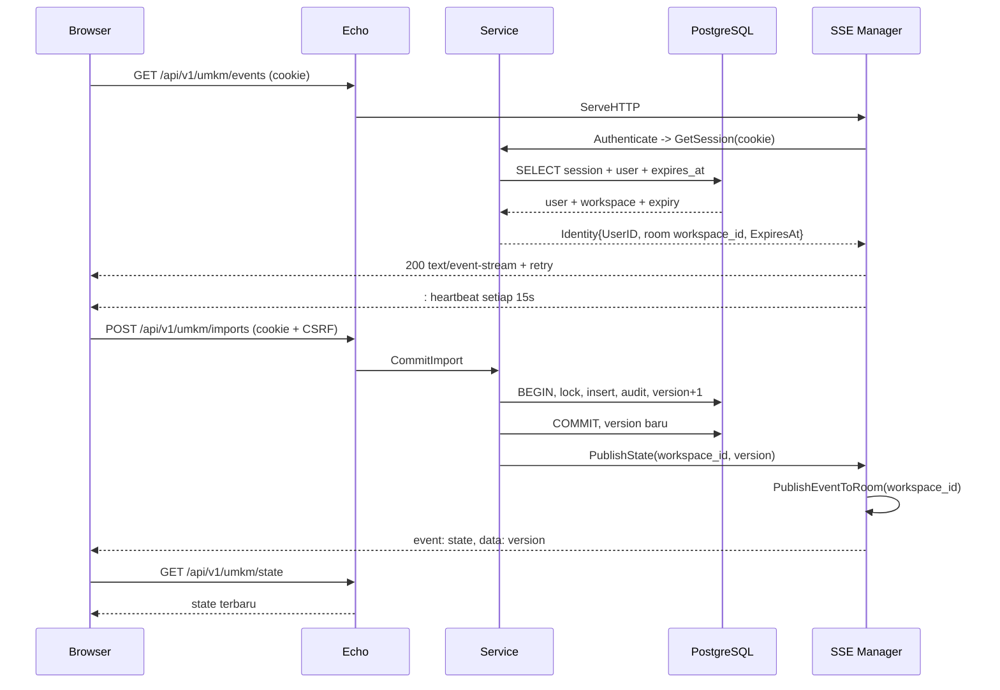

# Rencana Integrasi SSE — Rekonsiliasi Kas UMKM

Status: rencana implementasi, 27 Oktober 2026. Dokumen ini hanya rencana;
tidak ada kode produksi yang diubah. Semua path di bawah relatif terhadap root
repository `D:/appwebsite/rekonsiliasi-kas-umkm`.

## Keputusan yang direkomendasikan

| Hal | Keputusan |
|---|---|
| Route | `GET /api/v1/umkm/events` |
| Auth | Cookie session `rku_session`, divalidasi ulang lewat `Service.GetSession` di callback `sse.Config.Authenticate` |
| Identity | `UserID` = id user; room = `workspace_id` (satu room per workspace) |
| Event | `state` dengan data integer versi workspace |
| Pengiriman | `PublishEventToRoom` ke room workspace, setelah transaksi commit |
| Topologi | Satu proses/satu pod; hub lokal |
| Bus / Replay / Presence | Tidak dipakai pada tahap ini |
| Heartbeat | 15 detik; komentar `: heartbeat` dari paket |
| Backpressure | `QueueFullClose` (default), klien lambat ditutup dengan 1013 dan harus reconnect + ambil state REST |
| Lifecycle | `manager.Start(ctx)` sebelum HTTP melayani; `manager.Shutdown` sebelum `echo.Shutdown` |
| Sumber kebenaran | `GET /api/v1/umkm/state`; SSE hanya sinyal perubahan |

Alasannya sederhana: aplikasi ini satu workspace per pemilik dan saat ini
berjalan sebagai satu proses. Notifikasi yang hilang masih bisa dipulihkan
dengan mengambil state REST saat stream dibuka ulang. Paket `pkg/sse` mendukung
profil “single pod, best-effort notifications” dengan syarat konfigurasi yang
ketat, sementara profil multi-pod dan lossless replay belum didukung
(`backend/pkg/sse/docs/08-production-scope.md:8-18`).

## 1. Apa yang dilakukan prototipe

Prototipe memakai SSE sebagai **polling server-side yang dibungkus stream**,
bukan sebagai push event dari mutasi bisnis.

Route-nya `GET /api/events`, didaftarkan melalui wrapper privat yang memanggil
`a.session` sebelum handler dijalankan (`Tiga-Prototipe-PBL/internal/platform/server.go:217`,
`Tiga-Prototipe-PBL/internal/platform/server.go:147`). Handler SSE-nya ada di
`Tiga-Prototipe-PBL/internal/platform/server.go:266-300`:

- Menulis header `Content-Type: text/event-stream`, `Connection: keep-alive`, dan
  `X-Accel-Buffering: no`.
- Memastikan `http.Flusher` tersedia.
- Membuat ticker 4 detik.
- Setiap tick menjalankan query `SELECT version FROM pblg_workspaces WHERE id=$1`
  dengan timeout 5 detik dan write deadline 6 detik
  (`Tiga-Prototipe-PBL/internal/platform/server.go:274-285`).
- Jika versi berubah, mengirim `event: state` dengan data berupa **integer versi**;
  jika tidak berubah, mengirim komentar `: keepalive`
  (`Tiga-Prototipe-PBL/internal/platform/server.go:286-300`).
- Memanggil `a.session(r)` lagi setelah setiap tick untuk memeriksa session.

Frontend prototipe memakai `new EventSource("/api/events")`
(`Tiga-Prototipe-PBL/internal/platform/web/app.js:140-142`). Handler `state`
membandingkan `Number(event.data)` dengan `state.data.workspace.version`; jika
berbeda, frontend memanggil `refresh()` yang mengambil ulang
`/api/state` (`Tiga-Prototipe-PBL/internal/platform/web/app.js:171-182`,
`Tiga-Prototipe-PBL/internal/platform/web/app.js:764-790`). Saat modal terbuka
atau fokus berada di input, refresh ditunda dan tombol refresh ditampilkan.
`onerror` menandai koneksi terputus, lalu memeriksa `/api/me` paling sering
setiap 30 detik; respons 401 menutup stream dan memaksa login ulang
(`Tiga-Prototipe-PBL/internal/platform/web/app.js:150-170`). Stream dibuka
setelah login dan setelah init, lalu ditutup saat logout
(`Tiga-Prototipe-PBL/internal/platform/web/app.js:1063-1066`,
`Tiga-Prototipe-PBL/internal/platform/web/app.js:1459-1462`,
`Tiga-Prototipe-PBL/internal/platform/web/app.js:1242-1250`).

Versi workspace dinaikkan di dalam transaksi yang sama dengan perubahan state:
`UPDATE pblg_workspaces SET state=$1, version=version+1 ...`, kemudian
`tx.Commit` (`Tiga-Prototipe-PBL/internal/platform/store.go:87-118`). Artinya
versi adalah penanda perubahan global workspace, bukan urutan event per user.

Auth prototipe memakai cookie session; query session memeriksa
`s.expires_at > now()` (`Tiga-Prototipe-PBL/internal/platform/auth.go:52-59`).
Tidak ada CSRF pada GET, dan prototipe tidak mengirim `Last-Event-ID`, tidak
memakai replay, tidak punya antrean per klien, dan tidak mengirim close event.
Biaya utamanya adalah satu query database per klien setiap 4 detik. Itu alasan
utama memakai `pkg/sse`: stream tetap satu arah, tetapi deteksi perubahan
datang dari mutasi setelah commit, bukan polling.

## 2. Desain minimal dengan `pkg/sse`

### 2.1 Konfigurasi manager

Gunakan satu `*sse.Manager` per proses. Nilai awal yang disarankan:

| Field | Nilai | Alasan |
|---|---:|---|
| `Authenticate` | callback session | Validasi cookie sebelum header stream ditulis |
| `AllowedOrigins` | `cfg.Server.AllowedOrigins` | Origin harus persis; wildcard tidak boleh dengan credentials (`backend/pkg/sse/config.go:296-310`) |
| `AllowCredentials` | `true` | Browser mengirim cookie; gunakan origin yang sama |
| `HeartbeatInterval` | `15s` | Menjaga proxy dan koneksi idle |
| `Retry` | `3s` | Nilai awal untuk reconnect EventSource |
| `WriteTimeout` | `10s` per frame | Deadline tulis per frame, bukan umur stream |
| `SendQueue` | `64` | Cukup untuk notifikasi kecil; ukuran harus diukur |
| `MaxEventBytes` | default 1 MiB; saran 4 KiB | Batasi memori antrean per klien |
| `EventLimits` | tambahkan `state: 4 KiB` | Guard per tipe event |
| `AuthTimeout` | `5s` | DB session tidak boleh menahan handshake |
| `ConnectTimeout` | `5s` | Batas hook `OnConnect` |
| `MaxConnections` | `10000` | Batas lokal per pod; sesuaikan hasil ukur |
| `MaxConnectionsPerUser` | `5` | Beberapa tab/perangkat; 5 tab sudah mencapai batas |
| `MaxRoomsPerClient` | `1` | Satu workspace per koneksi |
| `MaxConcurrentHandshakes` | `32` | Handshake dibatasi terpisah dari stream |
| `MaxConnectionAge` | `12h` | Fallback jika `ExpiresAt` tidak tersedia |
| `QueueFullPolicy` | `QueueFullClose` | Jangan biarkan frame berikutnya melewati gap |
| `ShutdownTimeout` | `cfg.Server.ShutdownTimeout` | Drain stream saat deploy |
| `Bus`, `Replay`, `Presence` | `nil` | Tidak dibutuhkan pada profil ini |

`Identity.ExpiresAt` sekarang dapat diisi karena session query mengembalikan
`expires_at` (`backend/scripts/postgres/queries/auth.sql:1-16`,
`backend/internal/repository/rekonsiliasi_repository_sqlc/auth.sql.go:143-184`)
dan `models.Session` menyimpan `ExpiresAt`
(`backend/internal/models/auth.go:12-16`). Nilai ini dipakai untuk close event
4001 saat session benar-benar berakhir; `MaxConnectionAge` 12 jam menjadi
pengaman tambahan. Jangan mengedit file generated sqlc secara manual; ubah SQL
lalu jalankan generator sesuai `backend/AGENTS.md:18-20`.

### 2.2 Callback auth dengan cookie session

Callback `Authenticate` menerima `*http.Request`, bukan `echo.Context`. Karena
itu ia membaca cookie langsung dan memanggil service. Ini menghindari
ketergantungan service pada Echo dan memastikan query session yang sama dengan
endpoint REST.

```go
// backend/internal/echohttp/sse.go
package echohttp

import (
	"context"
	"log/slog"
	"net/http"
	"time"

	"github.com/AhmadKusumahDEV/rekonsiliasi-kas-umkm/backend/internal/config"
	"github.com/AhmadKusumahDEV/rekonsiliasi-kas-umkm/backend/internal/models"
	pkgErr "github.com/AhmadKusumahDEV/rekonsiliasi-kas-umkm/backend/pkg/errors"
	"github.com/AhmadKusumahDEV/rekonsiliasi-kas-umkm/backend/pkg/sse"
)

// sessionReader menjaga adapter SSE tetap dapat diuji tanpa database.
type sessionReader interface {
	GetSession(context.Context, string) (models.Session, error)
}

// Room memakai workspace_id mentah; tambahkan prefix jika nanti ada room lain.
func workspaceRoom(workspaceID string) string { return workspaceID }

func NewSSEManager(cfg config.Config, sessions sessionReader, logger *slog.Logger) (*sse.Manager, error) {
	return sse.New(sse.Config{
		Authenticate: func(r *http.Request) (sse.Identity, error) {
			cookie, err := r.Cookie(config.SessionCookieName)
			if err != nil || cookie.Value == "" {
				return sse.Identity{}, sse.NewAuthError(http.StatusUnauthorized, pkgErr.MsgUnauthorized)
			}

			session, err := sessions.GetSession(r.Context(), cookie.Value)
			if err != nil {
				status, message := mapHTTPError(err)
				if status >= http.StatusInternalServerError {
					// Biarkan manager mencatat error infrastruktur sebagai 5xx;
					// jangan menyamakannya dengan token yang tidak valid.
					return sse.Identity{}, err
				}
				return sse.Identity{}, sse.NewAuthError(status, message)
			}

			return sse.Identity{
				UserID:    session.User.ID,
				Rooms:     []string{workspaceRoom(session.User.WorkspaceID)},
				ExpiresAt: session.ExpiresAt,
				Values: map[string]any{
					"workspace_id": session.User.WorkspaceID,
					"role":         session.User.Role,
				},
			}, nil
		},

		AllowedOrigins:          cfg.Server.AllowedOrigins,
		AllowCredentials:        true,
		HeartbeatInterval:       15 * time.Second,
		Retry:                   3 * time.Second,
		WriteTimeout:            10 * time.Second,
		SendQueue:               64,
		CloseDrainTimeout:       time.Second,
		MaxEventBytes:           4 << 10,
		EventLimits:             map[string]sse.EventLimit{"state": {MaxDataBytes: 4 << 10}},
		AuthTimeout:             5 * time.Second,
		ConnectTimeout:          5 * time.Second,
		ShutdownTimeout:         cfg.Server.ShutdownTimeout,
		MaxConnections:          10000,
		MaxConnectionsPerUser:   5,
		MaxRoomsPerClient:       1,
		MaxConcurrentHandshakes: 32,
		MaxConnectionAge:        12 * time.Hour,
		QueueFullPolicy:         sse.QueueFullClose,
		Logger:                  logger,
		OnReject: func(_ context.Context, r *http.Request, reason sse.RejectReason, _ error) {
			logger.Info("sse reject", "reason", reason, "path", r.URL.Path)
		},
		OnDrop: func(_ context.Context, client *sse.Client, reason sse.DropReason) {
			logger.Warn("sse drop", "client_id", client.ID(), "user_id", client.UserID(), "reason", reason)
		},
		OnConnect: func(_ context.Context, client *sse.Client) error {
			logger.Info("sse connect", "client_id", client.ID(), "user_id", client.UserID())
			return nil
		},
		OnDisconnect: func(_ context.Context, client *sse.Client) {
			code, reason := client.CloseInfo()
			logger.Info("sse disconnect", "client_id", client.ID(), "user_id", client.UserID(), "code", code, "reason", reason)
		},
		OnPublish: func(_ context.Context, event sse.Event, duration time.Duration, err error) {
			if err != nil {
				logger.Warn("sse publish", "event", event.Name, "duration_ms", duration.Milliseconds(), "err", err)
			}
		},
	})
}
```

Catatan penting:

- `GetSession` sudah memfilter `u.app = umkm`
  (`backend/internal/service/auth_service.go:23-53`), jadi room tidak bisa
  berasal dari aplikasi lain.
- `mapHTTPError` adalah mapper yang sudah dipakai handler Echo
  (`backend/internal/echohttp/echohttp_error_handler.go:69-98`). Untuk 401/403
  hasilnya aman untuk body; untuk 5xx, callback mengembalikan error asli agar
  manager memberi 500 tanpa mengubahnya menjadi “session invalid”.
- Jangan menaruh token di query string. Cookie HttpOnly lebih aman dan tidak
  bocor ke access log (`backend/pkg/sse/INTEGRATION.md:127-137`).

### 2.3 Mount route di Echo

Route yang disarankan adalah `GET /api/v1/umkm/events`. Daftarkan di luar group
`protected` yang memakai `sessionMiddleware`, karena manager sudah melakukan
autentikasi sendiri. `e.Match` juga mendaftarkan OPTIONS agar preflight CORS
dapat dijawab:

```go
if len(sseManagers) > 0 && sseManagers[0] != nil {
	e.Match([]string{http.MethodGet, http.MethodOptions},
		config.APIPrefix+"/umkm/events",
		echo.WrapHandler(sseManagers[0]))
}
```

Kalau route dipasang di dalam `protected`, request SSE akan menjalankan query
session dua kali: sekali di middleware, sekali di `Authenticate`. GET tidak
memerlukan CSRF karena `sessionMiddleware` hanya memeriksa CSRF untuk method
selain GET/HEAD (`backend/internal/echohttp/auth_middleware.go:26-30`), tetapi
duplikasi query dan body error dari middleware tidak memberi manfaat. Pemasangan
di luar `protected` membuat satu jalur auth yang eksplisit di manager.

Middleware global Echo tetap berlaku: `securityHeaders`, CORS, request ID,
logger, dan `BodyLimit`. Jangan menambahkan middleware kompresi atau wrapper
`ResponseWriter` yang tidak mempertahankan `http.Flusher`; manager akan menolak
stream dengan error “streaming unsupported”
(`backend/pkg/sse/manager.go:294-318`, `backend/pkg/sse/INTEGRATION.md:62-74`).

### 2.4 Lifecycle dan shutdown

Urutan yang benar: buat manager, set notifier, `Start(ctx)`, buat Echo, lalu
shutdown manager sebelum Echo. `http.Server.Shutdown` menunggu handler aktif,
dan stream SSE adalah handler yang sengaja aktif lama; menutup Echo lebih dulu
dapat menggantung sampai timeout.

```go
// backend/cmd/api/main.go:51-61 (ringkas)
svc := service.NewService(cfg, db, httpClient)
sseManager, err := echohttp.NewSSEManager(cfg, svc, logger)
if err != nil {
	return fmt.Errorf("create sse manager: %w", err)
}
if err := sseManager.Start(ctx); err != nil {
	return fmt.Errorf("start sse manager: %w", err)
}
svc.SetStateNotifier(echohttp.NewSSENotifier(sseManager, logger))
return echohttp.RunEchoHTTPService(ctx, cfg, svc, logger, sseManager)
```

`manager.Start(ctx)` juga memasang goroutine yang memanggil `Shutdown` ketika
`ctx` dibatalkan (`backend/pkg/sse/manager.go:77-108`). Panggilan eksplisit di
atas tetap diperlukan agar urutannya pasti; `Shutdown` idempotent
(`backend/pkg/sse/manager.go:418-448`).

### 2.5 WriteTimeout

SSE memerlukan `http.Server.WriteTimeout = 0`. Kode yang ada memilih nilai
global 0 dan menambahkan `ReadHeaderTimeout` 5 detik
(`backend/internal/echohttp/http_server.go:71-82`). Ini memenuhi syarat paket
(`backend/pkg/sse/docs/05-usage.md:77-78`,
`backend/pkg/sse/docs/08-production-scope.md:47`), tetapi `server.write_timeout`
dari config tidak lagi mengikat server HTTP. Dokumentasikan konsekuensi ini:
response REST juga tidak punya write deadline global. Jika endpoint lain butuh
timeout, tambahkan flag `server.sse_enabled` dan set 0 hanya saat SSE aktif;
alternatifnya, pertahankan 0 dan andalkan timeout database/proxy. Jangan
mengandalkan `applyDefaults` yang mengubah nol menjadi 15 detik
(`backend/internal/config/config.go:172-174`) sebagai pengganti kebijakan ini.

`ReadTimeout` 10 detik hanya membatasi pembacaan request; `IdleTimeout` 60 detik
berlaku antar-request, bukan pada stream aktif. Paket juga memanggil
`SetWriteDeadline` per frame (`backend/pkg/sse/client.go:225-234`), tetapi
konfigurasi server tetap harus benar.

## 3. Bus, Replay, dan Presence

### Bus: tidak sekarang

Profil yang didukung paket adalah satu pod. Multi-pod secara eksplisit belum
didukung sampai M3 (`backend/pkg/sse/docs/08-production-scope.md:8-18`,
`backend/pkg/sse/docs/08-production-scope.md:88-96`). Redis Pub/Sub biasa juga
bukan pilihan fanout yang aman karena fire-and-forget; bila nanti perlu
multi-pod, gunakan adapter durable seperti RabbitMQ per-pod queue, Redis
Streams consumer group, atau NATS JetStream, dan ack setelah apply
(`backend/pkg/sse/INTEGRATION.md:17-50`). Untuk sekarang, `Bus: nil` membuat
`PublishEventToRoom` mengirim ke hub lokal.

### Replay: tidak sekarang

Notifikasi ini adalah sinyal “ambil state lagi”, bukan log peristiwa. Replay
memerlukan event ID aplikasi yang stabil, retensi, batas ukuran, deduplikasi di
klien, dan store yang di-index; itu menambah kompleksitas dan risiko yang tidak
sepadan untuk satu workspace. Tanpa `Replay`, paket tetap memberi `id` lokal
otomatis, tetapi `Last-Event-ID` tidak akan memulihkan event yang terlewat.
Klien wajib mengambil `GET /api/v1/umkm/state` setiap kali stream terbuka atau
tersambung ulang. Jika nanti notifikasi harus lossless, implementasikan outbox +
`ReplayStore` dan ID aplikasi yang stabil (`backend/pkg/sse/INTEGRATION.md:76-95`).

### Presence: tidak sekarang

Tidak ada fitur “sedang online”, indikator mengetik, atau daftar perangkat di
produk UMKM. Presence menambah store TTL dan refresh heartbeat tanpa manfaat
produk. `Stats()` dan `Online()` lokal cukup untuk observabilitas. Presence baru
relevan bila ada kebutuhan operasional nyata (`backend/pkg/sse/INTEGRATION.md:97-107`).

## 4. Notifikasi service setelah commit

### 4.1 Interface kecil di service

Service tidak boleh mengimpor Echo atau `pkg/sse`. Kontrak kecil berikut menjadi
batas antara domain dan transport (`backend/internal/service/sse_notifier.go:8-31`):

```go
type StateNotifier interface {
	PublishState(ctx context.Context, workspaceID string, version int64) error
	DisconnectUser(userID string)
}

func (s *Service) SetStateNotifier(notifier StateNotifier) {
	s.stateNotifier = notifier
}

func (s *Service) publishState(workspaceID string, version int64) {
	if s.stateNotifier == nil || version <= 0 {
		return
	}
	ctx, cancel := context.WithTimeout(context.Background(), 2*time.Second)
	defer cancel()
	_ = s.stateNotifier.PublishState(ctx, workspaceID, version)
}
```

Notifier hanya dipanggil setelah commit. Kegagalan notifikasi dicatat oleh
adapter dan tidak mengubah hasil transaksi. `context.Background()` dengan
timeout 2 detik memastikan notifikasi tetap dicoba walau request context sudah
dibatalkan tepat setelah commit.

### 4.2 Helper commit + notifikasi

Jangan publish di dalam transaksi. Publish hanya setelah `tx.Commit` berhasil,
agar rollback tidak menghasilkan event palsu. Versi dikembalikan langsung oleh
query bump, sehingga tidak ada query tambahan dan tidak ada race antara commit
dan pembacaan versi:

```sql
-- backend/scripts/postgres/queries/auth.sql:86-90
-- name: BumpWorkspaceVersion :one
UPDATE public.pblg_workspaces
SET version = version + 1
WHERE id = @workspace_id
RETURNING version;
```

`insertAuditAndBump` mengembalikan versi tersebut
(`backend/internal/service/umkm_service.go:512-527`). Setelah `tx.Commit`,
service memanggil `s.publishState(user.WorkspaceID, version)`. Notifier tidak
boleh dipanggil sebelum commit; idempotent path tetap menaikkan versi dan
menulis audit, jadi event tetap dikirim.

### 4.3 Titik pemanggilan

Titik commit yang sudah memanggil `publishState`:

| Method | Lokasi commit | Event |
|---|---|---|
| `CommitImport` (baru) | `backend/internal/service/umkm_service.go:244-251` | `state` |
| `CommitImport` (duplikat) | `backend/internal/service/umkm_service.go:161-168` | `state` |
| `Allocate` (baru) | `backend/internal/service/umkm_service.go:348-355` | `state` |
| `Allocate` (idempotent) | `backend/internal/service/umkm_service.go:285-292` | `state` |
| `UndoAllocation` | `backend/internal/service/umkm_service.go:394-401` | `state` |
| `CancelImport` | `backend/internal/service/umkm_service.go:447-454` | `state` |

Contoh urutan di satu blok:

```go
version, bumpErr := insertAuditAndBump(ctx, queries, user, "Impor transaksi", "Data CSV tervalidasi")
if bumpErr != nil {
	return models.CommitImportResponse{}, bumpErr
}
if err = tx.Commit(ctx); err != nil {
	return models.CommitImportResponse{}, pkgErr.ErrFailCommitTx
}
s.publishState(user.WorkspaceID, version)
return models.CommitImportResponse{ID: importID, Imported: len(newRows), Skipped: skipped}, nil
```

Jangan menaruh notifier di handler HTTP saja: worker atau pemanggil service
lain di masa depan harus mendapat perilaku yang sama.

### 4.4 Adapter SSE di lapisan transport

```go
// backend/internal/echohttp/sse.go:75-100
type SSENotifier struct {
	manager *sse.Manager
	logger  *slog.Logger
}

func NewSSENotifier(manager *sse.Manager, logger *slog.Logger) *SSENotifier {
	return &SSENotifier{manager: manager, logger: logger}
}

func (n *SSENotifier) PublishState(ctx context.Context, workspaceID string, version int64) error {
	if n == nil || n.manager == nil {
		return nil
	}
	event, err := sse.NewEvent("state", version)
	if err != nil {
		return fmt.Errorf("build sse state event: %w", err)
	}
	if err := n.manager.PublishEventToRoom(ctx, workspaceID, event); err != nil {
		n.logger.Warn("sse state publish failed", "workspace_id", workspaceID, "version", version, "error", err)
		return err
	}
	return nil
}
```

`PublishEventToRoom` mengembalikan `nil` bila room tidak punya klien, jadi user
yang sedang offline bukan error (`backend/pkg/sse/manager.go:553-564`). Jangan
menggunakan `SendEventToUser` untuk notifikasi workspace karena user dapat punya
beberapa perangkat dan room adalah batas data yang benar. Jangan mengirim
nominal, nama, email, CSRF, cookie, atau error internal ke payload; payload
hanya integer versi.

### 4.5 Logout, ganti password, dan session

Setelah `Logout` dan `ChangePassword` berhasil, handler memanggil
`s.DisconnectUser(session.User.ID)`; adapter meneruskannya ke
`DisconnectUserAsync(..., sse.CloseTokenExpired, "session revoked")` agar respons
REST tidak menunggu drain (`backend/internal/echohttp/auth_handler.go:61-89`,
`backend/internal/echohttp/sse.go:96-100`).
Paket tidak mendukung pencabutan per session; ini menutup semua device user
yang sama. Untuk aplikasi satu pemilik itu trade-off yang dapat diterima, tetapi
catat di runbook. `CloseTokenExpired` (4001) memberi tahu klien untuk memeriksa
session dan login ulang, bukan langsung reconnect buta.

## 5. Route, cookie session, dan CSRF

Route final: `GET /api/v1/umkm/events`. Ini konsisten dengan prefix domain
`/api/v1/umkm` yang sudah dipakai (`backend/internal/echohttp/http_server.go:47-60`)
dan dengan kontrak route di `backend/docs/API_ROUTES.md:35` serta bagian SSE
`backend/docs/API_ROUTES.md:303-327`.

| Aspek | Perilaku |
|---|---|
| Session | Cookie `rku_session`, HttpOnly, SameSite Strict (`backend/internal/config/auth.go:7-10`, `backend/internal/echohttp/auth_handler.go:92-103`) |
| CSRF | Tidak diperlukan untuk GET; jangan kirim `X-CSRF-Token` ke EventSource |
| Auth gagal | 401 sebelum header stream ditulis; body aman, tanpa detail driver |
| DB tidak siap | 503; klien harus mencoba ulang dengan backoff |
| Origin | Wajib sama/origin terdaftar; `AllowedOrigins` tidak boleh wildcard dengan credentials |
| Cache | `Cache-Control: no-cache, no-transform`, `X-Accel-Buffering: no` dari paket |
| Method lain | 405 dari router/manager; route hanya GET/OPTIONS |

EventSource selalu mengirim cookie untuk same-origin. Jika frontend dan API
berada di origin berbeda, cookie `SameSite=Strict` tidak akan dikirim pada
request lintas situs; susun deployment dengan satu origin (reverse proxy) atau
ubah kebijakan cookie secara sadar. `AllowCredentials: true` pada manager dan
`Access-Control-Allow-Credentials` diperlukan untuk skenario cross-origin;
namun skema yang direkomendasikan adalah same-origin.

CORS Echo saat ini tidak memasukkan `X-CSRF-Token` atau `Last-Event-ID` ke
`AllowHeaders` (`backend/internal/echohttp/security_middleware.go:25-45`). GET
EventSource bukan preflight, jadi ini tidak menghalangi alur normal. Bila ada
klien cross-origin yang mengirim `Last-Event-ID` manual, tambahkan header itu;
untuk same-origin tidak perlu mengubah CORS.

## 6. Kontrak SSE dan perilaku frontend

### 6.1 Frame dan payload

Paket mengirim header dan frame awal sendiri
(`backend/pkg/sse/manager.go:294-318`). Contoh stream:

```text
HTTP/1.1 200 OK
Content-Type: text/event-stream; charset=utf-8
Cache-Control: no-cache, no-transform
X-Accel-Buffering: no

retry: 3000

id: 7-3
event: state
data: 12

```

`id` di atas dibuat paket; jangan mengandalkan formatnya. Tanpa `Replay`,
`Last-Event-ID` tidak dipakai untuk memulihkan event. Heartbeat adalah komentar
`: heartbeat` setiap 15 detik dan tidak memicu listener JavaScript. Close event
memakai `server_close` dengan kode 1012 (restart), 1013 (slow client), 4001
(token/session), atau 4002 (umur koneksi)
(`backend/pkg/sse/PROTOCOL.md`, `backend/pkg/sse/docs/03-protocol.md:45-70`).

Nama `state` dan data integer dipertahankan dari prototipe. Frontend dapat
memakai listener yang sama setelah path diganti; tidak perlu mengubah format
payload. Jangan mengirim dua event sekaligus karena akan menggandakan refresh.

### 6.2 Urutan alur



### 6.3 EventSource yang tahan error

EventSource bawaan hanya melakukan reconnect otomatis untuk stream yang putus;
respons non-200 seperti 401/403/429/503 adalah kegagalan permanen untuk instance
itu (`backend/pkg/sse/docs/02-getting-started.md:90-113`). Karena itu gunakan
supervisor kecil dengan backoff eksplisit, bukan hanya `onerror` yang menunggu
browser.

```js
// frontend/src/events.js (ilustrasi; helper api/refreshState milik aplikasi)
let source = null;
let reconnectTimer = null;
let backoff = 1000;

function closeEvents() {
  if (source) {
    const old = source;
    source = null;
    old.close();
  }
  clearTimeout(reconnectTimer);
}

function scheduleReconnect(baseMs) {
  clearTimeout(reconnectTimer);
  const base = Math.max(1000, Number(baseMs) || 1000);
  const delay = Math.min(30000, base * (1 + Math.random()));
  backoff = Math.min(30000, backoff * 2);
  reconnectTimer = setTimeout(connectEvents, delay);
}

function connectEvents() {
  closeEvents();
  const es = new EventSource("/api/v1/umkm/events", { withCredentials: true });
  source = es;

  es.onopen = async () => {
    backoff = 1000;
    setConnectionState("online");
    // Tanpa replay: tutup gap dengan state REST setiap kali tersambung.
    await refreshState({ force: true });
  };

  es.addEventListener("state", (event) => {
    if (source !== es) return;
    const version = Number(event.data);
    if (!Number.isFinite(version) || version <= state.workspaceVersion) return;
    state.workspaceVersion = version;
    queueRefresh();
  });

  es.addEventListener("server_close", (event) => {
    if (source !== es) return;
    let info = {};
    try {
      info = JSON.parse(event.data);
    } catch {}
    closeEvents();
    setConnectionState("offline");
    if (info.code === 4001) {
      requireLogin();
      return;
    }
    scheduleReconnect(info.retry_ms || 3000);
  });

  es.addEventListener("resync", () => {
    if (source !== es) return;
    closeEvents();
    refreshState({ force: true }).finally(() => scheduleReconnect(1000));
  });

  es.onerror = async () => {
    if (source !== es) return;
    closeEvents();
    setConnectionState("offline");
    if (await sessionExpired()) {
      requireLogin();
      return;
    }
    scheduleReconnect(backoff);
  };
}

async function sessionExpired() {
  try {
    await api("/api/v1/auth/me");
    return false;
  } catch (err) {
    return err.status === 401;
  }
}
```

`queueRefresh` harus meniru perilaku prototipe: jika modal terbuka atau fokus di
input, tandai state kotor dan tampilkan tombol refresh; jika tidak, panggil
`refreshState`. `refreshState` harus memakai epoch/request sequence agar respons
lama tidak menimpa state baru. Jangan membuat satu EventSource baru tanpa
menutup yang lama; itu menambah koneksi dan bisa memicu batas per user.

## 7. Konfigurasi nginx

SSE membutuhkan respons yang tidak dibuffer dan timeout baca yang lebih panjang
dari heartbeat. Blok berikut untuk server TLS yang meneruskan ke API lokal:

```nginx
upstream rku_api {
    server 127.0.0.1:8080;
    keepalive 16;
}

server {
    listen 443 ssl http2;
    server_name temukas.madgo.my.id;

    location = /api/v1/umkm/events {
        proxy_pass http://rku_api;
        proxy_http_version 1.1;
        proxy_set_header Host $host;
        proxy_set_header X-Real-IP $remote_addr;
        proxy_set_header X-Forwarded-For $proxy_add_x_forwarded_for;
        proxy_set_header X-Forwarded-Proto $scheme;
        proxy_set_header Connection "";

        proxy_buffering off;
        proxy_cache off;
        proxy_read_timeout 3600s;
        proxy_send_timeout 3600s;
        send_timeout 3600s;
        gzip off;
    }

    location /api/ {
        proxy_pass http://rku_api;
        proxy_http_version 1.1;
        proxy_set_header Host $host;
        proxy_set_header X-Real-IP $remote_addr;
        proxy_set_header X-Forwarded-For $proxy_add_x_forwarded_for;
        proxy_set_header X-Forwarded-Proto $scheme;
    }
}
```

Penjelasan: `proxy_buffering off` mencegah nginx menahan frame; `X-Accel-Buffering:
no` dari aplikasi adalah lapisan kedua. `proxy_read_timeout` 1 jam jauh di atas
heartbeat 15 detik, jadi koneksi idle tetap hidup dan deploy tidak memotong
stream terlalu cepat. `proxy_http_version 1.1` dan `Connection ""` memungkinkan
keepalive ke upstream. `gzip off` di location ini mencegah kompresi menahan
flush; jangan mengandalkan `text/event-stream` untuk otomatis dikecualikan dari
gzip. Jika ada CDN/load balancer di depan nginx, atur idle timeout CDN lebih
besar dari 15 detik dan pastikan respons `text/event-stream` tidak di-cache.

Verifikasi: `nginx -t`, lalu dari host yang memiliki cookie:

```bash
curl -N -i -b 'rku_session=...' https://temukas.madgo.my.id/api/v1/umkm/events
```

Yang harus terlihat: status 200, `Content-Type: text/event-stream`, frame
`retry:`, komentar heartbeat, dan event `state` setelah POST mutasi.
Uji juga reconnect setelah `kill` koneksi dan setelah restart API (kode 1012).

## 8. Rencana pengujian

### 8.1 Paket dan unit

```bash
cd backend
go test ./pkg/sse -count=1
go test -race ./pkg/sse -count=1
go test ./internal/echohttp ./internal/service -count=1
go test ./...
go build ./...
```

`pkg/sse` sudah memiliki test untuk auth 401/500/503, origin, replay, close
event, heartbeat, queue penuh/1013, shutdown 1012, connection age, dan goleak
(`backend/pkg/sse/docs/04-testing.md:1-30`). Jalankan juga `go vet`. Catatan
lingkungan: pada sesi analisis ini `go test ./pkg/sse` berhenti di test jaringan
dengan `connectex ... forbidden` karena sandbox menolak loopback; itu bukan
gagal assertion. Jalankan di CI/host yang mengizinkan loopback.

### 8.2 Test manager + Echo

Gunakan `httptest.NewServer` dengan Echo hasil
`NewEcho(cfg, svc, logger, manager)`, bukan `ResponseRecorder` untuk stream
panjang. Kasus yang wajib:

1. Tanpa cookie -> 401 dan tidak ada `text/event-stream`.
2. Cookie tidak valid/expired -> 401; error database -> 500/503, bukan 401.
3. Cookie valid -> 200, header `Content-Type`, `Cache-Control`, dan
   `X-Accel-Buffering` benar; respons pertama adalah `retry:`.
4. GET tanpa `X-CSRF-Token` berhasil; POST ke route SSE -> 405.
5. Origin yang tidak terdaftar -> 403; origin terdaftar + credentials -> header
   CORS benar.
6. Dua klien di workspace yang sama menerima `state`; klien di
   workspace lain tidak menerima.
7. `QueueFullPolicy: QueueFullClose` dengan writer lambat menghasilkan 1013 dan
   tidak ada frame setelah gap.
8. `manager.Shutdown` mengirim `server_close` 1012 dan handler selesai sebelum
   `echo.Shutdown`; gunakan `goleak.VerifyNone` setelah server ditutup.
9. `ExpiresAt`/session expiry menghasilkan 4001; `MaxConnectionAge` 12h
   menghasilkan 4002 dengan retry jitter.

### 8.3 Test service setelah commit

Buat fake `StateNotifier` yang mencatat `PublishState`. Dengan `internal/testkit`
+ `TEST_DATABASE_URL` (sesuai `backend/AGENTS.md:26-30`):

- `CommitImport` sukses -> tepat satu `PublishState`, versi sama dengan versi
  workspace di response state setelah commit.
- `CommitImport` duplikat -> event tetap dikirim.
- `Allocate`, `UndoAllocation`, `CancelImport` sukses -> event sesuai tabel 4.3.
- Konflik saldo, ID tidak valid, atau rollback -> notifier tidak dipanggil.
- Notifier yang mengembalikan error tidak mengubah status respons REST; error
  hanya dicatat.
- `Logout`/`ChangePassword` memanggil `DisconnectUser` (bisa diuji dengan fake
  notifier atau test manager sungguhan).

### 8.4 Test kontrak frontend

- Baca satu frame dari stream nyata dan pastikan `event: state` dan data berupa
  integer versi.
- Pastikan payload tidak berisi nominal, nama, email, cookie, CSRF, atau pesan
  error internal.
- Simulasikan dua event dengan versi 10 lalu 9; UI tidak boleh refresh mundur.
  Simulasikan event duplikat versi 10; refresh tidak boleh berulang tanpa perlu.
- Simulasikan modal terbuka: event hanya menandai pending dan tidak menghapus
  isian form.
- Simulasikan `onerror`/401: supervisor menutup EventSource dan menampilkan
  login; simulasi 503/429: supervisor mencoba ulang dengan backoff, bukan diam.
- Uji Chrome, Firefox, dan Safari; uji reconnect setelah laptop sleep dan
  setelah deploy/restart.

### 8.5 Test proxy dan stres

- `nginx -t`; curl `-N` melalui nginx, cek tidak ada buffer dan heartbeat tiba.
- Putus koneksi di tengah stream; EventSource harus reconnect dan state diambil
  ulang.
- Ukur 100/500 koneksi bersamaan di staging; catat memori per stream, jumlah
  file descriptor, reconnect, dan drop. Angka benchmark 1000 klien di paket
  hanya fanout in-memory, bukan kapasitas jaringan
  (`backend/pkg/sse/INTEGRATION.md:142-172`).
- Uji `kill -TERM` saat stream aktif: klien menerima 1012, lalu reconnect ke
  proses baru.

## 9. Risiko dan batasan

| Risiko | Dampak | Mitigasi |
|---|---|---|
| Multi-pod | Event hanya sampai ke pod yang memegang koneksi | Tetap satu pod; bila scale-out, tambahkan Bus durable dan uji dua instance |
| Event hilang setelah commit | Klien tidak melihat notifikasi | State REST adalah sumber kebenaran; refresh saat open/reconnect; outbox bila perlu lossless |
| Replay tidak ada | `Last-Event-ID` tidak memulihkan gap | Ambil state penuh setelah reconnect; jangan mengklaim lossless |
| Session hanya divalidasi saat handshake | Session yang dicabut masih memegang stream | `ExpiresAt` + `MaxConnectionAge` 12h + `DisconnectUser` saat logout/password |
| Pencabutan per user, bukan per session | Logout satu device menutup semua device user | Terima untuk satu pemilik; dokumentasikan; perlu perubahan paket untuk per-session |
| `WriteTimeout=0` global | REST juga tanpa write deadline global | Dokumentasikan; tambahkan flag `sse_enabled` jika perlu timeout terpisah |
| `MaxEventBytes` default 1 MiB | Antrean 64 frame bisa menahan memori besar | Set 4 KiB dan `EventLimits` untuk `state` |
| Proxy buffering/gzip | Frame tertahan, UI tidak update | `proxy_buffering off`, `gzip off`, heartbeat < timeout |
| Batas 6 koneksi HTTP/1.1 per origin | Tab SSE dapat menghabiskan koneksi API | Gunakan HTTP/2 di produksi; batasi tab atau pakai SharedWorker/BroadcastChannel nanti |
| EventSource tidak retry 401/403/429/503 | Klien mati diam setelah error | Supervisor reconnect eksplisit + cek `/auth/me` |
| Slow client/queue penuh | Klien ditutup 1013 | Reconnect + refresh state; alert `OnDrop`/`Stats` |
| Origin exact-match | Same-origin production bisa ditolak bila tidak terdaftar | Masukkan origin produksi ke `server.allowed_origins`; jangan wildcard dengan credentials |
| Payload/log | Kebocoran data atau token | Hanya integer versi; jangan log cookie/token/error SQL |
| Notifikasi sinkron setelah commit | Menambah latensi respons | Batas 2s; publish lokal cepat; untuk Bus gunakan outbox/worker |
| Duplikasi/urutan event | Refresh berlebihan atau versi mundur | Bandingkan versi maksimum; deduplikasi; jangan asumsikan +1 |
| Cookie `Secure` belum konsisten | Cookie bisa terkirim tanpa TLS | Perbaiki terpisah; deployment wajib HTTPS |

Hal yang **tidak boleh** disalin dari `examples/chat`:

- Auth dari query `?user=`/`?room=` (`backend/pkg/sse/examples/chat/main.go:32-38`,
  `backend/pkg/sse/examples/chat/main.go:116-129`). Gunakan cookie session dan
  membership dari database.
- Event `message.new`, UI chat, endpoint `/publish/*`, typing, presence, dan
  statistik demo. Aplikasi ini hanya butuh sinyal perubahan workspace.
- Jangan menyalin angka demo tanpa pengukuran; nilai aktual `SendQueue: 64` dan
  `MaxConnections: 10000` juga harus divalidasi dengan kapasitas pod.
- Contoh chat tidak menetapkan `AllowedOrigins`, `MaxConnectionAge`, atau replay;
  itu bukan konfigurasi produksi.
- Jangan menambahkan inbound event di stream. SSE satu arah; perintah tetap
  lewat REST + CSRF (`backend/pkg/sse/INTEGRATION.md:213-218`).

## 10. Status dan urutan penyelesaian

Kode yang ada saat dokumen ini ditulis sudah memuat manager SSE, notifier,
route, session expiry, hook commit, disconnect saat logout, dan test integrasi
dasar. Yang masih perlu diselesaikan:

1. `backend/internal/echohttp/sse.go`: set `MaxEventBytes: 4 << 10`,
   `EventLimits: map[string]sse.EventLimit{"state": {MaxDataBytes: 4 << 10}}`,
   `MaxRoomsPerClient: 1`, dan hook `OnConnect`/`OnDisconnect`/`OnPublish`
   untuk log/metrik.
2. `backend/internal/config`: putuskan apakah `WriteTimeout=0` global
   dipertahankan; jika tidak, tambahkan flag `sse_enabled` dan dokumentasikan.
3. `backend/internal/echohttp/auth_handler.go`: sudah memanggil
   `DisconnectUser`; tambahkan test untuk memastikan 4001 terkirim.
4. `backend/internal/echohttp/sse_integration_test.go`: tambahkan test 401,
   405, origin, rollback tanpa event, shutdown 1012, dan goleak.
5. `backend/docs/API_ROUTES.md` sudah memuat route dan kontrak `state`; jaga
   agar tetap sinkron. `backend/README.md` masih menyatakan endpoint SSE belum
   ada dan perlu diperbarui.
6. Deployment: blok nginx, timeout, dan uji stream melalui proxy.
7. Frontend: supervisor EventSource, refresh state saat open/reconnect, dan
   penundaan refresh saat modal/input aktif.

Kriteria selesai: dengan cookie valid stream mengembalikan 200 dan heartbeat;
POST import/allocation yang commit mengirim satu `state` ke semua klien
workspace; rollback tidak mengirim event; logout menutup stream; restart
mengirim 1012; tidak ada goroutine tertinggal setelah shutdown; dan state yang
diambil setelah event memuat versi yang sama atau lebih baru.

