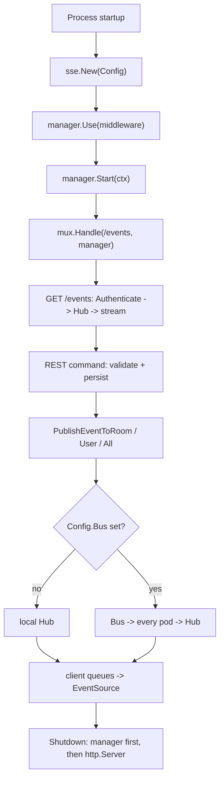
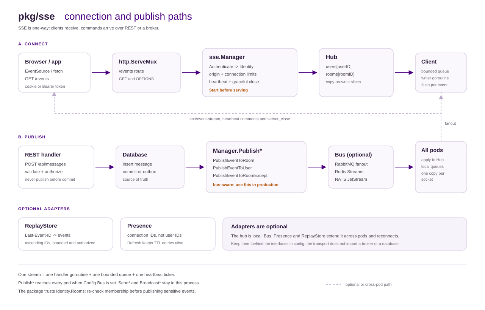
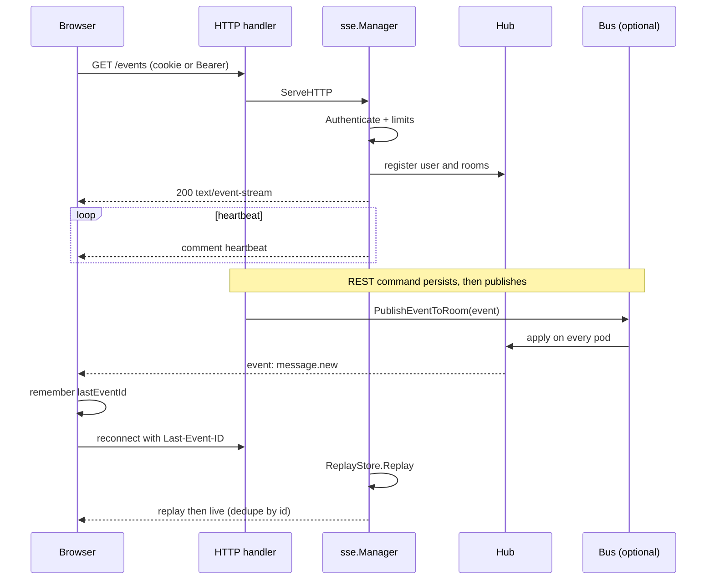

# Usage recipes and call order

This is the practical companion to [02-getting-started.md](02-getting-started.md).
It answers three questions: which function to call, in what order, and what to
avoid. The runnable version is in [../examples/chat](../examples/chat). The
core wiring in the first two sections matches the example; the recipes add
adapters that the example leaves out.

## 1. The call order

Use one `*sse.Manager` per process. Create it once during startup, start it
before serving traffic, and shut it down before the HTTP server.

| Step | Call | Why |
| --- | --- | --- |
| 1 | `sse.New(cfg)` | Validates the config and builds the hub. No network I/O. |
| 2 | `manager.Use(mw...)` | Optional HTTP middleware around the stream handler. |
| 3 | `manager.Start(ctx)` | Marks the manager ready and subscribes to `Config.Bus`. Canceling `ctx` triggers shutdown. |
| 4 | `mux.Handle("/events", manager)` | Opens the long-lived GET stream. `OPTIONS` is handled for CORS. |
| 5 | `manager.PublishEventToRoom(...)` | Sends an event after a REST command or worker job completes. |
| 6 | `manager.JoinUser` / `LeaveUser` | Updates live sockets after a membership change. |
| 7 | `manager.DisconnectUserAsync` / `CloseRoomAsync` | Revokes a session or removes a room without blocking the REST response. |
| 8 | `manager.Stats()`, `Online()`, `IsOnline()` | Feeds metrics, readiness and presence checks. |
| 9 | `manager.Shutdown(ctx)` | Drains streams with `server_close`. Run it before `http.Server.Shutdown`. |



The important split is step 4 versus step 5. The HTTP handler only opens the
stream. Server code publishes through the manager; SSE has no inbound event
handler.

## 2. Minimal skeleton

```go
manager, err := sse.New(sse.Config{
    Authenticate: func(r *http.Request) (sse.Identity, error) {
        userID, rooms, err := loadIdentity(r)
        if err != nil {
            return sse.Identity{}, sse.NewAuthError(http.StatusUnauthorized, "invalid session")
        }
        return sse.Identity{UserID: userID, Rooms: rooms}, nil
    },
    AllowedOrigins: []string{"https://app.example.com"},
    Logger:         logger,
})
if err != nil {
    return err
}
if err := manager.Start(ctx); err != nil {
    return err
}

mux := http.NewServeMux()
mux.Handle("/events", manager)

shutdownCtx, cancel := context.WithTimeout(context.Background(), 10*time.Second)
defer cancel()
_ = manager.Shutdown(shutdownCtx)
_ = server.Shutdown(shutdownCtx)
```

`WriteTimeout` on the host `http.Server` must stay `0` (or longer than the
longest stream). A fixed write timeout will cut every SSE connection. Use
`ReadHeaderTimeout` to protect the handshake instead.

## 3. Which function for which job

| Job | Function | Scope |
| --- | --- | --- |
| Open a stream | mount `manager` on `GET /events` | one HTTP route |
| Authenticate the stream | `Config.Authenticate` returning `sse.Identity` | handshake |
| All devices of one user | `PublishEventToUser` | bus-aware |
| Every socket in a room | `PublishEventToRoom` | bus-aware |
| Room minus the sender | `PublishEventToRoomExcept` | bus-aware |
| Every connected socket | `PublishEventToAll` | bus-aware |
| Local user delivery | `SendEventToUser` | this process only |
| Local room broadcast | `BroadcastToRoom` | this process only |
| Local global broadcast | `Broadcast` | this process only |
| Join or leave rooms after a REST change | `JoinUser`, `LeaveUser` | local sockets; Bus control when configured |
| Revoke a session | `DisconnectUserAsync` | local sockets; Bus control when configured |
| Close a deleted room | `CloseRoomAsync` | local sockets; Bus control when configured |
| Presence check | `Online`, `IsOnline` | local hub, then `Config.Presence` |
| Metrics snapshot | `Stats` | gauges and counters |
| HTTP middleware | `Use` | stream handler only |
| Replay after reconnect | `Config.Replay` plus `Event.ID` | handshake |
| Cross-pod fanout | `Config.Bus` | publish path |
| Cross-pod presence | `Config.Presence` | connect, heartbeat, disconnect |
| Graceful stop | `Shutdown` | lifecycle |

Use `PublishEvent*` in any deployment that may run more than one pod. The
`Send*` and `Broadcast*` families always deliver to the local hub only; they
are useful for tests and for a deliberate single-process deployment.

## 4. Recipes

### 4.1 Chat message: persist, then publish

```go
func (s *MessageService) Create(ctx context.Context, input CreateMessage) error {
    message, err := s.repo.Insert(ctx, input)
    if err != nil {
        return err
    }

    event, err := sse.NewEvent("message.new", message)
    if err != nil {
        return err
    }
    event.ID = message.ID // stable application ID; required when Replay is set

    return s.sse.PublishEventToRoomExcept(ctx, message.RoomID, event, message.SenderID)
}
```

Three rules matter here:

1. Publish after the database commit. Do not publish from inside a
   transaction that can still roll back.
2. Use `PublishEventToRoomExcept` when the sender already has an optimistic
   bubble in the UI. That avoids a duplicate message for the sender while the
   other members still receive the event.
3. Set `Event.ID` to an application ID (UUID, ULID or store sequence) when
   `Config.Replay` is configured. The manager rejects an empty ID in that mode
   because a package-local ID is not stable across pods or reconnects.

When the database write and the broker publish must be atomic, use an outbox:
write the message and an outbox row in one transaction, then let a worker call
`PublishEventToRoom`. The outbox worker can retry without duplicating the
message.

### 4.2 Notification to one user

```go
event, err := sse.NewEvent("notice", payload)
if err != nil {
    return err
}
if err := manager.PublishEventToUser(ctx, userID, event); err != nil {
    if errors.Is(err, sse.ErrUserOffline) {
        // Best effort: queue a push notification or an email instead.
        return enqueueFallback(ctx, userID, payload)
    }
    return err
}
```

One user can have several devices. `PublishEventToUser` reaches every local
socket for that user. With a `Bus`, the event also reaches sockets owned by
other pods. In that mode an offline result is only a local observation:
another pod may still own a live socket, so treat it as best effort.

### 4.3 Membership changes and session revocation

```go
// The repository add succeeded. Update sockets that are already connected.
manager.JoinUser(userID, roomID)

// The repository remove succeeded.
manager.LeaveUser(userID, roomID)

// Logout, password change or admin revocation. Do not block the HTTP response.
manager.DisconnectUserAsync(userID, sse.CloseTokenExpired, "session revoked")
```

`JoinUser` and `LeaveUser` only affect live sockets. A future connection gets
its rooms from `Authenticate`, so the database remains the source of truth.
`DisconnectUser` waits for the drain and can hold a REST handler for
`CloseDrainTimeout`; the `Async` variant starts the close and returns.

### 4.4 Reconnect and replay

```go
type ReplayStore struct {
    db *sql.DB
}

func (s ReplayStore) Replay(ctx context.Context, userID, lastEventID string) ([]sse.Event, error) {
    // Return events after lastEventID, in ascending ID order, limited to
    // rooms the user is allowed to read, and capped by a retention window.
    return s.loadEventsAfter(ctx, userID, lastEventID)
}
```

The browser sends `Last-Event-ID` automatically on reconnect. The manager
reads it, validates its length, calls `Replay`, and writes the returned events
before the live loop. If the store fails or the replay is truncated, the
client receives `event: resync` and must fetch state from the REST history
endpoint before reconnecting.

Replay and live delivery can overlap. Deduplicate on the client by
`lastEventId`, and keep the REST history endpoint as the final source of truth.
The package does not persist events and cannot recover a gap without a
`ReplayStore`.

### 4.5 Multi-pod fanout

```go
type Bus interface {
    Publish(ctx context.Context, message BusMessage) error
    Subscribe(ctx context.Context, handler func(BusMessage)) error
}
```

Use one durable or exclusive queue per pod, and ack the broker message only
after the handler returns. The publisher must also reach its own pod, or call
the local delivery path exactly once. See [INTEGRATION.md](../INTEGRATION.md)
for the RabbitMQ, Redis Streams and NATS JetStream patterns.

`LocalBus` is for tests and single-process examples. It is not a broker and
does not survive a restart.

The Bus also carries control messages: `join_user`, `leave_user`,
`disconnect_user` and `close_room`. `JoinUser`, `LeaveUser`,
`DisconnectUser` and `CloseRoom` apply locally and publish the control when
`Config.Bus` is set. The adapter must deliver every `BusMessage.Kind`; applying
a control twice is safe because the operations are idempotent. A failed publish
is logged and does not roll back the local change, so use a durable adapter for
strict delivery.

### 4.6 Presence

```go
type Presence interface {
    AddConnection(ctx context.Context, userID, connectionID string) error
    RemoveConnection(ctx context.Context, userID, connectionID string) error
    Online(ctx context.Context, userID string) (bool, error)
}
```

Presence is keyed by connection ID, not just user ID, so two devices do not
overwrite each other. If the backend uses TTL keys, also implement
`PresenceRefresher.Refresh`; the manager calls it on every heartbeat. After a
pod crash no refresh occurs and the entry expires normally.

### 4.7 Token expiry and connection age

Set `Identity.ExpiresAt` and the manager closes the stream with code `4001`
when the token expires. `MaxConnectionAge` produces code `4002`. The client
must close the `EventSource`, refresh the token, and reconnect. Automatic
EventSource retries would hit the same 401 until the token is refreshed.

### 4.8 Observability

```go
manager.Use(func(next sse.Handler) sse.Handler {
    return http.HandlerFunc(func(w http.ResponseWriter, r *http.Request) {
        start := time.Now()
        next.ServeHTTP(w, r)
        streamDuration.Observe(time.Since(start).Seconds())
    })
})
```

`Use` wraps the long-lived handler. A wrapper that replaces the
`ResponseWriter` must preserve `http.Flusher`, otherwise streaming is
rejected. Keep `OnPublish`, `OnDrop`, `OnReject`, `OnConnect` and
`OnDisconnect` fast; they run on the publish or connection path. `Stats`
provides connections, users, rooms, sent events, drops and rejects.

## 5. Best practices

1. Persist first, publish second. A published event for a rolled-back row is
   impossible to retract.
2. Prefer the outbox pattern when the database and the broker must agree.
3. Use `PublishEvent*` with a `Bus`; use `Send*` and `Broadcast*` only for a
   single process or a test.
4. Set `Event.ID` from the application when replay is enabled, and dedupe by
   `lastEventId` on the client.
5. Keep payloads small. Set `MaxEventBytes` and per-type `EventLimits` so one
   large event cannot fill every queue. A full queue uses `QueueFullClose` by
   default, so the first drop closes the stream and `Last-Event-ID` cannot skip
   the missing event. `QueueFullDrop` is best-effort only.
6. Use `DisconnectUserAsync` and `CloseRoomAsync` from REST handlers.
7. Set `http.Server.WriteTimeout` to `0` and keep the heartbeat shorter than
   the proxy idle timeout.
8. Disable response buffering and compression for `text/event-stream` at the
   proxy.
9. Use strict `AllowedOrigins`. Prefer an HttpOnly cookie over a token in the
   query string, which leaks into access logs and browser history.
10. Make `Authenticate` fast and context-aware. Load room membership in the
    same call so the first event is not delivered to the wrong room.
11. Re-check room membership on the REST publish path. The package trusts the
    identity and rooms supplied by `Authenticate`.
12. Monitor drops, rejects, reconnects and publish latency. Alert on repeated
    `1013` closes and on broker lag.
13. Load test with real streams on the target host and proxy. The package
    benchmark measures in-memory fanout, not socket capacity.
14. Treat SSE as one-way. Client commands belong on REST, WebSocket or a
    message broker.

## 6. Anti-patterns

| Anti-pattern | Why it fails | Do instead |
| --- | --- | --- |
| Publish inside an open transaction | The row can roll back after clients saw the event | Insert, commit, then publish; or use an outbox |
| `BroadcastToRoom` behind a load balancer | Only sockets in the current process receive the event | `PublishEventToRoom` with a `Bus` |
| Empty `Event.ID` with `Replay` | The manager returns `ErrMissingEventID` | Use a UUID, ULID or store sequence |
| Relying on EventSource retry for 401/403/429/503 | EventSource treats these as permanent failures | Explicit reconnect loop with backoff and token refresh |
| Wildcard origin with credentials | Browsers reject the combination and it weakens the boundary | Exact origins and a deliberate credential policy |
| Blocking logout on `DisconnectUser` | The REST response waits for `CloseDrainTimeout` | `DisconnectUserAsync` |
| Sending commands over the SSE stream | SSE has no inbound event parser | REST or WebSocket for commands |

## 7. Visual model





## 8. Run the example

```bash
go run ./pkg/sse/examples/chat
```

Open <http://localhost:8090>, connect a user to a room, and publish from the
page. The [example README](../examples/chat/README.md) lists the equivalent
curl commands and explains which function each endpoint calls.

## 9. Before production

- [ ] `Authenticate` validates signature, issuer, audience and expiry.
- [ ] `AllowedOrigins` is exact; credentials policy is deliberate.
- [ ] `Event.ID` is stable for every event when `Replay` is enabled.
- [ ] The replay store is bounded, indexed and access-controlled.
- [ ] `Config.Bus` reaches every pod, including the publisher.
- [ ] `PresenceRefresher` is implemented for TTL-backed presence.
- [ ] `http.Server.WriteTimeout` is `0`; proxy buffering is disabled.
- [ ] Shutdown order is manager first, then HTTP server.
- [ ] `Stats`, drops, rejects and publish latency are scraped and alerted.
- [ ] A real load test covers the expected stream count and fanout rate.

The full operational checklist is in [INTEGRATION.md](../INTEGRATION.md).
