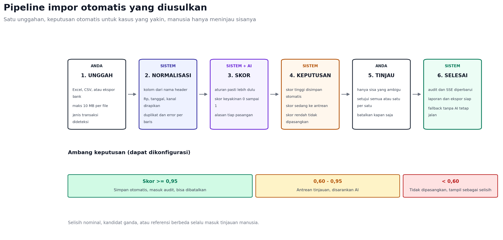
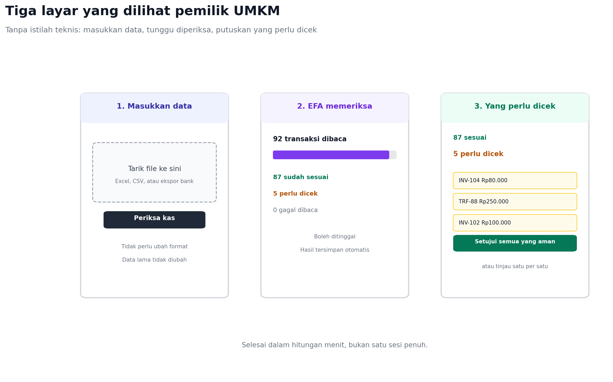

# Otomatisasi Impor dan Pencocokan

**Status: post-MVP.** Proposal MVP menetapkan tanpa AI, OCR, atau kredensial bank.
Dokumen ini adalah backlog setelah pilot, bukan bagian demo.

Rencana ini menjawab satu pertanyaan: apa yang harus disiapkan agar alur
impor-cocokkan berjalan otomatis, bukan menambah pekerjaan manual. Dasar
diagnosisnya adalah kode yang berjalan sekarang, Bukan asumsi.



Sumber diagram: `docs/diagrams/pipeline_ai.py`.

## 1. Kenapa sekarang masih manual

| Penyebab | Bukti di kode | Akibat bagi pengguna |
| --- | --- | --- |
| Format kaku | Hanya CSV tujuh kolom, angka tanpa titik, tanggal `YYYY-MM-DD` | Harus mengonversi Excel lebih dulu |
| Pencocokan hanya exact | Kunci pasangan: referensi (huruf kecil), kanal, tanggal, nominal harus sama | Sedikit perbedaan saja langsung masuk selisih |
| Tidak ada simpan otomatis | Endpoint hanya memberi usulan; setiap pasangan harus dikonfirmasi | Puluhan klik per impor |
| Sisa pekerjaan menumpuk | Semua yang tidak exact masuk `exceptions` | Pengguna berhadapan dengan antrean besar |
| Proses sinkron | Pratinjau dan simpan berjalan dalam satu request | Tidak ada progres, tidak bisa ditinggal |

Jadi masalahnya bukan kurang AI, tetapi belum ada lapisan normalisasi dan
ambang keputusan. AI yang ditempel tanpa dua lapisan itu hanya menambah biaya
tanpa mengurangi klik.

## 2. Prinsip yang dipakai

1. Aturan pasti lebih dulu, AI kemudian. Format uang, tanggal, kanal, dan
   duplikat diselesaikan tanpa model.
2. Otomatis hanya untuk kasus yang yakin. Ambang keyakinan menentukan
   simpan otomatis, antre tinjauan, atau tidak dipasangkan.
3. Setiap keputusan bisa dibatalkan dan tercatat di audit.
4. AI tidak boleh mengarang data. Nilai yang tidak ada di file tetap kosong.
5. Jika AI gagal, impor tetap selesai dengan aturan deterministik.

## 3. Alur target

| Tahap | Siapa | Yang terjadi otomatis |
| --- | --- | --- |
| 1. Unggah | Pengguna | Satu tombol, terima Excel/CSV/ekspor bank, deteksi jenis transaksi |
| 2. Normalisasi | Sistem | Petakan kolom dari nama header, rapikan Rp dan tanggal, tandai duplikat |
| 3. Skor | Sistem, lalu AI untuk sisa | Hitung keyakinan pasangan beserta alasannya |
| 4. Keputusan | Sistem | Simpan otomatis skor tinggi, antrekan skor sedang, tolak skor rendah |
| 5. Tinjau | Pengguna | Hanya melihat yang ambigu, bisa setujui semua |
| 6. Selesai | Sistem | Audit, event SSE, laporan dan ekspor |

Ambang awal yang diusulkan: simpan otomatis pada skor minimal 0,95; antrean
tinjauan 0,60 sampai 0,95; di bawah 0,60 tidak dipasangkan. Angka ini
konfigurasi, bukan konstanta di kode.

## 4. Status batch impor

| Status | Arti | Aksi berikutnya |
| --- | --- | --- |
| `uploaded` | File diterima, belum diproses | Worker mengambil job |
| `normalizing` | Sedang memetakan kolom dan nilai | Polling atau SSE progres |
| `needs_fix` | Ada baris yang tidak bisa dinormalkan | Pengguna memperbaiki, unggah ulang |
| `matching` | Sedang mencocokkan | Tunggu |
| `review_required` | Ada pasangan skor sedang | Pengguna meninjau |
| `completed` | Semua selesai atau disetujui | Laporan |
| `failed` | Gagal sistem | Coba lagi, data tidak berubah |

Batch tidak boleh setengah tersimpan. Pasangan dan entri masuk dalam satu
transaksi, atau tidak sama sekali.

## 5. Yang perlu disiapkan

### A. Keputusan produk dan konfigurasi

- Ambang otomatis dan ambang tinjauan.
- Jendela tanggal pencocokan, misalnya 7 hari.
- Batas toleransi biaya layanan: boleh beda nominal hanya jika selisihnya
  cocok dengan fee yang diisi pengguna.
- Batas ukuran file dan jumlah baris untuk Excel.
- Apakah pengguna boleh mematikan otomatisasi per impor.
- Lama jendela pembatalan massal.

Konfigurasi disimpan sebagai environment, bukan hardcode:

```text
IMPORT_MAX_BYTES=10485760
IMPORT_MAX_ROWS=2000
MATCH_AUTO_APPLY=true
MATCH_AUTO_THRESHOLD=0.95
MATCH_REVIEW_THRESHOLD=0.60
MATCH_DATE_WINDOW_DAYS=7
AI_ENABLED=false
AI_PROVIDER=
AI_MODEL=
AI_TIMEOUT=8s
AI_MAX_CANDIDATES=20
AI_MONTHLY_BUDGET_USD=
```

### B. Skema data

Migrasi baru, tanpa mengubah tabel yang sudah dipakai:

- `umkm_imports` tambah kolom: `source_format`, `status`, `row_count`,
  `error_count`, `normalization` (jsonb), `matched_count`, `auto_applied_count`,
  `completed_at`.
- Tabel `umkm_match_decisions`: `id`, `workspace_id`, `import_id`, `sale_id`,
  `receipt_id`, `score`, `band`, `source` (rule/ai/human), `signals` (jsonb),
  `reason`, `applied_at`, `reversed_at`, `created_at`.
- Unique index parsial: satu pasangan aktif per sale dan per receipt.
- Index untuk antrean tinjauan: `(workspace_id, band, applied_at)`.

`signals` menyimpan komponen skor agar keputusan bisa dijelaskan tanpa
menghitung ulang.

### C. Komponen backend

| Komponen | Tanggung jawab |
| --- | --- |
| `importfile` | Terima multipart, deteksi MIME, batas ukuran, simpan sementara |
| `importer/csv` | Parser CSV yang ada, dipertahankan |
| `importer/xlsx` | Baca sheet pertama, header baris pertama, nilai sel apa adanya |
| `normalizer` | Peta header, parsing Rp dan tanggal, sinonim kanal, dedupe |
| `scorer` | Skor deterministik dari referensi, nominal, kanal, tanggal, nama |
| `decider` | Terapkan ambang, tandai alasan wajib tinjauan |
| `applier` | Simpan pasangan dalam transaksi, audit, event SSE, undo |
| `aigateway` | Panggil model untuk kandidat ambigu, validasi JSON, cache, timeout |
| `jobrunner` | Proses batch di latar belakang, status, retry |

Untuk worker, tabel `pblg_jobs` yang sudah ada bisa dipakai; tidak perlu
antrean baru.

### D. Perubahan API

Endpoint baru:

```http
POST /api/v1/umkm/imports/upload        (multipart: file, kind opsional)
GET  /api/v1/umkm/imports/{id}/status
GET  /api/v1/umkm/imports/{id}/result
POST /api/v1/umkm/imports/{id}/approve-all
POST /api/v1/umkm/imports/{id}/undo-auto
POST /api/v1/umkm/decisions/{id}/undo
```

Respons unggah `202`:

```json
{"batch_id":"...","status":"processing","poll_after_ms":1500}
```

Respons status:

```json
{
  "status":"review_required",
  "progress":100,
  "counts":{"rows":92,"ready":92,"auto_matched":87,"review":5,"errors":0},
  "review":[{"sale_id":"...","receipt_id":"...","score":0.82,"reason":"..."}],
  "errors":[]
}
```

Endpoint lama `/imports/preview` dan `/imports` tetap ada selama masa transisi,
lalu ditandai deprecated.

### E. Frontend

- Satu layar impor: unggah, progres, ringkasan tiga angka, tombol tinjau.
- Progres dari SSE `import.progress`, bukan polling terus-menerus.
- Tinjauan berupa daftar pendek dengan alasan dan tombol setujui semua.
- Tombol batalkan untuk keputusan otomatis, per pasangan dan massal.
- Tampilkan koreksi baris yang gagal, bukan hanya jumlah error.

### F. Observability dan biaya

- Span untuk unggah, normalisasi, skor, panggilan AI, dan apply.
- Metrik: durasi per tahap, jumlah baris, panggilan AI, tingkat override.
- Batas biaya bulanan dan pemutus sirkuit bila provider gagal.
- Log tidak boleh memuat isi file atau nama pelanggan.

### G. Pengujian

- Tabel kasus normalisasi: `Rp1.250.000`, `1.250.000,00`, `25/10/2026`,
  `2026-10-25`, kanal `Transfer`, `TRF`, `bank transfer`.
- File contoh `.xlsx` asli dari Excel Indonesia sebagai golden test.
- Skor: kasus exact, selisih fee, kandidat ganda, tanggal jauh, nama mirip.
- Idempotensi: unggah file sama dua kali tidak menggandakan.
- Fallback: provider AI mati, impor tetap selesai.
- Integrasi: 92 baris menghasilkan 0 duplikat dan audit lengkap.

## 6. Model skor

| Sinyal | Bobot | Catatan |
| --- | --- | --- |
| Referensi sama setelah normalisasi | 0,35 | Buang spasi, tanda hubung, dan prefix umum |
| Nominal sama | 0,25 | Selisih hanya boleh jika cocok fee |
| Kanal sama setelah sinonim | 0,15 | transfer, trf, bank transfer dianggap sama |
| Jarak tanggal | 0,15 | Semakin dekat semakin tinggi, maksimal jendela |
| Kemiripan nama | 0,10 | Normalisasi huruf dan spasi |

Aturan yang memaksa tinjauan, berapa pun skornya:

- selisih nominal di luar fee yang diizinkan;
- lebih dari satu kandidat di sisi penjualan atau penerimaan;
- tanggal di luar jendela;
- referensi kosong;
- pasangan akan membuat sisa negatif.

## 7. Kontrak AI

AI hanya menerima kandidat yang sudah lolos aturan, maksimal 20 per panggilan.
Keluaran wajib JSON:

```json
{
  "decisions":[
    {"sale_id":"S1","receipt_id":"R1","decision":"match","confidence":0.88,"reason":"Referensi sama, nominal sama, beda 1 hari"}
  ]
}
```

Aturan:

- `sale_id` dan `receipt_id` harus ada di daftar kandidat; jika tidak, jawaban
  dibuang dan pasangan masuk tinjauan.
- `confidence` dari model tidak dipakai langsung; skor akhir tetap hasil
  gabungan aturan dan model.
- Suhu 0, tanpa percobaan ulang yang mengubah isi.
- Cache berdasarkan hash kandidat dan versi prompt.
- Timeout 8 detik; lewat dari itu, lanjut tanpa AI.

## 8. Yang membuat alur jadi lebih otomatis

| Manual hari ini | Pengganti otomatis |
| --- | --- |
| Konversi Excel ke CSV | Unggah langsung, normalisasi di server |
| Menyusun tujuh kolom dengan urutan tepat | Pemetaan kolom dari nama header |
| Mengetik ulang nominal dan tanggal | Parser Rp dan tanggal multi-format |
| Memilih kanal dari daftar | Sinonim kanal dinormalkan |
| Mengonfirmasi semua pasangan | Simpan otomatis untuk skor tinggi |
| Menyelesaikan antrean panjang | Hanya sisa ambigu yang tampil |
| Memeriksa satu per satu | Setujui semua untuk sisa yang aman |
| Mengulang dari awal saat salah | Batalkan otomatis, ulangi tanpa impor ulang |

## 9. Peran Gemini

Model yang dipakai: `gemini-2.5-flash` untuk kasus yang butuh penalaran, dan
`gemini-2.5-flash-lite` bila hanya perlu klasifikasi murah. Harga indikatif
Gemini Developer API saat ini 0,30 dolar per juta token input dan 2,50 dolar
per juta token output; cek halaman pricing sebelum implementasi karena angka
bisa berubah.

Gemini dipakai untuk tiga pekerjaan saja:

1. Memetakan kolom pada file yang tidak dikenali aturan, misalnya ekspor bank
   tanpa header standar. Hasil pemetaan ditampilkan untuk dikoreksi, bukan
   langsung dipakai diam-diam.
2. Memilih pasangan pada kandidat ambigu, dengan alasan singkat.
3. Menjelaskan sisa temuan ke bahasa manusia, misalnya “kemungkinan pelanggan
   membayar dua kali”.

Yang tidak boleh dilakukan Gemini: mem-parsing nominal dan tanggal (itu urusan
parser deterministik), menyimpan pasangan tanpa audit, atau mengarang ID yang
tidak ada di file.

Perkiraan biaya: satu panggilan berisi 20 kandidat sekitar 1.500 token input
dan 400 token output, jadi sekitar 0,0015 dolar. Lima panggilan per impor
berarti di bawah Rp150; seratus impor per bulan masih di bawah Rp15.000.
Angka ini indikatif dan perlu diukur setelah implementasi.

Pengelolaan kunci: `GEMINI_API_KEY` hanya di environment backend, tidak pernah
dikirim ke frontend. Tambahkan kuota per workspace, batas biaya bulanan,
timeout 8 detik, cache berdasarkan hash kandidat, dan fallback ke aturan
deterministik bila kuota habis atau provider gagal.

## 10. Pengalaman pengguna



Janji produknya satu kalimat: “Cek apakah catatan penjualanmu sudah sesuai
dengan uang yang benar-benar masuk.” Pengguna tidak perlu tahu apa itu CSV,
skor, atau model AI.

| Langkah | Yang dilihat pengguna | Yang tidak ditampilkan |
| --- | --- | --- |
| Masukkan data | Kotak unggah dan tombol “Periksa kas” | Nama kolom, format tanggal, aturan validasi |
| EFA memeriksa | Progres dan tiga angka: dibaca, sesuai, perlu dicek | Skor, nama model, prompt |
| Yang perlu dicek | Kartu temuan dan tombol “Setujui semua yang aman” | Kandidat alternatif, bobot sinyal |

Kata “AI” tidak perlu muncul di alur utama. Cukup “diperiksa otomatis”. AI
muncul sebagai penjelasan bila pengguna membuka detail temuan, misalnya
“kemungkinan ini pembayaran yang sama karena nominal dan tanggalnya dekat”.

Copy yang dipakai: “Periksa kas”, “sudah sesuai”, “perlu dicek”, “setujui
semua yang aman”, “batalkan”. Hindari “eksekusi”, “rekonsiliasi otomatis”,
atau “confidence score”.

## 11. Roadmap

| Fase | Isi | Estimasi | Kriteria selesai |
| --- | --- | --- | --- |
| 0 | Konfigurasi, migrasi, kontrak API, feature flag | 2-3 hari | Flag bisa menyalakan dan mematikan alur baru |
| 1 | Unggah multipart, adapter CSV dan XLSX, normalisasi | 4-5 hari | File Excel Indonesia lolos tanpa konversi |
| 2 | Simpan otomatis untuk exact match, audit, undo | 3-4 hari | 80% pasangan bersih selesai tanpa klik |
| 3 | Skor fuzzy tanpa AI, aturan wajib tinjauan | 3-4 hari | Selisih fee dan tanggal dekat tertangani |
| 4 | AI gateway untuk sisa ambigu | 3-5 hari | Panggilan AI kurang dari 5% baris |
| 5 | UI satu layar, SSE progres, setujui semua | 4-5 hari | Pengguna menyelesaikan 100 baris di bawah 5 menit |

Total backend sekitar 15-20 hari kerja, frontend 4-5 hari, bisa berjalan
bertahap. Fase 1 dan 2 sudah menghapus sebagian besar pekerjaan manual tanpa
menunggu AI.

## 12. Metrik keberhasilan

- Tingkat otomatis: minimal 70% pasangan pada data bersih tanpa klik.
- Tingkat pembatalan di bawah 2%; jika lebih, ambang terlalu longgar.
- Panggilan AI di bawah 5% baris.
- Waktu sampai selesai di bawah 5 menit untuk 100 baris.
- Error normalisasi di bawah 2% baris pada file Excel umum.

## 13. Risiko

| Risiko | Dampak | Mitigasi |
| --- | --- | --- |
| Ambang terlalu longgar | Pasangan salah tersimpan | Mulai konservatif, ukur pembatalan, audit |
| AI mengarang pasangan | Data tidak valid | Validasi id terhadap kandidat, buang jawaban liar |
| Provider lambat atau mahal | Impor tertahan | Timeout, cache, batas biaya, fallback |
| File Excel beragam | Normalisasi gagal | Golden test dari file nyata, pesan koreksi per sel |
| Proses latar gagal di tengah | Data setengah jadi | Transaksi per batch, status jelas, retry aman |

## 14. Keputusan yang harus diambil lebih dulu

1. Ambang otomatis 0,95 dan tinjauan 0,60: setuju atau ubah?
2. Auto-apply dinyalakan sejak fase 2 atau setelah 30 hari data uji?
3. Provider AI dan batas biaya bulanan.
4. Batas baris per file untuk Excel: tetap 500 atau naik ke 2000?
5. Siapa yang boleh membatalkan keputusan otomatis: semua owner atau hanya
   pengguna yang mengunggah?

