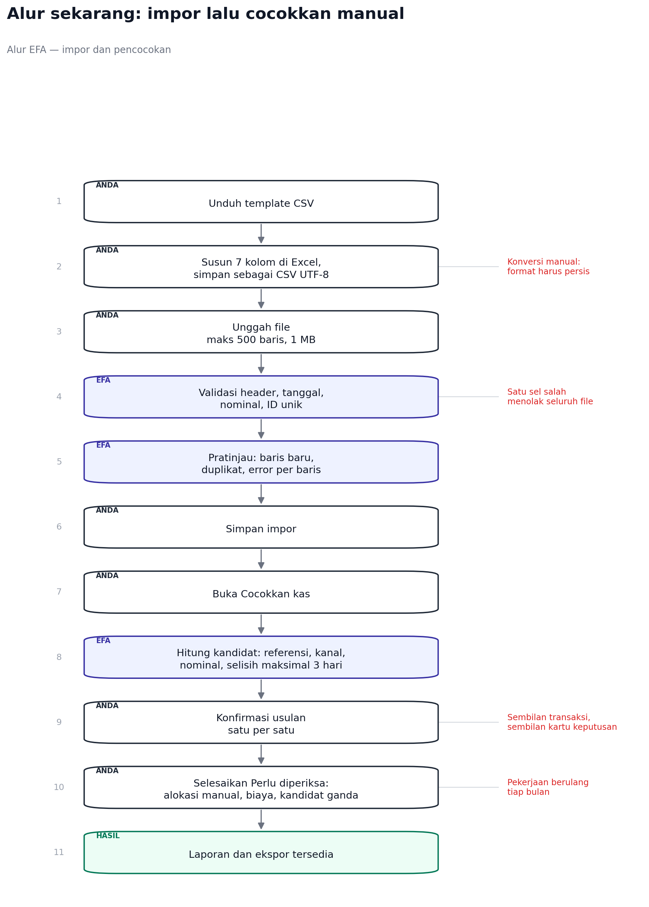
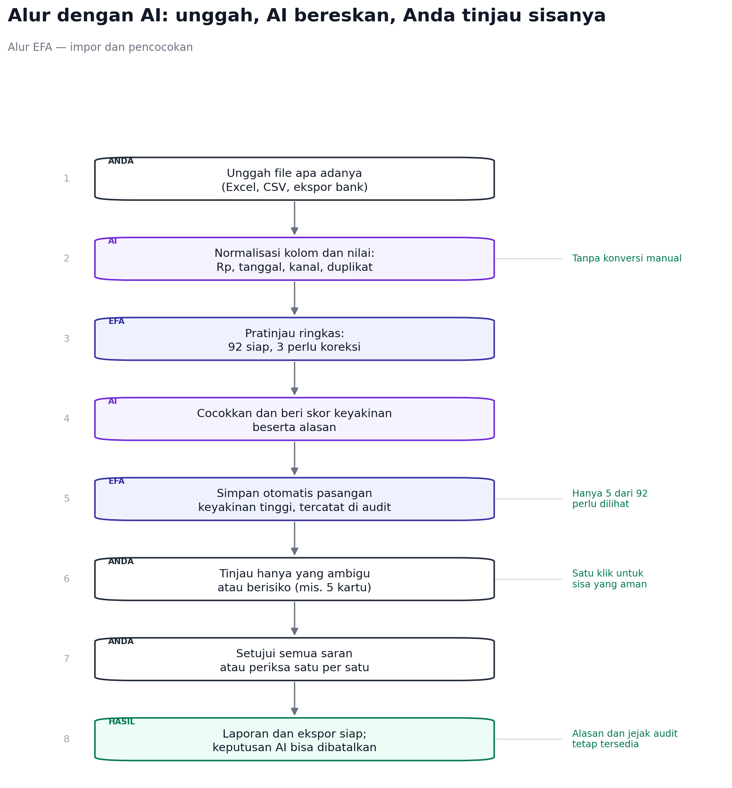
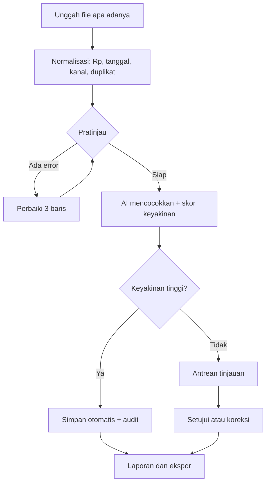

# Alur Impor dan Pencocokan: Sekarang vs Dengan AI

Dokumen ini menjelaskan alur yang berjalan sekarang, alur setelah bantuan AI
dipasang, dan batas yang harus dijaga agar AI tidak menjadi sumber kesalahan
baru. Diagram dibuat dari kode backend dan frontend yang ada saat ini.





Sumber diagram: `docs/diagrams/flow_ai.py` (jalankan `python
docs/diagrams/flow_ai.py` untuk membuat ulang).

Rencana teknis dan daftar kesiapan untuk menjalankan alur ini ada di
[AI_IMPORT_AUTOMATION.md](AI_IMPORT_AUTOMATION.md).

## Alur sekarang

1. Pengguna mengunduh template CSV.
2. Data disusun ulang menjadi tujuh kolom, lalu disimpan sebagai CSV UTF-8.
3. File diunggah, maksimal 500 baris dan 1 MB.
4. Backend memvalidasi header, tanggal, nominal, dan ID unik. Satu kesalahan
   menolak seluruh file.
5. Pratinjau menampilkan baris baru, duplikat, dan error per baris.
6. Pengguna menyimpan impor.
7. Pengguna membuka menu Cocokkan kas.
8. Backend menghitung kandidat berdasarkan referensi, kanal, nominal, dan
   selisih tanggal maksimal tiga hari.
9. Pengguna mengonfirmasi usulan satu per satu.
10. Sisa yang ambigu diselesaikan lewat alokasi manual, biaya layanan, atau
    pemilihan kandidat ganda.
11. Laporan dan ekspor tersedia.

Titik beratnya bukan di langkah 4-8, melainkan di langkah 2, 9, dan 10:
konversi format, lalu keputusan berulang untuk setiap pasangan. Pada data demo
lima penjualan dan empat penerimaan menghasilkan sembilan kartu, dan pengguna
harus membuka satu per satu.

## Alur dengan AI

1. Pengguna mengunggah file apa adanya: Excel, CSV, atau ekspor bank.
2. AI menormalkan kolom dan nilai: `Rp1.250.000` menjadi `1250000`,
   `25/10/2026` menjadi `2026-10-25`, nama kanal diseragamkan, duplikat
   ditandai.
3. Pratinjau ringkas: berapa baris siap, berapa perlu dikoreksi, dan apa yang
   akan dilakukan AI.
4. AI mencocokkan dan memberi skor keyakinan beserta alasannya.
5. Pasangan dengan keyakinan tinggi disimpan otomatis dan tercatat di audit.
6. Pengguna hanya melihat yang ambigu atau berisiko, misalnya 5 dari 92.
7. Pengguna menyetujui semua saran atau memeriksa satu per satu.
8. Laporan dan ekspor siap. Setiap keputusan AI bisa dibatalkan.

Perubahan besar bukan pada “AI mencocokkan”, tetapi pada jumlah keputusan yang
harus diambil manusia. Alur sekarang meminta keputusan untuk semua transaksi;
alur AI meminta keputusan hanya untuk yang tidak yakin.

## Perbandingan

| Aspek | Sekarang | Dengan AI |
| --- | --- | --- |
| Langkah pengguna | 5-6 aksi sebelum melihat hasil | 3 aksi: unggah, cek ringkasan, setujui |
| Format file | CSV tujuh kolom, UTF-8 | Excel, CSV, ekspor bank |
| Konversi manual | Wajib | Tidak perlu |
| Keputusan per transaksi | Semua | Hanya yang ambigu atau berisiko |
| Waktu untuk 100 transaksi | Puluhan menit | Beberapa menit |
| Risiko salah cocok | Bergantung ketelitian pengguna | Dibatasi ambang keyakinan dan audit |

## Bentuk yang paling sederhana untuk pengguna

Satu tombol, satu layar keputusan:

```text
[ Impor file ]

  AI membaca 92 transaksi
  87 sudah dicocokkan otomatis
  5 perlu keputusan Anda

  [ Tinjau 5 ]        [ Setujui semua yang aman ]
```

Semua detail teknis (kolom, format tanggal, pemetaan kanal) tidak perlu
ditampilkan kecuali ada yang gagal. Yang terlihat hanya tiga angka: berapa
dibaca, berapa selesai, berapa tersisa.

## Batas yang harus dijaga

- AI tidak boleh menyimpan pasangan diam-diam. Setiap keputusan otomatis masuk
  audit dengan alasan dan skor.
- Pasangan dengan selisih nominal, tanggal jauh, atau kandidat ganda tidak
  boleh diotomatiskan; itu masuk antrean tinjauan.
- Keputusan otomatis harus bisa dibatalkan satu per satu dan sekaligus.
- AI tidak boleh mengarang ID sumber atau referensi. Nilai yang tidak ada di
  file tetap kosong.
- Normalisasi harus deterministik dan bisa diuji tanpa model: `Rp`, titik,
  koma, format tanggal, dan nama kanal ditangani aturan, bukan tebakan.
- Model hanya dipakai untuk kasus yang memang ambigu, misalnya nama pelanggan
  mirip atau catatan bebas. Ini menekan biaya dan menjaga hasil bisa dijelaskan.
- Jika model gagal atau lambat, impor tetap berjalan dengan pencocokan
  deterministik yang sekarang. AI adalah lapisan tambahan, bukan jalur tunggal.

## Titik implementasi di backend

| Lapisan | Perubahan |
| --- | --- |
| Impor | Terima `xlsx` dan CSV dengan pemetaan kolom berdasarkan nama header, bukan urutan |
| Normalisasi | Aturan nilai: mata uang, tanggal, kanal, spasi, duplikat |
| Pencocokan | Skor keyakinan dari sinyal yang sudah ada: referensi, kanal, nominal, jarak tanggal |
| Keputusan | Ambang otomatis, antrean tinjauan, alasan per pasangan |
| Audit | Catat `ai_auto`, `ai_suggested`, `human_confirmed`, dan skor |
| API | Pratinjau menerima multipart, bukan string CSV di JSON |

## Yang perlu diputuskan sebelum coding

1. Ambang keyakinan untuk simpan otomatis, misalnya 0,95, dan apakah nominal
   harus sama persis.
2. Apakah pengguna boleh mematikan otomatisasi per impor.
3. Batas ukuran dan jumlah baris untuk Excel.
4. Apakah AI berjalan saat unggah atau sebagai pekerjaan latar belakang.
5. Berapa lama hasil otomatis bisa dibatalkan.

## Diagram Mermaid



