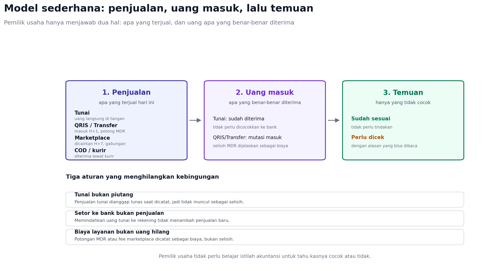

# Mencatat Kas untuk Pemilik UMKM

Dokumen ini menjawab pertanyaan paling mendasar: bagaimana pemilik usaha mencatat
penjualan dan uang yang masuk, termasuk uang tunai, tanpa belajar akuntansi.



## Prinsip

Aplikasi hanya butuh dua jawaban dari pengguna:

1. Apa yang terjual hari ini?
2. Uang apa yang benar-benar diterima?

Selisih di antara keduanya adalah temuan, bukan kesalahan pengguna. Semua
istilah teknis disembunyikan.

## Tiga cara mencatat

| Cara | Untuk siapa | Waktu | Yang diisi |
| --- | --- | --- | --- |
| Catat harian | Warung, kafe, toko kecil | 1-2 menit per hari | Tiga angka: tunai, QRIS/transfer, marketplace |
| Impor | Punya kasir, POS, atau rekap Excel | Sekali sebulan | Unggah file, tinjau temuan |
| Rinci | Butuh jejak per pesanan | Per transaksi | Satu pesanan, metode bayar, nominal |

Catat harian menjadi jalur utama karena paling sedikit gesekan. Impor tetap
ada untuk yang sudah punya data, dan rinci untuk yang membutuhkannya.

## Perlakuan per metode pembayaran

| Metode | Kapan dianggap lunas | Yang perlu dilakukan pengguna |
| --- | --- | --- |
| Tunai | Saat dicatat | Tidak ada; tidak perlu dicocokkan ke bank |
| QRIS | Saat dana masuk rekening, biasanya H+1 | Tidak ada; potongan MDR dicatat sebagai biaya |
| Transfer bank | Saat mutasi masuk | Tidak ada bila nominal dan tanggal dekat |
| Marketplace | Saat pencairan | Tidak ada; pencairan gabungan dialokasikan otomatis |
| COD / kurir | Saat setoran kurir diterima | Cocokkan satu setoran dengan beberapa pesanan |
| E-wallet | Saat saldo masuk | Sama seperti QRIS |
| DP / uang muka | Saat DP diterima | Sisa dicatat saat pelunasan |

Uang tunai adalah kasus paling sederhana dan paling sering: uangnya sudah di
tangan, jadi tidak ada yang perlu dicocokkan. Yang perlu dicocokkan hanya uang
yang bergerak lewat bank, QRIS, atau marketplace.

## Tutup kas harian

Layar tutup kas menanyakan satu hal: berapa uang tunai yang ada di tangan
sekarang.

```text
Kas awal            Rp 200.000
Penjualan tunai     Rp 850.000
Uang keluar         Rp 150.000
Seharusnya ada      Rp 900.000
Uang dihitung       Rp 885.000
Selisih             Rp  15.000  (perlu dicek)
```

Jika pengguna tidak mencatat uang keluar, selisih akan muncul setiap kali
membeli bahan atau membayar listrik. Karena itu sediakan tombol cepat "Uang
keluar" dengan tiga pilihan: bahan, operasional, lain-lain.

## Yang tidak perlu dilakukan pengguna

- Menghitung atau mencocokkan transaksi tunai satu per satu.
- Mencatat setoran tunai ke bank sebagai penjualan baru.
- Memasukkan biaya layanan secara manual bila sudah terlihat dari selisih.
- Mengubah format file sebelum mengunggah.
- Memahami istilah rekonsiliasi, alokasi, atau kandidat.

## Kasus yang sering terjadi

| Kasus | Penanganan |
| --- | --- |
| Pembeli bayar tunai lebih, lalu kembalian | Catat nominal penjualan, bukan uang yang diserahkan |
| Setor tunai ke bank | Catat sebagai "pindah dana", bukan penerimaan |
| Potongan MDR QRIS | Otomatis diusulkan sebagai biaya layanan |
| Pencairan marketplace gabungan | Alokasikan otomatis ke pesanan yang cocok |
| Pesanan batal atau refund | Catat pembatalan, jangan hapus riwayat |
| Bon / utang pelanggan | Penjualan tetap tercatat, uang masuk menyusul |
| Uang laci dipakai belanja | Catat uang keluar agar selisih kas masuk akal |

## Bentuk layar

1. **Catat hari ini**: tiga kolom angka (Tunai, QRIS/Transfer, Marketplace),
   tanggal otomatis hari ini, tombol simpan. Total muncul langsung.
2. **Tutup kas**: kas awal, uang keluar, uang dihitung, lalu hasil sesuai atau
   selisih beserta alasannya.
3. **Temuan**: hanya daftar yang belum cocok, masing-masing dengan kalimat
   alasan dan dua tindakan: "sudah benar" atau "perlu dicek".

Ketiga layar ini cukup untuk pemakaian harian. Impor dan AI menjadi jalur
alternatif, bukan syarat agar aplikasi bisa dipakai.

## Keputusan produk

1. Apakah catat harian membuat satu entri agregat per metode, atau memecahnya
   per transaksi? Rekomendasi: agregat, dengan opsi rinci.
2. Apakah uang keluar masuk scope MVP? Rekomendasi: ya, minimal tiga kategori,
   karena tanpa itu tutup kas selalu selisih.
3. Apakah kas awal diisi manual atau diwarisi dari hari sebelumnya?
   Rekomendasi: diwarisi, bisa diubah.
4. Apakah penjualan tunai otomatis lunas? Rekomendasi: ya, dengan opsi
   menandai piutang.

