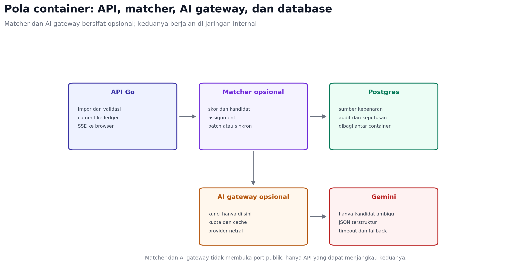

# Matching dalam Arsitektur Container

Jawaban singkat: bisa. Tools seperti Splink dapat dijalankan sebagai container
terpisah, API mengirim pekerjaan, lalu container mengembalikan hasil matching.
Tetapi ada tiga pola yang perlu dibedakan.



## Tiga pola

| Pola | Bentuk | Cocok untuk |
| --- | --- | --- |
| In-process | Engine Go di dalam container API | Volume kecil, latensi rendah, demo |
| Matcher container | Container terpisah, API memanggil lewat HTTP | Batch besar, Splink/Python, isolasi bahasa |
| SaaS | Panggilan ke layanan pihak ketiga | Tim tanpa operasi, volume besar |

## Kalau memakai Splink di container

Splink adalah library Python untuk batch, bukan layanan per request. Bentuk
yang masuk akal:

```text
POST /v1/jobs
{"workspace_id":"...","import_id":"...", "threshold":0.95}

202 {"job_id":"...", "status":"queued"}

GET /v1/jobs/{job_id}
200 {"status":"done", "decisions":[...]}
```

Container Splink membaca data dari PostgreSQL, menjalankan blocking dan
Fellegi-Sunter, lalu menulis kandidat atau keputusan ke tabel hasil. API tidak
mengirim seluruh file lewat HTTP.

Konsekuensinya: citra Python besar, waktu mulai lama, dan hasil muncul dalam
hitungan detik sampai menit. Untuk 100 transaksi ini berlebihan.

## Kalau memakai engine Go sendiri di container

Lebih ringan: satu binary, tanpa runtime Python. Kontraknya bisa sinkron:

```text
POST /v1/match
{"workspace_id":"...","import_id":"..."}

200 {"matched":87,"review":5,"decisions":[...]}
```

Engine membaca PostgreSQL langsung, memakai lock workspace, dan menulis
keputusan dalam transaksi. API tetap menjadi pemilik commit ke ledger.

## AI gateway sebagai container

Pola yang paling berguna: container kecil yang menyimpan API key dan kuota.

```text
POST /v1/rerank
{"candidates":[{"sale_id":"...","receipt_id":"...","score":0.82}]}

200 {"decisions":[{"sale_id":"...","receipt_id":"...","pick":true,"evidence":["EXACT_AMOUNT"]}]}
```

Keuntungan: kunci tidak tersebar, biaya bisa dipantau, provider bisa diganti
tanpa mengubah API, dan timeout/fallback terpusat.

## Yang harus dijaga

- Container matcher dan AI gateway tidak membuka port publik.
- Autentikasi antar-container memakai token internal atau mTLS.
- Batasi CPU, memori, dan waktu proses.
- Jangan menulis isi transaksi ke log.
- API tetap menjadi satu-satunya penulis keputusan final ke ledger.
- Idempoten: job yang sama dijalankan dua kali tidak menggandakan pasangan.

## Rekomendasi untuk EFA

1. Demo: tetap in-process, tanpa container baru.
2. Produksi awal: tambahkan AI gateway container saat Gemini dipakai.
3. Matcher container baru diperlukan jika pindah ke Splink, volume ribuan
   transaksi per impor, atau ingin bahasa terpisah.

