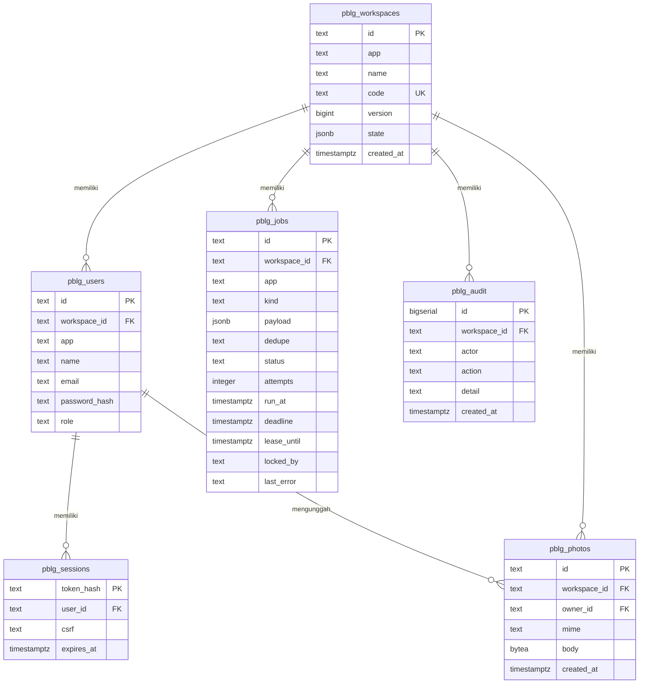
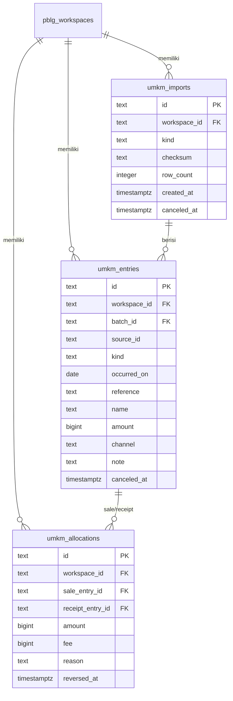
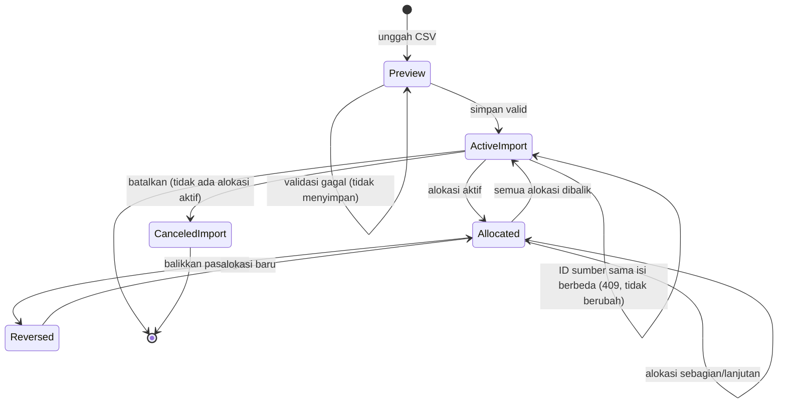
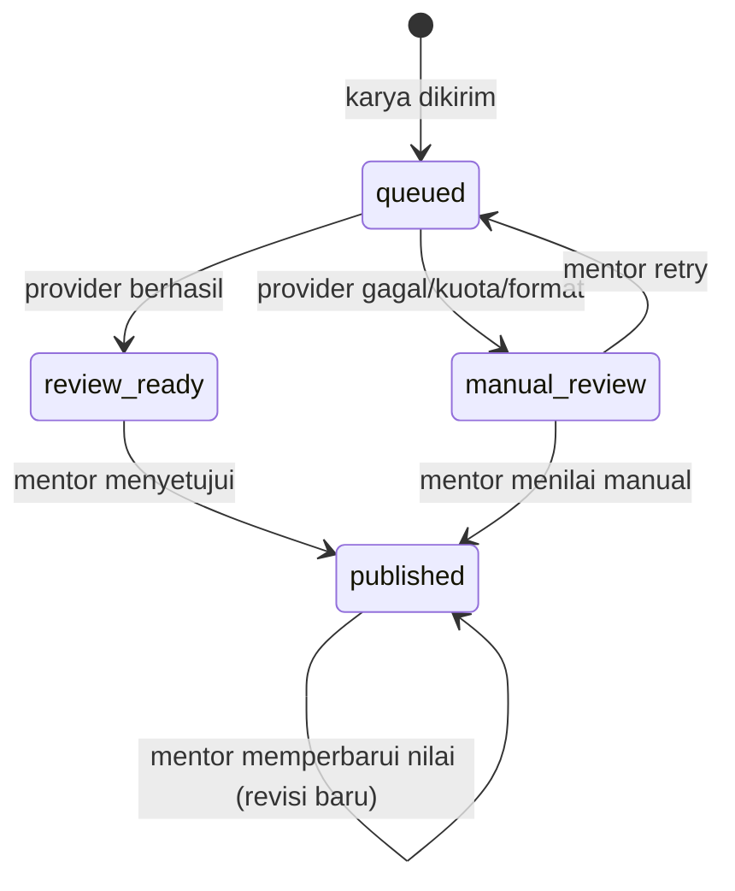
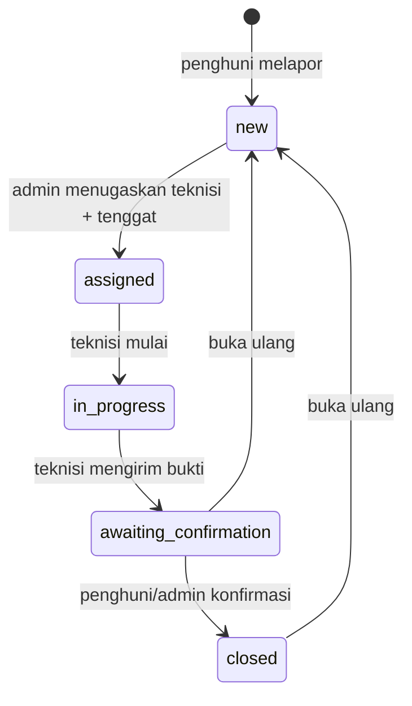

# FRD — Rekonsiliasi Kas UMKM (Temu Kas)

| Field | Nilai |
|---|---|
| Dokumen | Functional Requirements Document |
| Produk | Temu Kas — Rekonsiliasi Kas UMKM |
| Repositori | `D:/appwebsite/rekonsiliasi-kas-umkm` |
| Branch | `feat/pbl-sqlc-and-docs` |
| Tanggal | 26 Oktober 2026 |
| Status | Draft implementasi; perilaku acuan berasal dari prototipe |
| Sumber perilaku | `Tiga-Prototipe-PBL` (read-only) |
| Dokumen terkait | [`PRD.md`](PRD.md) |

> Dokumen ini tidak memuat kata sandi, token, API key, email akun demo, atau data pribadi. Nilai rahasia dari `.env`, `AKUN_DEMO.txt`, fixture, dan log sengaja tidak disalin.

## 1. Dasar, status, dan cara membaca dokumen

Urutan sumber kebenaran yang dipakai:

1. **Repositori saat ini** untuk status implementasi, konfigurasi runtime, dan schema yang sudah dikomit.
2. **Prototipe** untuk perilaku fungsional yang diminta, termasuk validasi, transisi status, dan pesan error.
3. **Pengujian prototipe** untuk perilaku yang sudah dibuktikan, bukan sekadar diklaim di dokumentasi.
4. **Dokumen batasan** untuk hal yang sengaja tidak dikerjakan dan risiko yang belum dibuktikan.

Jika ada konflik, status repositori menang untuk pertanyaan “apakah fitur ini sudah ada”, sedangkan perilaku prototipe menang untuk pertanyaan “bagaimana fitur ini seharusnya bekerja” sampai ada keputusan produk baru.

Path seperti `auth.go`, `umkm.go`, `server.go`, `web/app.js`, dan `docs/api.md` merujuk ke `Tiga-Prototipe-PBL/`; path yang diawali `backend/` merujuk ke repositori ini.

Status repositori saat ini:

| Komponen | Status | Bukti |
|---|---|---|
| Backend HTTP | Echo scaffold; hanya `GET /health/live` dan `GET /health/ready` | `backend/internal/echohttp/http_server.go:30-45`; `backend/README.md:8-11` |
| Database schema | Baseline `pblg_*`, migration `000002_umkm_normalized`, dan backfill `000003` pada branch implementasi | `backend/scripts/postgres/migrations/000001_pbl_baseline.up.sql:8-79`; `backend/scripts/postgres/migrations/000002_umkm_normalized.up.sql:1-84`; `backend/scripts/postgres/migrations/000003_backfill_umkm_state.up.sql` |
| Autentikasi/sesi/CSRF | Belum ada | Tidak ada route atau middleware autentikasi di `http_server.go` |
| Domain UMKM | Query sqlc auth/UMKM sudah digenerate; handler/service belum ada | `backend/scripts/postgres/queries/auth.sql`, `backend/scripts/postgres/queries/umkm.sql`, `backend/internal/repository/rekonsiliasi_repository_sqlc/` |
| Frontend | Belum ada | Direktori `frontend/` belum ada; README menyebut ruang kerja yang belum diisi |
| Worker/job | Belum ada | Worker hanya ada di prototipe |
| CI | Vet, test race, build, lint | `.github/workflows/backend-ci.yml` |

Legenda status di tabel:

- **Prototipe**: perilaku terverifikasi di `Tiga-Prototipe-PBL`, belum tentu ada di repositori ini.
- **Repo**: sudah ada di checkout saat ini.
- **Future**: konteks suite/modul masa depan.
- **Gap**: belum ada dan belum menjadi bagian implementasi saat ini.

## 2. Aktor, peran, dan matriks izin

| Aktor | Ruang kerja | Tujuan | Catatan |
|---|---|---|---|
| Pemilik usaha | Satu ruang kerja UMKM | Mengimpor, mencocokkan, membalik, membatalkan, mengekspor | Satu-satunya peran UMKM pada prototipe |
| Mentor | Satu kelas | Membuat tugas/rubrik, menilai, menerbitkan, mengekspor | Konteks suite |
| Siswa | Satu kelas | Mengirim karya, melihat nilai final miliknya | Konteks suite |
| Pengelola properti | Satu properti | Menugaskan, memantau SLA, mengonfirmasi, membuka ulang, mengekspor | Konteks suite |
| Penghuni | Satu properti | Membuat laporan, melihat dan mengonfirmasi tiketnya | Konteks suite |
| Teknisi | Satu properti | Mengerjakan tiket yang ditugaskan | Konteks suite |

Matriks izin berdasarkan bukti kode. “Milik sendiri” berarti data difilter berdasarkan identitas sesi, bukan hanya tombol yang disembunyikan.

| Kapabilitas | Pemilik | Mentor | Siswa | Pengelola | Teknisi | Penghuni |
|---|---|---|---|---|---|---|
| Masuk dan mengganti kata sandi | Ya | Ya | Ya | Ya | Ya | Ya |
| Melihat state ruang kerja | Seluruh UMKM | Seluruh kelas | Karya sendiri + nilai final | Seluruh properti | Tiket yang ditugaskan | Tiket miliknya |
| Impor CSV | Ya | — | — | — | — | — |
| Alokasi/pembalikan/pembatalan impor | Ya | — | — | — | — | — |
| Mengekspor rekap | Ya | Ya | Tidak | Ya | Tidak | Tidak |
| Membuat tugas/rubrik | — | Ya | — | — | — | — |
| Mengirim karya | — | — | Ya | — | — | — |
| Menerbitkan nilai | — | Ya | — | — | — | — |
| Membuat tiket | — | — | — | Ya | — | Ya |
| Menugaskan teknisi dan tenggat | — | — | — | Ya | — | — |
| Mulai/selesai pekerjaan | — | — | — | — | Hanya tiket yang ditugaskan | — |
| Konfirmasi/buka ulang | — | — | — | Ya | Tidak | Hanya tiket miliknya |
| Unggah foto | — | — | — | Ya | Ya | Ya |
| Baca foto | — | — | — | Semua di properti | Foto tiket terkait | Foto tiket miliknya |

Catatan: endpoint `POST /api/photos` hanya memerlukan sesi; antarmuka Ruang yang membatasi pemakaiannya. Matriks di atas menggambarkan kapabilitas UI dan aturan domain, bukan satu-satunya pemeriksaan di server.

Aturan peran yang terbukti:

- Peran diambil dari database. Login menerima field `role` tetapi tidak memakainya untuk mengubah kewenangan.
- `allowedRole()` membatasi peran per aplikasi: UMKM hanya `owner`, Tilik `mentor`/`student`, Ruang `admin`/`technician`/`resident`.
- Pengelola adalah pembuat ruang kerja pada Tilik/Ruang; anggota memakai kode bergabung. Kode tidak memberi peran pengelola.
- Siswa tidak menerima draf AI; `state()` menghapus `Draft` dan data pengguna lain sebelum mengirim respons.
- Teknisi hanya melihat tiket yang `technician_id`-nya sama dengan ID-nya; penghuni hanya tiket yang `resident_id`-nya sama.
- Teknisi tidak dapat mengonfirmasi pekerjaannya sendiri; konfirmasi hanya oleh admin atau penghuni pemilik tiket.

## 3. Halaman dan perilaku fungsional

### 3.1 Halaman masuk dan daftar

| Aspek | Perilaku |
|---|---|
| Inisialisasi | Browser memuat `GET /api/config` untuk kind, brand, tagline, dan daftar peran; lalu `GET /api/me` untuk memeriksa sesi. Tanpa sesi, tampil halaman masuk. |
| Masuk | Field email dan kata sandi. Tidak ada pilihan peran. Kata sandi dapat ditampilkan/disembunyikan dengan tombol “Lihat”. |
| Daftar | Field nama, email, kata sandi, jenis akun, dan nama usaha/kelas/properti atau kode bergabung. Pemilik/mentor/admin melihat field nama ruang kerja; anggota melihat kode bergabung. |
| Validasi klien | Nama 2–100 karakter; email wajib; kata sandi 12–72 karakter; nama ruang kerja maksimal 100 karakter; kode bergabung maksimal 20 karakter. Validasi server tetap menjadi penentu. |
| Setelah berhasil | Browser menyimpan user dan CSRF dari `/api/me`, memuat state, memulai SSE, dan menghapus hash rute. |
| Gagal | Pesan error ditampilkan di form dan fokus dipindahkan ke elemen error. 401 mengembalikan pengguna ke halaman masuk. |
| Batas | Login/register dibatasi 25 request per alamat IP per aplikasi dalam 10 menit. |

Catatan: halaman daftar UMKM hanya menampilkan peran pemilik. Kode bergabung tidak relevan untuk UMKM karena tidak ada peran anggota pada MVP.

### 3.2 Ringkasan (`#overview`)

| Aspek | Perilaku |
|---|---|
| Data | `GET /api/state`; untuk UMKM, state berisi `entries`, `imports`, `allocations`. |
| Metrik | Penjualan tercatat, penerimaan, sisa tagihan, jumlah penjualan yang sudah cocok, dan jumlah transaksi. |
| Daftar | Maksimal enam penjualan dengan saldo > 0 dari state yang dimuat; setiap baris menampilkan sisa tagihan dan tombol “Cocokkan”. |
| Penerimaan per kanal | Total penerimaan dikelompokkan berdasarkan `channel`; jika belum ada penerimaan, tampil keadaan kosong. |
| Aksi | “Impor CSV” membuka dialog impor; “Periksa pasangan” menuju `#reconcile`; “Buka rekap kas” menuju `#reports`. |
| Keadaan kosong | “Semua penjualan sudah cocok” dengan ajakan menambah transaksi periode berikutnya. |
| Batas | Ringkasan tidak dibatasi ukuran halaman; daftar transaksi penuh ada di halaman Transaksi. |

### 3.3 Transaksi (`#entries`)

| Aspek | Perilaku |
|---|---|
| Data | Seluruh `entries` yang terlihat oleh peran, ditampilkan terbaru lebih dulu. |
| Kolom | Referensi/ID sumber, nama, jenis (penjualan/penerimaan), nominal, sisa, status. |
| Pencarian | Mencari pada nama, referensi, ID sumber, dan kanal tanpa membedakan huruf besar/kecil. |
| Filter status | Semua status, penjualan, penerimaan, dibatalkan. |
| Paging | 20/50/100 baris; tombol sebelumnya/berikutnya; halaman dihitung ulang setelah filter berubah. |
| Status baris | “Cocok” bila sisa 0; “Ada sisa” bila sisa > 0; “Dibatalkan” bila `canceled`. |
| Keadaan kosong | “Tidak ada data yang cocok” bila pencarian/filter tidak menemukan hasil; ajakan menambah data bila daftar memang kosong. |
| Aksi | “Impor CSV” membuka dialog impor. Tidak ada edit/hapus transaksi per baris. |

### 3.4 Cocokkan kas (`#reconcile`)

| Aspek | Perilaku |
|---|---|
| Usulan | `GET /api/suggestions` mengembalikan pasangan unik beserta alasan. Kartu menampilkan referensi, nominal, nama, dan kanal. |
| Aksi usulan | “Periksa pasangan” membuka dialog alokasi dengan penjualan dan penerimaan yang sudah terisi. Usulan tidak langsung mengubah saldo. |
| Alokasi manual | “Alokasi manual” membuka dialog yang sama dengan pilihan awal penjualan/penerimaan pertama yang masih memiliki saldo. |
| Riwayat keputusan | Daftar alokasi terbaru: referensi penjualan/penerimaan, nominal, biaya, catatan, status aktif/dibatalkan, dan tombol “Batalkan pasangan” untuk yang aktif. |
| Pembalikan | Konfirmasi sebelum membalik; server menandai `reversed`; saldo kembali; riwayat tetap ada. |
| Keadaan kosong | “Tidak ada pasangan unik yang tersisa” dengan arahan memakai alokasi manual untuk biaya, pembayaran sebagian, atau pencairan gabungan. |
| Catatan | Usulan hanya untuk referensi tidak kosong, nominal/kanal sama, penerimaan 0–3 hari setelah penjualan, dan kandidat tunggal di kedua sisi. |

### 3.5 Impor CSV (`#imports`)

| Aspek | Perilaku |
|---|---|
| Halaman | Penjelasan format, tautan unduh contoh penjualan/penerimaan, dan riwayat impor. |
| Riwayat | Waktu, jenis, jumlah baris baru, status tersimpan/dibatalkan, tombol “Batalkan impor” untuk batch aktif. |
| Dialog | Memilih jenis (penjualan/penerimaan), file CSV, lalu “Periksa CSV”. |
| Batas file | Maksimal 1 MB; jika file kosong atau lebih besar, klien menolak sebelum unggah. |
| Pratinjau | Menampilkan jumlah baris valid, total nominal, dan lima baris pertama. Pratinjau belum menyimpan. |
| Simpan | Tombol “Simpan impor ini” mengirim payload pratinjau yang sama ke `POST /api/imports`. |
| Duplikat | Jika file identik, server mengembalikan `duplicate: true`; klien memberi pesan “tidak ada data ganda”. |
| Perubahan input | Mengubah jenis atau file menghapus pratinjau lama agar tidak menyimpan data yang salah. |
| Pembatalan | Konfirmasi; server menolak bila masih ada alokasi aktif pada batch. |
| Keadaan kosong | Riwayat kosong menampilkan ajakan mengimpor file pertama. |

### 3.6 Riwayat (`#history`)

| Aspek | Perilaku |
|---|---|
| Data | `events` dari `GET /api/state`, diambil dari `pblg_audit` terbaru maksimal 120 baris. |
| Kolom | Waktu, pelaksana, aktivitas, keterangan. |
| Pencarian/paging | Sama seperti daftar lain: pencarian teks, ukuran halaman 20/50/100. |
| Peran | Pada UMKM hanya pemilik, sehingga seluruh event ruang kerja terlihat. Pada suite, siswa dan non-admin tidak menerima event. |

### 3.7 Laporan (`#reports`)

| Aspek | Perilaku |
|---|---|
| Metrik | Ringkasan penjualan, penerimaan, sisa tagihan, dan jumlah penjualan cocok. |
| Rekap UMKM | Jumlah pasangan aktif dan total biaya yang sudah dikonfirmasi. |
| Ekspor | Tautan “Unduh rekap CSV” menuju `GET /api/export`. |
| Peringatan | Angka bukan perhitungan laba; ekspor memuat transaksi aktif dan dibatalkan beserta sisa alokasi. |
| Peran | Ekspor hanya untuk pemilik/mentor/admin; pada UMKM hanya pemilik. |

### 3.8 Pengaturan (`#settings`)

| Aspek | Perilaku |
|---|---|
| Profil | Nama, email, peran, nama ruang kerja, dan keterangan penyimpanan PostgreSQL. |
| Ganti kata sandi | Dialog meminta kata sandi saat ini dan kata sandi baru 12–72 karakter. Server memverifikasi kata sandi lama dan mengakhiri semua sesi akun. |
| Setelah ganti | Klien menghapus sesi lokal, kembali ke halaman masuk, dan meminta pengguna masuk dengan kata sandi baru. |
| Keluar | `POST /api/logout` mengakhiri sesi saat ini dan menghapus cookie. |
| Peringatan data | Data awal sintetis; jangan unggah data pelanggan/siswa nyata sebelum ada izin. |

### 3.9 Dialog, error, dan perilaku global

| Aspek | Perilaku |
|---|---|
| Dialog | Memakai elemen `<dialog>` native; tombol tutup; Escape memicu `cancel`. |
| Isian belum disimpan | Jika dialog kotor, tutup/Escape/beforeunload meminta konfirmasi. |
| Request berjalan | Form diberi `aria-busy`, kontrol dinonaktifkan, tombol berubah “Menyimpan...”; dialog tidak boleh ditutup sampai request selesai. |
| Error | Error form ditampilkan di `role="alert"` dan difokuskan; error aksi non-form memakai toast 4,5 detik. |
| Timeout | Fetch dibatalkan setelah 32 detik dengan pesan bahwa data mungkin sudah tersimpan dan perlu muat ulang sebelum mengirim lagi. |
| Pembaruan | SSE mengirim versi workspace setiap sekitar 4 detik. Jika versi berubah dan tidak ada dialog/isian aktif, halaman dimuat ulang otomatis. Jika ada isian, tombol “Data baru · muat ulang” muncul. |
| Sesi berakhir | 401 saat refresh/SSE menghentikan event dan mengembalikan ke halaman masuk. |
| Navigasi | Hash route; perubahan hash mereset halaman/pencarian/filter dan memfokuskan `main`. |
| Skip link | “Lewati navigasi” memindahkan fokus ke `main` tanpa mengubah rute. |
| Mobile | Menu disclosure berisi navigasi dan logout; tabel bergulir di area tabel. |

### 3.10 Halaman suite (konteks, bukan MVP repositori ini)

| Aplikasi | Halaman | Perilaku ringkas |
|---|---|---|
| Tilik | Ringkasan, Tugas, Antrean review/Karya saya, Laporan kelas, Anggota, Pengaturan | Mentor membuat tugas dan rubrik total 100; siswa mengirim teks/PDF/GitHub; worker membuat draf; mentor menerbitkan nilai; siswa hanya melihat final. |
| Ruang | Ringkasan, Laporan, Papan progres, Tim properti, Aktivitas SLA, Laporan, Pengaturan | Penghuni melapor; admin menugaskan teknisi/tenggat; teknisi mulai dan mengirim bukti; penghuni/admin konfirmasi atau buka ulang; SLA dihitung sebagai saran. |

## 4. Katalog API

### 4.1 Konvensi

- URL relatif terhadap server aplikasi. Request JSON memakai `Content-Type: application/json`; error berbentuk `{"error":"penjelasan yang dapat ditindaklanjuti"}`.
- Endpoint privat memerlukan cookie sesi. Perubahan (non-GET) juga memerlukan `X-CSRF-Token` dari `GET /api/me`; permintaan lintas situs ditolak.
- Workspace dan app diambil dari sesi, bukan dari parameter klien. Ini mencegah pengguna memilih ruang kerja lain lewat payload.
- Respons sukses memakai 200 untuk baca/perubahan dan 201 untuk pembuatan, termasuk idempotent retry yang mengembalikan hasil lama.
- Body JSON prototipe dibatasi 2 MB dan menolak field tidak dikenal serta lebih dari satu objek JSON.
- Prototipe memakai prefix `/api`; scaffold repositori ini belum menetapkan prefix domain dan masih memakai `/health/*`. Keputusan prefix ada di pertanyaan terbuka.

### 4.2 Endpoint akun dan data bersama

| ID | Method dan path | Auth/CSRF | Request | Respons sukses | Error/status | Bukti | Status repo |
|---|---|---|---|---|---|---|---|
| API-S01 | `GET /api/config` | Publik | — | `{kind, brand, tagline, roles[]}` | 500 bila gangguan internal | `server.go:182-187` | Gap |
| API-S02 | `GET /api/health` | Publik | — | `{status:"ok", app, database:"postgresql"}` | 503 bila database tidak dapat dihubungi | `server.go:188-195` | Gap; repo punya `/health/live` dan `/health/ready` |
| API-S03 | `POST /api/register` | Publik + rate limit | `name, email, password, role, workspace, join_code` | 201 `{user}` | 400 validasi/kode bergabung salah; 409 email sudah terdaftar; 429; 500 gangguan penyimpanan | `auth.go:77-134`; `server.go:196-209` | Gap |
| API-S04 | `POST /api/login` | Publik + rate limit | `email, password` | 200 `{user}` | 401 kredensial salah; 429; 503 | `auth.go:135-154`; `server.go:196-209` | Gap |
| API-S05 | `GET /api/me` | Sesi | — | 200 `{user, csrf}` | 401 sesi berakhir; 503 penyimpanan sesi gangguan | `auth.go:52-67`; `server.go:210-217` | Gap |
| API-S06 | `POST /api/logout` | Sesi + CSRF | `{}` | 200 `{ok:true}` | 401; 403 CSRF | `auth.go:155-164` | Gap |
| API-S07 | `POST /api/password` | Sesi + CSRF | `current, password` | 200 `{ok:true}`; semua sesi akun dihapus | 400 kata sandi lama salah/baru tidak valid; 401; 403 | `auth.go:165-204` | Gap |
| API-S08 | `GET /api/state` | Sesi | — | `{workspace, state, users, events, ai_configured}`; difilter per peran | 401; 503 | `auth.go:205-248`; `store.go:74-153` | Gap |
| API-S09 | `GET /api/events` | Sesi | — | SSE `event: state`, `data: <version>`; keepalive | 401; koneksi ditutup bila sesi berakhir | `server.go:266-307` | Gap |
| API-S10 | `GET /api/export` | Sesi; GET tidak butuh CSRF | — | CSV unduhan | 403 peran tidak berhak; 401; 500 | `umkm.go:388-439`; `jobs.go:245-263` | Gap |

Catatan health: scaffold repositori ini memiliki `GET /health/live` dan `GET /health/ready` dengan bentuk respons `LivenessResponse`/`ReadinessResponse`; keduanya bukan pengganti kontrak `GET /api/health` prototipe.

### 4.3 Endpoint Temu Kas

| ID | Method dan path | Auth/CSRF | Request | Respons sukses | Error/status | Bukti | Status repo |
|---|---|---|---|---|---|---|---|
| API-U01 | `POST /api/imports/preview` | Sesi + CSRF | `{kind:"sale"\|"receipt", csv:string}` | 200 `{rows[], count, total, checksum}` | 400 encoding/header/baris/nominal/ukuran; 401; 403 | `umkm.go:204-218` | Gap |
| API-U02 | `POST /api/imports` | Sesi + CSRF | `{kind, csv}` | 201 `{id, imported, skipped}` atau `{duplicate:true, id}` | 400 validasi; 401; 403; 409 ID sumber berbeda/dibatalkan; 400 batas 10.000 | `umkm.go:219-276` | Gap |
| API-U03 | `GET /api/suggestions` | Sesi | — | 200 array `{sale, receipt, reason}` | 401; 500 | `umkm.go:111-170`; `jobs.go:245-263` | Gap |
| API-U04 | `POST /api/allocations` | Sesi + CSRF | `{sale_id, receipt_id, amount, fee, reason, key}` | 201 `Allocation` | 400 key/nominal/biaya/alasan; 404 transaksi tidak ada; 409 saldo kurang/key konflik; 401; 403 | `umkm.go:277-316`; `umkm.go:171-203` | Gap |
| API-U05 | `POST /api/allocations/{id}/undo` | Sesi + CSRF | `{}` | 200 `{ok:true}` | 404 alokasi tidak ditemukan; 401; 403 | `umkm.go:317-331` | Gap |
| API-U06 | `POST /api/imports/{id}/cancel` | Sesi + CSRF | `{}` | 200 `{ok:true}` | 404 batch tidak ditemukan; 409 masih ada alokasi aktif; 401; 403 | `umkm.go:332-364` | Gap |

`{id}` pada undo adalah ID alokasi, yang pada prototipe sama dengan `key` 32 karakter hex yang dikirim klien. Jangan menganggapnya ID database terpisah.

### 4.4 Kontrak data utama

`authInput` (prototipe):

| Field | Tipe | Aturan |
|---|---|---|
| `name` | string | 2–100 byte (UI membatasi 2–100 karakter), tanpa karakter NUL; wajib saat daftar |
| `email` | string | Satu alamat email valid, di-lowercase dan di-trim, panjang <255; unik per `(app,email)` |
| `password` | string | 12–72 byte; hash bcrypt cost 12 |
| `role` | string | Harus peran yang diizinkan aplikasi; login mengabaikannya |
| `workspace` | string | Wajib untuk pemilik/mentor/admin; 1–100 karakter |
| `join_code` | string | Wajib untuk anggota; dicocokkan dengan kode ruang kerja aplikasi yang sama |

`Entry`, `Import`, dan `Allocation`:

| Entitas | Field | Aturan |
|---|---|---|
| Entry | `id, source_id, batch_id, kind, date, reference, name, amount, channel, note, canceled` | `id` internal 32 hex; `source_id` dari CSV maksimal 80; `kind` sale/receipt; `date` `YYYY-MM-DD`; `amount` integer positif ≤1 triliun; `channel` lowercase; `note` maksimal 400 |
| Import | `id, kind, checksum, rows, created_at, canceled` | `checksum` SHA-256 dari `kind+csv`; `rows` jumlah baris baru; `canceled` penanda lunak |
| Allocation | `id, sale_id, receipt_id, amount, fee, reason, created_at, reversed` | `id` = key klien 32 hex; `amount` >0; `fee` ≥0; `reason` maksimal 400; `reversed` penanda lunak |

Contoh bentuk state JSONB prototipe (bukan data nyata):

```json
{
  "entries": [
    {
      "id": "<32 hex>",
      "source_id": "S-001",
      "batch_id": "<32 hex>",
      "kind": "sale",
      "date": "2026-10-25",
      "reference": "INV-001",
      "name": "Contoh",
      "amount": 150000,
      "channel": "transfer",
      "note": "",
      "canceled": false
    }
  ],
  "imports": [
    {
      "id": "<32 hex>",
      "kind": "sale",
      "checksum": "<sha256>",
      "rows": 1,
      "created_at": "2026-10-25T00:00:00Z",
      "canceled": false
    }
  ],
  "allocations": [
    {
      "id": "<32 hex>",
      "sale_id": "<32 hex>",
      "receipt_id": "<32 hex>",
      "amount": 100000,
      "fee": 0,
      "reason": "Pembayaran sebagian",
      "created_at": "2026-10-25T00:00:00Z",
      "reversed": false
    }
  ]
}
```

### 4.5 Endpoint Tilik dan Ruang (konteks suite)

Tilik:

| ID | Method dan path | Auth/CSRF | Request | Respons/error utama | Bukti |
|---|---|---|---|---|---|
| API-T01 | `POST /api/assignments` | Mentor + CSRF | `title, description, criteria[{id,title,description,max_score}]` | 201 Assignment; 400 rubrik 1–10 kriteria/total 100/ID unik; 403 peran | `grader.go:19-108` |
| API-T02 | `POST /api/submissions` | Siswa + CSRF | `assignment_id, content, source:text/github` | 201 Submission; 400 panjang/sumber; 404 tugas; 403 peran; 400 batas 1.000 | `grader.go:110-162` |
| API-T03 | `POST /api/pdf/extract` | Siswa + CSRF | multipart `file` | 200 `{text,pages,characters}`; 400 PDF >2 MB/rusak/terkunci/>20 halaman/<30 karakter | `pdf.go:31-93` |
| API-T04 | `POST /api/submissions/{id}/approve` | Mentor + CSRF | `revision, review{items[],feedback,provider}` | 200 `{ok:true}`; 400 review tidak valid; 404; 409 revisi basi | `grader.go:163-202` |
| API-T05 | `POST /api/submissions/{id}/retry` | Mentor + CSRF | `{}` | 200 `{ok:true}`; 409 bukan `manual_review`; 404 | `grader.go:203-225` |
| API-T06 | `GET /api/export` | Mentor | — | CSV rekap kelas; 403 siswa | `umkm.go:410-425` |

Ruang:

| ID | Method dan path | Auth/CSRF | Request | Respons/error utama | Bukti |
|---|---|---|---|---|---|
| API-R01 | `POST /api/tickets` | Penghuni/admin + CSRF | `key, title, description, location, category, urgency, photo_id` | 201 Ticket; 400 validasi/limit; 409 key dengan isi berbeda; 403 peran | `facility.go:158-211` |
| API-R02 | `POST /api/tickets/{id}/action` | Peran sesuai transisi + CSRF | `action, version` + field sesuai aksi | 200 Ticket; 400 note/tenggat/biaya; 403 peran; 404; 409 versi/status | `facility.go:45-143`, `facility.go:212-256` |
| API-R03 | `POST /api/photos` | Sesi + CSRF | multipart `photo` | 201 `{id}`; 400 format/ukuran/quota; 401; 403 | `facility.go:257-316` |
| API-R04 | `GET /api/photos/{id}` | Sesi; pemilik/admin/pihak tiket | — | 200 JPEG privat; 403 tanpa hubungan; 404 lintas properti | `facility.go:317-350` |
| API-R05 | `GET /api/export` | Admin | — | CSV rekap properti; 403 non-admin | `umkm.go:426-439` |

Aturan suite ringkas yang perlu dipertahankan bila modul ini diaktifkan:

- **Tilik:** rubrik 1–10 kriteria dengan total bobot tepat 100; teks karya 30–50.000 karakter; PDF teks maksimal 2 MB/20 halaman/50.000 karakter; GitHub hanya URL akar HTTPS publik, maksimal 8 file/45.000 karakter, folder dependency/file tersembunyi/secret diabaikan; nilai final hanya setelah approval mentor; revisi mencegah overwrite (`grader.go:19-50`, `grader.go:110-162`, `grader.go:256-316`; `pdf.go:31-93`).
- **Ruang:** kategori `ac/listrik/air/bangunan/lainnya`, urgensi `routine/urgent/emergency`; saran tenggat Senin–Jumat 08.00–17.00 WIB, listrik 4 jam, AC/air 8 jam, bangunan/lainnya 16 jam, urgent 4 jam, emergency 1 jam; saran bukan SLA kontraktual; foto maksimal 3 MB/12 megapiksel, re-encode JPEG, kuota 100 foto/30 MB per properti; biaya adalah catatan, bukan pembayaran (`facility.go:257-316`; `sla.go:9-53`).

### 4.6 Status endpoint di repositori ini

| Endpoint | Status | Catatan |
|---|---|---|
| `GET /health/live` | Repo | Mengembalikan `status, service, version, uptime_seconds, time`. |
| `GET /health/ready` | Repo | Mengembalikan `status, service, version, checks`; 503 bila database diaktifkan tetapi tidak siap; database nonaktif dilaporkan `disabled` dengan 200. |
| `GET /api/config`, `/api/me`, `/api/state`, `/api/events` | Gap | Belum ada route. |
| Seluruh endpoint UMKM `API-U01`–`API-U06` | Gap | Belum ada handler/service/query. |
| Endpoint Tilik/Ruang | Future | Tidak termasuk MVP repositori ini. |

### 4.7 Pemetaan error

| Status | Kapan | Contoh pesan/penanganan |
|---|---|---|
| 400 | Input tidak valid, CSV/JSON/PDF/foto gagal validasi, batas terlampaui | Pesan spesifik baris atau field; form tetap terbuka |
| 401 | Sesi tidak ada/kedaluwarsa, kredensial salah | Kembali ke halaman masuk atau tampilkan error login |
| 403 | Peran tidak berhak, CSRF salah, origin lintas situs | Tolak aksi; jangan bocorkan data |
| 404 | Data tidak ada di ruang kerja | Pesan generik “tidak ditemukan di ruang kerjamu” |
| 409 | Saldo kurang, versi/revisi basi, ID/key duplikat dengan isi berbeda, impor masih teralokasi | Muat ulang data sebelum mencoba lagi |
| 429 | Login/register melewati 25 percobaan/10 menit | Tunggu 10 menit |
| 503 | Database/penyimpanan sesi/provider tidak tersedia | Minta coba lagi; jangan mengirim ulang data otomatis |
| 500 | Gangguan tak terduga | Pesan umum; detail ada di log server |

## 5. Entitas data dan transisi status

### 5.1 Hubungan tabel



Catatan: `pblg_sessions` berelasi ke `pblg_users`, bukan langsung ke `pblg_workspaces`; workspace diperoleh melalui user.

Arah normalisasi UMKM (migration `000002_umkm_normalized` dan backfill `000003`):



Diagram kedua adalah arah implementasi, bukan pengganti hubungan `pblg_*` di atas. `pblg_workspaces.state` tetap dipertahankan untuk kompatibilitas PBL/suite.

### 5.2 Entitas dan invariant

| Entitas | Lokasi | Invariant utama |
|---|---|---|
| Workspace | `pblg_workspaces` | `id` unik; `app` harus salah satu kind; `code` unik; `state` JSONB; `version` naik setiap mutasi |
| User | `pblg_users` | `(app,email)` unik; role harus sesuai aplikasi; password hash bcrypt |
| Session | `pblg_sessions` | `token_hash` unik; `expires_at > now()`; CSRF disimpan untuk dicek |
| Entry | `state.entries` (prototipe) atau `umkm_entries` (normalized 000002) | `source_id` unik per kind dalam ruang kerja; `amount > 0`; `canceled`/`canceled_at` penanda lunak |
| Import | `state.imports` (prototipe) atau `umkm_imports` (normalized 000002) | `checksum` mengidentifikasi file; `rows`/`row_count` jumlah baris baru; `canceled`/`canceled_at` penanda lunak |
| Allocation | `state.allocations` (prototipe) atau `umkm_allocations` (normalized 000002) | `amount > 0`; `fee >= 0`; total alokasi aktif tidak melebihi saldo; `reversed`/`reversed_at` penanda lunak |
| Job | `pblg_jobs` | `(workspace_id,dedupe)` unik; lease dan `attempts` mencegah pekerjaan ganda |
| Audit | `pblg_audit` | Append-only; actor/action/detail/waktu; dibaca maksimal 120 terbaru |
| Photo | `pblg_photos` | JPEG privat; quota per workspace; akses berdasarkan pemilik/keterkaitan tiket |

### 5.3 `state` JSONB versus tabel ternormalisasi

Prototipe menyimpan data domain di `pblg_workspaces.state` JSONB, bukan satu tabel per entitas. Untuk UMKM, state berisi array `entries`, `imports`, dan `allocations`. Tabel lain menyimpan identitas, sesi, job, audit, dan foto.

Repositori ini bergerak ke model hibrida:

- `pblg_workspaces.state` tetap ada untuk kompatibilitas database prototipe dan data suite (Tilik/Ruang).
- Migration `000002_umkm_normalized` menambahkan tabel `umkm_imports`, `umkm_entries`, dan `umkm_allocations` untuk domain UMKM. Migration `000003_backfill_umkm_state` memindahkan state JSONB lama. Query sqlc sudah digenerate; handler/service belum ada.
- Untuk UMKM, tabel `umkm_*` sebaiknya menjadi satu-satunya sumber kebenaran setelah cutover. Jangan dual-write ke JSONB dan tabel tanpa keputusan eksplisit karena dua sumber kebenaran memperbesar drift.

Konsekuensi yang perlu disadari:

- Mutasi mengambil satu baris workspace dengan `FOR UPDATE`, sehingga keputusan dalam satu ruang kerja diserialkan. Ini melindungi saldo dari dua alokasi bersamaan.
- Setiap mutasi menulis ulang seluruh state JSONB; tidak ada index per transaksi dan tidak ada foreign key antar-entri.
- Batas 10.000 transaksi/ruang kerja adalah batas MVP, bukan rancangan analitik jutaan baris.
- Untuk produksi, normalisasi dan backfill UMKM sudah disiapkan; keputusan yang tersisa adalah commit, validasi hasil backfill, dan pemilihan waktu cutover.

Migration `000001` memindahkan schema `pblg_*`; `IF NOT EXISTS` membuat baseline aman ditempel ke database prototipe tanpa menghapus data. Migration `000002` menambahkan constraint/index domain UMKM. Migration `000003` memindahkan imports, entries, dan allocations UMKM dari JSONB ke `umkm_*`; timestamp canceled/reversed memakai waktu backfill karena state lama hanya menyimpan boolean. Jumlah baris hasil backfill tetap harus diverifikasi pada environment nyata.

### 5.4 Transisi status UMKM



| Objek | Status | Transisi yang sah | Efek |
|---|---|---|---|
| Import | Aktif | Aktif → dibatalkan | Menandai batch dan semua entri `canceled`/`canceled_at`; saldo entri menjadi 0 |
| Entry | Aktif | Aktif → dibatalkan | Hanya melalui pembatalan batch; tidak ada edit/hapus |
| Allocation | Aktif | Aktif → reversed | Saldo penjualan/penerimaan kembali; baris tetap ada; schema normalized memakai `reversed_at` |
| Allocation | Reversed | Tidak kembali aktif | Keputusan baru harus dibuat sebagai alokasi baru |
| Session | Aktif | Aktif → kedaluwarsa/logout/ganti kata sandi | Token dihapus atau tidak lagi valid |

### 5.5 Transisi suite (kontekstual)

Tilik:



Catatan: `approve` tidak memeriksa status secara eksplisit; pengujian integrasi menerbitkan nilai saat karya masih `queued` selama `revision` cocok. Karya identik untuk siswa/tugas yang sama mengembalikan submission lama tanpa membuat job kedua. Apakah produksi harus membatasi approval ke `review_ready`/`manual_review` masih terbuka.

Ruang:



Transisi Ruang memerlukan `version` terbaru. Perubahan tenggat menaikkan `deadline_version`; job pengingat/overdue dengan versi lama harus diabaikan. Buka ulang menghapus penugasan/tenggat/bukti, menambah catatan alasan ke deskripsi, dan tidak menghapus total biaya yang sudah tercatat.

## 6. Validasi dan aturan bisnis

| ID | Aturan | Implementasi yang diharapkan | Bukti |
|---|---|---|---|
| BR-01 | CSV harus UTF-8, jenis file valid, maksimal 1 MB dan 500 baris | Tolak string non-UTF-8, kind selain sale/receipt, ukuran >1 MB, dan baris ke-501; BOM UTF-8 diterima | `umkm.go:27-89`; `domain_test.go:10-47` |
| BR-02 | Header wajib tujuh kolom dengan urutan tetap | `id,tanggal,referensi,nama,nominal,kanal,catatan`; header dibandingkan case-insensitive setelah trim | `umkm.go:40-55`; `domain_test.go:10-26` |
| BR-03 | Setiap field dibatasi dan dibersihkan | Tiap field maksimal 400 karakter, trim spasi, tolak NUL; ID sumber wajib, maksimal 80, unik dalam file; tanggal `YYYY-MM-DD`; nama dan kanal wajib | `umkm.go:57-88` |
| BR-04 | Nominal harus bilangan Rupiah bulat positif | `strconv.ParseInt`; tolak nol, negatif, desimal, dan >1 triliun | `umkm.go:73-79`; `domain_test.go:10-47` |
| BR-05 | Impor bersifat all-or-nothing | Satu baris gagal membatalkan seluruh file; tidak ada setengah file tersimpan | `umkm.go:57-89`; `flow.txt:61-63` |
| BR-06 | File identik tidak menggandakan transaksi | Checksum SHA-256 dari `kind+csv`; jika sudah ada batch aktif, kembalikan `duplicate:true` tanpa menambah entri | `umkm.go:90-92`, `umkm.go:228-240` |
| BR-07 | ID sumber yang sama harus konsisten | Jika kind dan source ID sama dengan seluruh field sama, baris dilewati; jika berbeda atau sudah dibatalkan, kembalikan 409 | `umkm.go:241-267`; `integration_test.go:101-145` |
| BR-08 | Batch yang sudah dibatalkan tidak dapat diimpor ulang | Checksum batch `canceled` menghasilkan 409; gunakan ID sumber baru untuk mencatat ulang | `umkm.go:230-236` |
| BR-09 | Batas ruang kerja 10.000 transaksi | Impor yang akan melewati batas ditolak sebelum menulis | `umkm.go:241-244`; `batasan.md:9` |
| BR-10 | Usulan memakai referensi, kanal, nominal, dan tanggal | Referensi dibandingkan case-insensitive; kanal dan nominal harus sama; penerimaan 0–3 hari setelah penjualan (inklusif) | `umkm.go:111-170`; `api.md:33` |
| BR-11 | Usulan harus unik di kedua sisi | Hitung kandidat penerimaan untuk penjualan dan kandidat penjualan untuk penerimaan; hanya tampilkan bila masing-masing tepat satu | `umkm.go:128-169`; `domain_test.go:83-107` |
| BR-12 | Referensi kosong, transaksi batal, atau sudah teralokasi tidak mendapat usulan | Usulan hanya untuk entri aktif, referensi tidak kosong, dan belum memiliki alokasi aktif | `umkm.go:122-127`; `domain_test.go:83-107` |
| BR-13 | Saldo penjualan dan penerimaan berbeda rumus | Penjualan: `amount - (alokasi + biaya)`; penerimaan: `amount - alokasi`; entri batal bersaldo 0 | `umkm.go:93-110`; `umkm.go:171-203` |
| BR-14 | Alokasi tidak boleh melebihi saldo | `amount + fee <= sisa penjualan` dan `amount <= sisa penerimaan`; pelanggaran 409 | `umkm.go:180-189`; `domain_test.go:52-82` |
| BR-15 | Nominal dan biaya memiliki batas | `amount > 0`; `fee >= 0`; keduanya ≤1 triliun | `umkm.go:172-174` |
| BR-16 | Biaya positif wajib memiliki alasan | Alasan setelah trim minimal 5 karakter; biaya nol boleh tanpa alasan | `umkm.go:190-192`; `domain_test.go:52-60` |
| BR-17 | Catatan alokasi dibatasi | Maksimal 400 karakter, tanpa NUL | `umkm.go:193-199` |
| BR-18 | Key alokasi idempoten | Key wajib 32 karakter hex; retry dengan payload sama mengembalikan alokasi lama; payload berbeda atau alokasi sudah reversed menghasilkan 409 | `umkm.go:277-316`; `integration_test.go:101-145` |
| BR-19 | Pembalikan bukan penghapusan | `undo` menandai `reversed=true`; saldo kembali; riwayat tetap ada | `umkm.go:317-331`; `domain_test.go:66-68` |
| BR-20 | Pembatalan impor hanya tanpa alokasi aktif | Tolak bila ada entri batch dengan saldo tidak sama dengan nominal dan belum batal; jika lolos, tandai batch dan semua entri batal | `umkm.go:332-364`; `integration_test.go:101-145` |
| BR-21 | Ekspor memuat status dan sisa | Kolom `id,jenis,tanggal,referensi,nama,nominal,sisa,kanal,status,catatan`; urut tanggal; status aktif/batal; memakai saldo terbaru | `umkm.go:388-409` |
| BR-22 | Ekspor menetralkan formula spreadsheet | Sel yang diawali `= + - @` setelah spasi/tab/CR/LF diberi awalan apostrof | `umkm.go:365-371`; `domain_test.go:108-117` |
| BR-23 | Mutasi diserialkan per ruang kerja | `SELECT ... FOR UPDATE` pada baris workspace; validasi saldo terjadi di dalam transaksi | `store.go:87-118`; `integration_test.go:146-176` |
| BR-24 | Registrasi memvalidasi identitas dan peran | Email satu alamat <255; nama 2–100; kata sandi 12–72 byte; role harus diizinkan aplikasi; workspace wajib untuk pemilik; join code untuk anggota | `auth.go:26-50`, `auth.go:77-134` |
| BR-25 | Kata sandi disimpan sebagai hash dan diganti dengan verifikasi | bcrypt cost 12; ganti kata sandi memeriksa kata sandi lama; seluruh sesi akun dihapus | `auth.go:85-115`, `auth.go:165-204` |
| BR-26 | Sesi 12 jam dan token disimpan sebagai hash | Cookie `pbl_<kind>`, `HttpOnly`, `SameSite=Strict`, `Secure` saat TLS, `MaxAge=43200`; DB menyimpan hash token | `auth.go:68-76`; `flow.txt:47-53` |
| BR-27 | CSRF dan origin check | Non-GET memerlukan `X-CSRF-Token` yang cocok constant-time; origin berbeda atau `Sec-Fetch-Site: cross-site` ditolak 403 | `server.go:147-158`, `server.go:242-265` |
| BR-28 | Login dibatasi per IP | 25 request per 10 menit per IP per aplikasi; pembatas in-memory | `server.go:159-181`; `security_test.go:148-160` |
| BR-29 | Data difilter berdasarkan peran dan sesi | Workspace dari sesi; siswa hanya karya sendiri dan tanpa draf; teknisi hanya tiket yang ditugaskan; penghuni hanya tiket miliknya | `auth.go:205-248`; `security_test.go:19-40` |
| BR-30 | Setiap mutasi domain melalui `Mutate` menghasilkan audit | Actor, action, detail, waktu; tidak ada update/delete audit dari API. Login/register/logout/ganti kata sandi tidak menulis audit di prototipe | `store.go:87-118`, `store.go:135-153` |
| BR-31 | Revisi/versi mencegah overwrite data basi | Tilik memakai `revision`; Ruang memakai `version`; perubahan tenggat memakai `deadline_version` | `grader.go:163-202`; `facility.go:45-143` |
| BR-32 | Body JSON dibatasi dan divalidasi ketat | Maksimal 2 MB; field tidak dikenal ditolak; hanya satu objek JSON | `server.go:114-126`; `io_test.go:103-110` |
| BR-33 | Schema UMKM ternormalisasi menjaga invariant di database | `umkm_imports`/`umkm_entries`/`umkm_allocations`: ID 32 hex; workspace FK cascade; checksum unik per workspace; `row_count` 0–500; source ID 1–80; amount 1..1 triliun; channel lowercase; reference/note ≤400; source ID unik per `(workspace,kind)`; allocation beda sale/receipt; FK ke entry; index tanggal/pencocokan/audit | `backend/scripts/postgres/migrations/000002_umkm_normalized.up.sql:1-84` |

### 6.1 Kasus tepi yang harus diuji

| Kasus | Perilaku yang diharapkan |
|---|---|
| CSV berawalan BOM | Diterima; BOM dihapus sebelum parsing |
| CSV 501 baris | Ditolak seluruhnya |
| Header salah atau kolom tambahan | Ditolak dengan pesan header/jumlah kolom |
| ID sumber berulang dalam satu file | Ditolak |
| Nominal negatif, desimal, atau overflow | Ditolak |
| Nama/kanal kosong | Ditolak |
| Referensi kosong | Boleh diimpor, tetapi tidak mendapat usulan otomatis |
| Dua kandidat dengan kunci sama | Tidak diusulkan karena ambigu |
| Penerimaan hari ke-3 | Diusulkan; hari ke-4 tidak |
| Penjualan/penerimaan yang sudah teralokasi sebagian | Tidak muncul sebagai usulan; sisa harus diselesaikan lewat alokasi manual |
| File berbeda checksum tetapi semua baris sudah ada | Prototipe membuat batch baru dengan `rows=0`; keputusan apakah ini dipertahankan masih terbuka |
| Undo pada alokasi yang sudah reversed | Prototipe mengembalikan 200 lagi; tidak ada konflik eksplisit |
| Pembatalan impor dengan alokasi aktif | 409; pengguna harus membalik alokasi lebih dahulu |
| Dua alokasi penuh bersamaan | Tepat satu berhasil; yang lain mendapat konflik saldo |
| Ekspor berisi sel `=HYPERLINK(...)` | Sel diberi awalan apostrof |
| Sesi kedaluwarsa saat SSE | SSE berhenti; browser kembali ke halaman masuk |
| CSRF hilang atau salah | 403; form tidak tersimpan |
| Origin lintas situs | 403 sebelum handler domain |
| Body lebih besar dari batas | Ditolak 400/413 sesuai lapisan yang menangani |
| JSON berisi dua objek | Ditolak |
| Database tidak tersedia saat baca state | 503 dengan pesan yang dapat ditindaklanjuti |

## 7. Kriteria penerimaan

Kriteria di bawah dapat diuji pada prototipe atau pada implementasi baru. Kolom bukti menunjukkan pengujian yang sudah ada; “Gap” berarti belum ada di repositori ini.

| ID | Given | When | Then | Bukti/status |
|---|---|---|---|---|
| AC-01 | File CSV valid dengan header dan satu baris | Meminta pratinjau | 200; `count=1`; total benar; tidak ada entri baru | Prototipe; `domain_test.go:10-47` |
| AC-02 | File CSV tidak valid | Meminta pratinjau | 400 dengan pesan baris/field; state tidak berubah | Prototipe |
| AC-03 | File berisi 500 baris valid | Impor | 201; 500 baris tersimpan | Prototipe; `batch_test.go:11-47` |
| AC-04 | File berisi 501 baris | Impor | 400; tidak ada baris tersimpan | Prototipe; `domain_test.go:37-46` |
| AC-05 | Satu file berisi baris valid dan satu baris nominal negatif | Impor | 400; seluruh file ditolak | Prototipe |
| AC-06 | File identik sudah pernah diimpor | Impor ulang | 201 `duplicate:true`; jumlah entri tidak bertambah | Prototipe; `integration_test.go:101-145` |
| AC-07 | ID sumber sama, nominal berbeda | Impor | 409; transaksi lama tidak berubah | Prototipe; `integration_test.go:101-145` |
| AC-08 | Batch sudah dibatalkan | Impor ulang file yang sama | 409; pengguna diminta memakai ID baru | Prototipe; `umkm.go:230-236` |
| AC-09 | Penjualan dan penerimaan dengan referensi/kanal/nominal sama, selisih 0–3 hari, kandidat tunggal | Meminta usulan | Satu pasangan muncul; saldo belum berubah | Prototipe; `domain_test.go:83-107` |
| AC-10 | Referensi kosong | Meminta usulan | Tidak ada usulan untuk pasangan tersebut | Prototipe; `domain_test.go:83-107` |
| AC-11 | Dua kandidat dengan kunci sama | Meminta usulan | Tidak ada usulan (ambigu) | Prototipe; `domain_test.go:83-107` |
| AC-12 | Penerimaan berada 4 hari setelah penjualan | Meminta usulan | Tidak ada usulan | Prototipe; `domain_test.go:83-107` |
| AC-13 | Penjualan 200.000 dan penerimaan 190.000 | Alokasi 190.000 + biaya 10.000 dengan alasan | Kedua saldo menjadi 0; biaya tidak menambah uang diterima | Prototipe; `domain_test.go:52-82` |
| AC-14 | Penjualan 200.000 dan penerimaan 190.000 | Alokasi 100.000 tanpa biaya | Sisa penjualan 100.000; sisa penerimaan 90.000 | Prototipe; `domain_test.go:52-82` |
| AC-15 | Biaya >0 | Alokasi tanpa alasan ≥5 karakter | 400; alokasi tidak tersimpan | Prototipe; `domain_test.go:52-60` |
| AC-16 | Saldo penjualan 10.000 | Alokasi 10.001 | 409; saldo tidak berubah | Prototipe; `domain_test.go:52-82` |
| AC-17 | Key 32 hex baru | Kirim alokasi dua kali dengan payload sama | Kedua respons 201; hanya satu alokasi; saldo hanya berkurang sekali | Prototipe; `integration_test.go:101-145` |
| AC-18 | Key sudah dipakai | Kirim payload berbeda | 409; alokasi lama tetap | Prototipe; `umkm.go:283-295` |
| AC-19 | Alokasi aktif | Balikkan | 200; saldo kembali; baris tetap ada dengan status reversed | Prototipe; `domain_test.go:66-68` |
| AC-20 | Batch memiliki alokasi aktif | Batalkan impor | 409; batch tetap aktif | Prototipe; `integration_test.go:101-145` |
| AC-21 | Semua alokasi batch sudah dibalik | Batalkan impor | 200; batch dan entri menjadi batal | Prototipe; `integration_test.go:101-145` |
| AC-22 | Data berisi sel `=HYPERLINK(1)`, ` +CMD`, `\t@SUM(1)`, `-10` | Ekspor | Semua sel berbahaya diberi awalan apostrof; nilai biasa tidak berubah | Prototipe; `domain_test.go:108-117` |
| AC-23 | Email siswa terdaftar | Login dengan field role mentor | Login berhasil sebagai siswa; role tidak berubah | Prototipe; `security_test.go:77-100` |
| AC-24 | Sesi valid | Kirim POST tanpa CSRF atau dari origin lain | 403; data tidak berubah | Prototipe; `integration_test.go:101-145` |
| AC-25 | Sesi siswa aktif | Ganti kata sandi | Semua sesi akun berakhir; login lama gagal; login baru berhasil | Prototipe; `security_test.go:77-100` |
| AC-26 | Dua ruang kerja berbeda | Admin properti pertama mencoba tiket/foto properti kedua | 404/403; data tidak bocor | Prototipe; `security_test.go:19-40` |
| AC-27 | Dua alokasi penuh bersamaan | Jalankan konkuren | Tepat satu berhasil; tidak ada saldo negatif | Prototipe; `integration_test.go:146-176` |
| AC-28 | Mutasi domain berhasil | Baca audit | Ada event dengan actor/action/detail/waktu | Prototipe; `store.go:87-153` |
| AC-29 | Halaman dibuka di 375/768/1440 px | Navigasi dan buka dialog | Tidak ada overflow halaman; tabel bergulir; dialog dapat ditutup dengan keyboard | Prototipe; `pengujian.md:38-58` |
| AC-30 | Request gagal 503 saat formulir terisi | Selesaikan request | Isian tetap ada; kontrol aktif kembali; dialog tetap terbuka | Prototipe; `pengujian.md:43-48` |
| AC-31 | Repositori ini dijalankan | Panggil `/health/live` dan `/health/ready` | Respons health tersedia; readiness 503 bila dependency tidak siap | Repo; `http_server.go:30-45` |
| AC-32 | Database kosong | Jalankan migration baseline | Enam tabel `pblg_*` dan dua index dibuat tanpa menghapus data lama | Repo; `000001_pbl_baseline.up.sql:8-79` |
| AC-33 | Ruang kerja berisi 10.000 transaksi | Impor satu baris lagi | 400; tidak ada baris tersimpan | Prototipe; `umkm.go:241-244` |
| AC-34 | File CSV 1 MB | Kirim sebagai JSON | Body harus cukup besar untuk amplop; batas `1M` di scaffold Echo perlu disesuaikan | Gap; `server.go:114-126` vs `http_server.go:35` |
| AC-35 | Database sudah memiliki baseline `pblg_*` | Jalankan migration `000002_umkm_normalized` | Tabel `umkm_imports`, `umkm_entries`, `umkm_allocations` dan index/constraint terbentuk; `000001` tidak diubah | Repo (workspace); `000002_umkm_normalized.up.sql:1-84` |
| AC-36 | Database lama berisi state JSONB UMKM | Jalankan migration `000003_backfill_umkm_state` | Imports, entries, dan allocations valid tersalin ke tabel `umkm_*`; jumlah baris diverifikasi; timestamp canceled/reversed adalah waktu backfill, bukan waktu asli | Repo (branch); `000003_backfill_umkm_state.up.sql` |

## 8. Non-goals, batasan, dan celah yang diketahui

### 8.1 Non-goals MVP

- Tidak mengakses rekening bank, tidak mengimpor mutasi bank otomatis, dan tidak melakukan transfer.
- Tidak menangani refund/transaksi negatif otomatis; nominal wajib positif.
- Tidak melakukan OCR, pajak, pembukuan laba, atau laporan keuangan lengkap.
- Tidak menyediakan banyak pemilik dalam satu ruang kerja UMKM.
- Tidak menyediakan billing/pembayaran vendor, IoT, atau penagihan IPL/air/listrik.
- Tidak menyediakan AI untuk UMKM; AI hanya ada di Tilik dan bukan bagian MVP repositori ini.
- Tidak menyediakan reset kata sandi via email, MFA, atau penghapusan akun.
- Tidak menyediakan rate limit terdistribusi, object storage, atau deployment multi-instance.
- Tidak memigrasikan data demo, akun, atau state Tilik/Ruang; backfill hanya untuk data UMKM yang valid dan tetap perlu diverifikasi.

### 8.2 Batasan prototipe yang relevan

- State domain disimpan di JSONB dan ditulis ulang per mutasi; ini pilihan MVP, bukan rancangan untuk jutaan transaksi.
- Pembatas login berbasis memori satu proses; tidak cukup untuk beberapa instance.
- Foto disimpan sebagai `bytea` di PostgreSQL; bukan object storage.
- Tidak ada halaman reset kata sandi, MFA, administrasi penghapusan akun, atau retensi otomatis.
- Notifikasi hanya event/audit di aplikasi; tidak ada Telegram, WhatsApp, atau email.
- Login, register, logout, dan ganti kata sandi tidak menulis audit di prototipe; jika kepatuhan membutuhkan jejak auth, ini gap tambahan.
- Uji yang ada belum mencakup beban banyak pengguna, Safari/Firefox/iOS asli, pembaca layar, audit penetrasi, atau deployment cloud.
- Coverage paket prototipe 60,9% statement; bukan jaminan bebas bug.
- Angka waktu pengujian prototipe bukan SLA produksi.

### 8.3 Celah repositori ini

- Tidak ada autentikasi, sesi, CSRF, atau rate limit di backend saat ini.
- Query sqlc untuk auth/UMKM sudah digenerate, tetapi handler/service untuk impor, alokasi, pembalikan, pembatalan, dan ekspor belum ada.
- Tidak ada worker, SSE, atau audit writer.
- Tidak ada frontend; halaman di dokumen ini adalah acuan implementasi.
- `BodyLimit("1M")` lebih kecil dari amplop JSON 2 MB yang dipakai prototipe; CSV 1 MB dapat gagal sebelum validasi domain.
- Migration `000002` menambah tabel domain UMKM dan `000003` menyediakan backfill JSONB, tetapi backfill belum divalidasi terhadap database nyata; data demo, akun, dan state Tilik/Ruang tidak disalin.
- Keputusan dual-write versus cutover ke `umkm_*` belum ditetapkan; dua sumber kebenaran akan menimbulkan drift.
- CORS default hanya `localhost:3000` dan `localhost:5173`; sesuaikan dengan asal frontend sebenarnya.

## 9. Traceability requirement ke sumber

Semua path tanpa prefix `backend/` merujuk ke `Tiga-Prototipe-PBL/`.

| ID requirement | Requirement | Sumber perilaku | Pengujian/bukti |
|---|---|---|---|
| FR-AUTH-01 | Registrasi akun dan ruang kerja; anggota memakai kode bergabung | `auth.go:77-134`; `api.md:9-15` | `security_test.go:77-100` |
| FR-AUTH-02 | Login tidak dapat mengganti peran | `auth.go:135-154` | `security_test.go:77-100` |
| FR-AUTH-03 | Sesi 12 jam, cookie aman, CSRF | `auth.go:52-76`; `server.go:147-158`, `server.go:182-265` | `security_test.go:77-100`; `integration_test.go:101-145` |
| FR-AUTH-04 | Logout mengakhiri sesi saat ini | `auth.go:155-164` | `integration_test.go:101-145` |
| FR-AUTH-05 | Ganti kata sandi mengakhiri semua sesi | `auth.go:165-204` | `security_test.go:77-100` |
| FR-AUTH-06 | Rate limit login/register | `server.go:159-181` | `security_test.go:148-160` |
| FR-UMKM-01 | Pratinjau CSV tanpa menulis | `umkm.go:204-218` | `domain_test.go:10-47`; `batch_test.go:11-47` |
| FR-UMKM-02 | Simpan impor dan hitung baris baru | `umkm.go:219-276` | `integration_test.go:101-145` |
| FR-UMKM-03 | Deduplikasi file dan ID sumber | `umkm.go:219-267` | `integration_test.go:101-145` |
| FR-UMKM-04 | Usulan pasangan unik 0–3 hari | `umkm.go:111-170` | `domain_test.go:83-107` |
| FR-UMKM-05 | Alokasi penuh/sebagian dengan biaya | `umkm.go:171-203`, `umkm.go:277-316` | `domain_test.go:52-82`; `integration_test.go:146-176` |
| FR-UMKM-06 | Idempotensi key alokasi | `umkm.go:277-316` | `integration_test.go:101-145` |
| FR-UMKM-07 | Pembalikan tanpa menghapus riwayat | `umkm.go:317-331` | `domain_test.go:52-82` |
| FR-UMKM-08 | Pembatalan impor hanya tanpa alokasi aktif | `umkm.go:332-364` | `integration_test.go:101-145` |
| FR-UMKM-09 | Ekspor CSV dengan sisa dan proteksi formula | `umkm.go:365-439` | `domain_test.go:108-117` |
| FR-UMKM-10 | State dan audit | `store.go:74-153`; `auth.go:205-248` | `security_test.go:19-40` |
| FR-UMKM-11 | Mutasi konkuren diserialkan | `store.go:87-118` | `integration_test.go:146-176` |
| FR-UI-01 | Route dan shell per aplikasi | `app.js:187-252`; `design.js:31-47` | `pengujian.md:38-58` |
| FR-UI-02 | Ringkasan kas | `app.js:283-398`; `design.js:64-109` | `pengujian.md:38-58` |
| FR-UI-03 | Daftar transaksi, pencarian, filter, paging | `app.js:400-436`; `app.js:379-398` | `pengujian.md:38-58` |
| FR-UI-04 | Cocokkan kas dan riwayat keputusan | `app.js:437-496` | `pengujian.md:38-58` |
| FR-UI-05 | Impor CSV, pratinjau, simpan, batal | `app.js:464-496`, `app.js:828-841`, `app.js:1028-1130` | `pengujian.md:38-58` |
| FR-UI-06 | Riwayat audit | `app.js:603-623` | `pengujian.md:38-58` |
| FR-UI-07 | Laporan dan ekspor | `app.js:641-720` | `pengujian.md:38-58` |
| FR-UI-08 | Pengaturan dan ganti kata sandi | `app.js:721-729`, `app.js:792-812` | `pengujian.md:38-58` |
| FR-UI-09 | Dialog, error, SSE, dan perlindungan isian | `app.js:83-183`, `app.js:813-827`, `app.js:1028-1360` | `pengujian.md:38-58` |
| FR-NFR-01 | Isolasi workspace dan filter peran | `auth.go:205-248`; `security_test.go:19-40` | `security_test.go:19-40` |
| FR-NFR-02 | Batas data dan validasi ukuran | `umkm.go:27-89`; `batasan.md:9` | `domain_test.go:10-47`; `batch_test.go:11-47` |
| FR-NFR-03 | Aksesibilitas dan responsif | `index.html:22-33`; `style.css:202-215`, `style.css:507-509`, `style.css:1116`; `README.md:16-17` | `pengujian.md:38-58` |
| FR-SUITE-01 | Tilik: rubrik, karya, draf, approval | `grader.go:19-225`; `pdf.go:31-93`; `flow.txt:87-115` | `io_test.go:35-102`; `integration_test.go:177-206` |
| FR-SUITE-02 | Ruang: tiket, transisi, SLA, foto | `facility.go:45-350`; `sla.go:9-53`; `flow.txt:121-149` | `domain_test.go:169-220`; `security_test.go:19-76` |
| FR-REPO-01 | Health endpoint repositori | `backend/internal/echohttp/http_server.go:39-40`, `backend/internal/echohttp/health_handler.go:10-25` | `AC-31` |
| FR-REPO-02 | Baseline migration dan schema | `backend/scripts/postgres/migrations/000001_pbl_baseline.up.sql:8-79`; `backend/docs/DATABASE_FROM_PBL.md:11-149` | `AC-32` |
| FR-REPO-03 | Batas body dan konfigurasi runtime | `backend/internal/echohttp/http_server.go:34-35`, `backend/internal/config/config.go:142-147` | `AC-34` |
| FR-REPO-04 | Schema UMKM ternormalisasi, backfill, dan query sqlc | `backend/scripts/postgres/migrations/000002_umkm_normalized.up.sql:1-84`; `backend/scripts/postgres/migrations/000003_backfill_umkm_state.up.sql`; `backend/scripts/postgres/queries/umkm.sql:1-115`; `backend/scripts/postgres/queries/auth.sql:1-94` | `AC-35`, `AC-36` |

## 10. Pertanyaan terbuka teknis

| ID | Pertanyaan | Dampak | Status |
|---|---|---|---|
| TQ-01 | Apakah prefix API final `/api` atau `/v1`? | Klien, dokumentasi, dan route auth | Blocking untuk implementasi |
| TQ-02 | Berapa body limit final? CSV 1 MB membutuhkan amplop JSON lebih dari 1 MB | Impor CSV 1 MB dapat gagal di `BodyLimit("1M")` | Blocking |
| TQ-03 | Autentikasi mana yang dipakai di Echo: cookie sesi prototipe atau mekanisme lain? | Seluruh endpoint privat dan CSRF | Blocking |
| TQ-04 | Normalisasi (`000002`) dan backfill (`000003`) sudah disiapkan; kapan di-commit, divalidasi pada data nyata, dan `state` JSONB dijadikan legacy/read-only? | Cutover, query, index, migrasi, performa | Blocking untuk cutover |
| TQ-05 | Di mana frontend akan berada? | Struktur repo, CORS, deployment | Blocking untuk rilis UI |
| TQ-06 | Apakah SSE dipertahankan? | Kompleksitas proxy, sesi, dan Worker | Tidak blocking untuk core API |
| TQ-07 | Bagaimana CSRF token dirotasi setelah login/logout? | Keamanan dan pengalaman form | Perlu keputusan |
| TQ-08 | Apakah cookie `Secure` dikonfigurasi manual di belakang reverse proxy? | Sesi dapat tidak aman atau tidak berfungsi | Perlu keputusan deployment |
| TQ-09 | Apakah batch 0 baris tetap dibuat? | Riwayat impor dapat membingungkan | Produk |
| TQ-10 | Apakah undo pada alokasi reversed harus 200 atau 409? | Konsistensi idempotensi | Produk/engineer |
| TQ-11 | Apakah ekspor UMKM perlu cek peran eksplisit? | Keamanan bila peran bertambah | Engineer |
| TQ-12 | Apakah panjang kata sandi dihitung byte atau karakter? | Pengguna dengan karakter multibyte | Engineer |
| TQ-13 | Berapa retensi audit dan bagaimana pembersihan sesi kedaluwarsa? | Operasional dan privasi | Perlu keputusan |
| TQ-14 | Kapan backfill UMKM `000003` dijalankan dan diverifikasi pada data nyata? | Kebutuhan migrasi data; data Tilik/Ruang dan akun demo tidak termasuk | Produk + engineer |
| TQ-15 | Apakah rate limit perlu terdistribusi untuk pilot? | Keamanan multi-instance | Deployment |
| TQ-16 | Apakah error 413/400 untuk body terlalu besar perlu diseragamkan? | Konsistensi API | Engineer |
| TQ-17 | Apakah `umkm_imports.kind='contoh'` dipertahankan untuk seed? | Constraint dan migrasi data demo | Produk/engineer |
| TQ-18 | Apakah mentor boleh menerbitkan nilai saat status masih `queued`? | Alur approval dan ekspektasi review | Produk |
