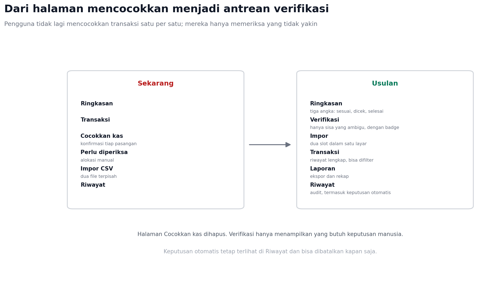

# Spesifikasi Implementasi Impor, Pencocokan, dan AI

**Catatan scope:** proposal MVP tidak memakai AI. Bagian Gemini di dokumen ini
adalah backlog post-MVP; demo hanya memakai aturan deterministik.

Dokumen ini adalah gambaran teknis sebelum implementasi penuh. Isinya
kontrak API, skema data, alur, batas AI, perubahan navigasi, dan urutan
pengerjaan.

Prakiraan bentuk file yang akan diunggah dan dasar pencocokan ada di
[PREDIKSI_UPLOAD.md](PREDIKSI_UPLOAD.md).

## 1. Keputusan yang sudah tetap

1. Format kanonik tetap tujuh kolom, tetapi hanya dipakai internal.
2. Layar impor punya dua slot: penjualan dan penerimaan. Salah satu boleh
   kosong.
3. Penjualan memakai template sederhana lima kolom; penerimaan mengikuti
   format bank atau marketplace dan dipetakan oleh adapter.
4. Halaman Cocokkan kas dihapus, diganti antrean Verifikasi.
5. Pasangan yang yakin disimpan otomatis; hanya yang ambigu masuk Verifikasi.
6. AI tidak mem-parsing angka atau tanggal, hanya memilih kolom dan kandidat.

## 2. Ruang lingkup

Termasuk:

- Unggah CSV dan XLSX melalui multipart.
- Normalisasi kolom dan nilai.
- Profil pemetaan tersimpan per sumber.
- Pencocokan deterministik dan simpan otomatis.
- Antrean verifikasi, keputusan massal, dan pembatalan.
- Gemini untuk kasus ambigu.

Tidak termasuk pada fase pertama:

- PDF dan screenshot.
- OCR struk.
- Multi-mata uang.
- Impor lintas workspace.

## 3. Arsitektur backend

```text
backend/internal/
├── imports/
│   ├── file.go        deteksi signature, batas ukuran, file sementara
│   ├── csv.go         parser CSV, delimiter, encoding
│   ├── xlsx.go        pembaca XLSX (Excelize)
│   ├── sheet.go       pemilihan sheet dan region tabel
│   ├── header.go      deteksi baris header dan alias kolom
│   ├── normalize.go   nominal, tanggal, kanal, duplikat
│   ├── profile.go     sidik jari dan profil tersimpan
│   └── preview.go     ringkasan, error per baris
├── matching/
│   ├── score.go       bobot sinyal dan ambang
│   ├── decide.go      auto, review, reject
│   └── apply.go       transaksi, audit, undo
├── ai/
│   ├── gateway.go     antarmuka provider
│   ├── gemini.go      implementasi Gemini
│   ├── schema.go      validasi keluaran
│   └── cache.go       hash kandidat
└── echohttp/
    └── imports_handler.go
```

Dependensi baru: `github.com/xuri/excelize/v2`. Tetap tanpa vendor; `go mod`
cukup. Parser CSV memakai `encoding/csv` yang sudah ada.

## 4. Status batch

```text
uploaded -> normalizing -> needs_fix
                       -> matching -> completed
                                  -> review_required -> completed
                       -> failed
```

| Status | Arti |
| --- | --- |
| uploaded | File diterima, belum diproses |
| normalizing | Kolom dan nilai sedang dipetakan |
| needs_fix | Ada baris yang tidak bisa dinormalkan |
| matching | Pencocokan berjalan |
| review_required | Ada pasangan ambigu |
| completed | Selesai atau disetujui |
| failed | Gagal sistem, tidak ada data tersimpan |

Worker memakai tabel `pblg_jobs` yang sudah ada. Satu job per unggahan.
Batch disimpan atomik: entri, pasangan, dan audit masuk dalam satu transaksi.

## 5. Kontrak API

### Unggah

```http
POST /api/v1/umkm/imports/files
Content-Type: multipart/form-data

file=@mutasi.xlsx
slot=penjualan|penerimaan
profile_id=opsional
```

```json
202 {"import_id":"imp_01","status":"uploaded","poll_after_ms":1500}
```

### Status

```http
GET /api/v1/umkm/imports/{id}
```

```json
{
  "status":"review_required",
  "progress":100,
  "source":{"format":"xlsx","sheet":"Mutasi","header_row":8},
  "counts":{"rows":92,"normalized":92,"auto_matched":87,"review":5,"errors":0},
  "mapping":[{"source":"Kredit","target":"nominal","status":"cocok"}],
  "warnings":[]
}
```

### Konversi pratinjau

```http
POST /api/v1/umkm/imports/convert
Content-Type: multipart/form-data
```

Respons berisi CSV kanonik, pemetaan, dan koreksi. Tidak menyimpan transaksi.

### Konfirmasi dan koreksi

```http
POST /api/v1/umkm/imports/{id}/mapping
POST /api/v1/umkm/imports/{id}/confirm
POST /api/v1/umkm/imports/{id}/cancel
POST /api/v1/umkm/imports/{id}/approve-all
POST /api/v1/umkm/imports/{id}/undo-auto
POST /api/v1/umkm/decisions/{id}/undo
GET  /api/v1/umkm/imports/{id}/errors.csv
```

Kode error: `400` validasi, `401` sesi, `403` CSRF atau role, `404` batch,
`409` batch sudah selesai atau sedang diproses, `413` file terlalu besar,
`422` file valid tetapi tidak ada tabel yang dikenali, `503` database atau
worker tidak tersedia.

## 6. Skema data

Migrasi baru `000006_import_pipeline`:

```sql
ALTER TABLE umkm_imports
  ADD COLUMN source_format text,
  ADD COLUMN slot text,
  ADD COLUMN status text NOT NULL DEFAULT 'completed',
  ADD COLUMN sheet_name text,
  ADD COLUMN header_row int,
  ADD COLUMN profile_id text,
  ADD COLUMN normalization jsonb,
  ADD COLUMN error_count int NOT NULL DEFAULT 0,
  ADD COLUMN matched_count int NOT NULL DEFAULT 0,
  ADD COLUMN auto_count int NOT NULL DEFAULT 0,
  ADD COLUMN completed_at timestamptz;

CREATE TABLE umkm_import_rows (
  id text PRIMARY KEY,
  import_id text NOT NULL REFERENCES umkm_imports(id) ON DELETE CASCADE,
  row_no int NOT NULL,
  raw jsonb NOT NULL,
  normalized jsonb,
  status text NOT NULL,
  errors jsonb
);

CREATE TABLE umkm_import_profiles (
  id text PRIMARY KEY,
  workspace_id text NOT NULL,
  name text NOT NULL,
  source_type text NOT NULL,
  fingerprint text NOT NULL,
  dialect jsonb NOT NULL,
  mapping jsonb NOT NULL,
  status text NOT NULL DEFAULT 'draft',
  version int NOT NULL DEFAULT 1,
  last_used_at timestamptz,
  created_at timestamptz NOT NULL DEFAULT now()
);

CREATE TABLE umkm_match_decisions (
  id text PRIMARY KEY,
  workspace_id text NOT NULL,
  import_id text REFERENCES umkm_imports(id),
  sale_id text NOT NULL,
  receipt_id text NOT NULL,
  score numeric(4,3) NOT NULL,
  band text NOT NULL,
  source text NOT NULL,
  signals jsonb NOT NULL,
  reason text,
  applied_at timestamptz NOT NULL DEFAULT now(),
  reversed_at timestamptz
);
```

Index: pasangan aktif unik per `sale_id` dan `receipt_id`, antrean verifikasi
per `(workspace_id, band, applied_at)`, dan `import_id` pada baris.

## 7. Normalisasi dan pemetaan

Urutan pemetaan: exact setelah normalisasi teks, kamus sinonim, fuzzy, lalu AI
bila masih ada kandidat lebih dari satu.

Alias penting:

| Target | Alias |
| --- | --- |
| tanggal | tanggal, tgl, tanggal transaksi, posting date, date |
| referensi | referensi, ref, no referensi, teller |
| nama | nama, keterangan, uraian, description, remarks |
| nominal | nominal, jumlah, amount, mutasi, kredit, masuk |
| kanal | kanal, channel, metode, tipe pembayaran |
| saldo | saldo, balance, saldo akhir |

Kolom saldo tidak pernah dipetakan ke nominal. Untuk bank dengan debit dan
kredit, hanya kredit yang menyentuh sisi penerimaan.

Aturan nilai:

- `Rp1.250.000` menjadi `1250000`.
- `1.250.000,00` menjadi `1250000`.
- `(500.000)` menjadi negatif dan wajib konfirmasi.
- Tanggal `dd/mm/yyyy`, `yyyy-mm-dd`, dan serial Excel diterima sesuai metadata.
- Kanal dinormalkan: `tf`, `trf`, `transfer` menjadi `transfer`.

Keyakinan ditampilkan tiga tingkat: cocok, perlu dicek, belum dipetakan. Jangan
tampilkan persentase sebelum ada data kalibrasi.

## 8. Pencocokan dan simpan otomatis

| Sinyal | Bobot |
| --- | --- |
| Referensi sama | 0,35 |
| Nominal sama | 0,25 |
| Kanal sama | 0,15 |
| Jarak tanggal | 0,15 |
| Kemiripan nama | 0,10 |

Ambang awal: simpan otomatis minimal 0,95; tinjau 0,60 sampai 0,95; di bawah
0,60 tidak dipasangkan.

Aturan yang memaksa tinjauan: selisih nominal di luar fee, kandidat ganda,
tanggal di luar jendela, referensi kosong, atau sisa negatif.

Setiap simpan otomatis menulis `umkm_match_decisions`, audit, dan event SSE
`state`. Pembatalan menandai `reversed_at` dan memulihkan sisa.

## 9. Integrasi Gemini

Kapan dipanggil:

1. Pemetaan kolom gagal aturan dan masih ada 2-3 kandidat target.
2. Pencocokan menyisakan kandidat dengan skor 0,60-0,95.

Payload yang dikirim hanya field yang diperlukan: tanggal, nominal, referensi,
kanal, nama yang sudah dipotong, dan daftar kandidat. Tanpa nomor rekening
lengkap dan tanpa data pelanggan lain.

```json
{
  "task":"pilih_pasangan",
  "kandidat":[{"sale_id":"S1","receipt_id":"R1","skor_aturan":0.72}]
}
```

Keluaran wajib:

```json
{"decisions":[{"sale_id":"S1","receipt_id":"R1","pilih":true,"alasan":"Nominal sama, beda satu hari"}]}
```

Validasi: id harus ada di kandidat, maksimal satu keputusan per pasangan,
`alasan` maksimal 200 karakter. Jawaban yang tidak valid dibuang dan pasangan
masuk Verifikasi.

Batas: timeout 8 detik, maksimal 20 kandidat per panggilan, suhu 0, cache
berdasarkan hash kandidat, dan kuota harian per workspace. Bila gagal, impor
tetap selesai tanpa AI.

Biaya indikatif seperti dokumen sebelumnya: sekitar 0,0015 dolar per panggilan,
di bawah Rp150 per impor.

## 10. Perubahan navigasi



Menu baru: Ringkasan, Verifikasi, Impor, Transaksi, Laporan, Riwayat,
Pengaturan. Halaman Cocokkan kas dihapus; tautan lama diarahkan ke Verifikasi.

Verifikasi hanya menampilkan:

- pasangan ambigu dengan alasan,
- baris gagal normalisasi,
- selisih yang tidak bisa dipasangkan.

Keputusan otomatis tidak muncul di sini; semuanya ada di Riwayat dan bisa
dibatalkan.

## 11. Panduan dan tutorial

Jangan mengajari pengguna mengubah Excel dengan alat lain. Itu menambah beban
dan cepat basi. Yang perlu dibuat:

1. Halaman “Cara mengunduh mutasi” per bank, berisi langkah resmi dan format
   yang dipilih (utamakan CSV atau XLSX).
2. Halaman “Cara mengunduh laporan marketplace” per marketplace, dengan
   peringatan beda antara settlement dan payout.
3. Template penjualan lima kolom yang bisa langsung diisi.
4. Fitur Bantu Rapikan di dalam aplikasi.
5. Tiga video 45-90 detik: impor mutasi, catat penjualan, selesaikan temuan.

## 12. Pengujian

- Unit: parser nominal, tanggal, kanal, dan header.
- Golden file: XLSX dan CSV asli dari bank dan marketplace yang sudah
  dianonimkan.
- Integrasi: unggah sampai commit, termasuk kegagalan di tengah.
- Keamanan: file terenkripsi, zip bomb, formula injection, path traversal.
- Idempotensi: unggah ulang file yang sama tidak menggandakan.
- Performa: 2.000 baris selesai di bawah 10 detik tanpa AI.
- Fallback: provider AI mati, alur tetap selesai.

## 13. Urutan pengerjaan

Estimasi ini memperhitungkan kode yang sudah ada: parser CSV, tabel impor,
audit, alokasi, pencocokan exact, SSE, dan test. Yang benar-benar baru adalah
multipart, pembaca XLSX, antrean job, profil pemetaan, skor, dan layar
Verifikasi.

| Fase | Isi | Dari nol | Dengan dasar sekarang |
| --- | --- | --- | --- |
| 1 | Migrasi, status batch, endpoint unggah dan status | 3 hari | 2 hari |
| 2 | Adapter CSV: delimiter, encoding, alias header | 3 hari | 2 hari |
| 3 | Adapter XLSX dan pemilihan sheet | 4 hari | 3-4 hari |
| 4 | Profil pemetaan dan pratinjau koreksi | 3 hari | 2-3 hari |
| 5 | Skor dan simpan otomatis | 4 hari | 3 hari |
| 6 | Gemini untuk ambigu | 3 hari | 2 hari |
| 7 | Frontend: dua slot, Verifikasi, Riwayat | 4 hari | 3-4 hari |
| | **Total** | **24 hari** | **17-20 hari** |

Kalau backend dan frontend dikerjakan paralel setelah kontrak API disepakati,
kalender sekitar 3 minggu. Satu orang mengerjakan semuanya sekitar 4 minggu
termasuk pengujian dan perbaikan.

Jalur tercepat untuk nilai terbesar: fase 1, 2, dan 5 lebih dulu. Itu sudah
memberi unggah CSV, pencocokan skor, dan simpan otomatis tanpa XLSX dan AI,
sekitar 7-8 hari, dan sudah menghapus sebagian besar klik manual.

Risiko jadwal terbesar bukan kode, tetapi file nyata. Tanpa salinan anonim dari
bank dan marketplace, adapter XLSX akan butuh 2-3 hari tambahan untuk iterasi.


## 14. Keputusan yang masih terbuka

1. Batas baris: 500 atau 2.000.
2. Ambang auto-apply: 0,95 atau lebih konservatif.
3. Sumber kas resmi untuk marketplace: settlement atau mutasi bank.
4. Apakah PDF masuk fase 2 atau ditunda sampai ada file nyata.
5. Siapa yang boleh membatalkan keputusan otomatis.

## 15. Status implementasi

Yang sudah masuk ke kode:

- Skor pencocokan deterministik dengan bobot referensi, nominal, kanal,
  tanggal, dan nama (`internal/service/auto_match.go`).
- Simpan otomatis setelah impor untuk pasangan yang skornya minimal ambang dan
  tidak ambigu di kedua sisi. Respons impor memuat `auto_matched`.
- Endpoint impor toleran header: `POST /api/v1/umkm/imports/flexible`, menerima
  delimiter koma, titik koma, atau tab; nominal `Rp1.250.000`; tanggal
  `dd/mm/yyyy`; dan nama kolom sehari-hari.
- Klien Gemini di `internal/ai` dengan validasi ID kandidat dan pembatasan
  panjang alasan. Kini dipanggil untuk pasangan skor 0,60-0,95 dengan ambang
  tambahan AI_MIN_SCORE (default 0,90); hasilnya tercatat sebagai
  "Disarankan AI" dan dihitung di ai_matched.

Konfigurasi baru:

```text
MATCH_AUTO_APPLY=true
MATCH_AUTO_THRESHOLD=0.95
GEMINI_API_KEY=
GEMINI_MODEL=gemini-2.5-flash
GEMINI_BASE_URL=https://generativelanguage.googleapis.com/v1beta
GEMINI_TIMEOUT=8s
```

Belum dikerjakan: unggah multipart XLSX, antrean job dan status batch, profil
pemetaan tersimpan, layar Verifikasi, dan pemanggilan Gemini dari alur impor.


## 16. Risiko utama

| Risiko | Mitigasi |
| --- | --- |
| Saldo bank terbaca sebagai transaksi | Kolom saldo diblokir, validasi saldo berjalan |
| AI memilih pasangan salah | Kandidat tertutup, validasi ID, ambang aturan |
| Dokumen bank berubah format | Profil berbasis header, uji file nyata |
| File besar menghabiskan memori | Batas dekompresi, streaming, worker terpisah |
| Pengguna bingung dua slot | Satu layar, slot opsional, status jelas |

