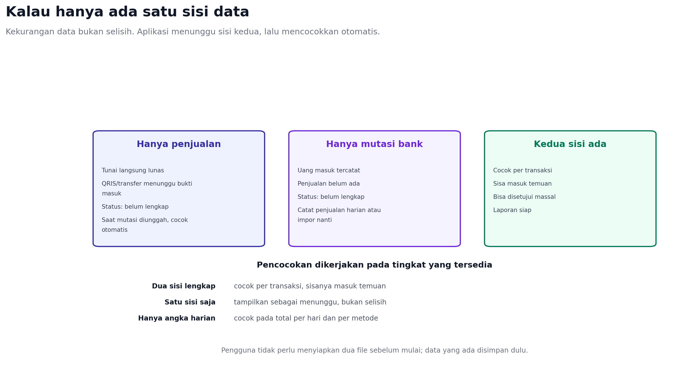

# Jenis File yang Bisa Diunggah

Dokumen ini menjawab satu pertanyaan: apa saja yang sebenarnya diunggah
pengguna. Kondisi sekarang hanya menerima dua jenis file, satu penjualan dan
satu penerimaan, keduanya CSV tujuh kolom.

## Kondisi sekarang

| Aspek | Kondisi |
| --- | --- |
| Jenis | Hanya `sale` (penjualan) dan `receipt` (penerimaan) |
| Jumlah file | Satu file per jenis, diunggah terpisah |
| Format | CSV tujuh kolom, UTF-8, maksimal 500 baris dan 1 MB |
| Excel | Belum didukung; file biner ditolak |
| Deteksi jenis | Pengguna memilih sendiri lewat dropdown |

Pembatasan ini masuk akal untuk versi pertama, tetapi bukan cara berpikir
pemilik usaha. Banyak yang hanya punya satu file: rekap kasir, mutasi bank,
atau pencairan marketplace. Memaksa dua file membuat pekerjaan terasa berat.

## Jenis unggahan yang disarankan

| Jenis | Isi | Arah | Contoh sumber |
| --- | --- | --- | --- |
| Rekap penjualan | Satu baris per pesanan atau rekap harian | Penjualan | Kasir, POS, Excel manual |
| Rekap penerimaan | Uang yang benar-benar masuk | Penerimaan | Mutasi bank, QRIS, e-wallet |
| Gabungan | Satu file berisi penjualan dan penerimaan sekaligus | Keduanya | Rekap internal, ekspor aplikasi lain |
| Pencairan marketplace | Satu baris per pencairan, berisi potongan fee | Penerimaan | Shopee, Tokopedia, TikTok Shop |
| Mutasi bank | Kolom debit, kredit, saldo | Penerimaan | BCA, Mandiri, BRI, dan sejenisnya |
| Tanpa file | Angka harian: tunai, QRIS, marketplace | Penjualan dan penerimaan | Pemilik yang mencatat manual |

## Aturan deteksi

Sistem menentukan jenis secara berurutan, dan hanya bertanya bila ragu:

1. Ada kolom `jenis` dengan nilai penjualan/penerimaan/sale/receipt, maka file
   gabungan dan dipecah per baris.
2. Ada kolom `debit` dan `kredit`, maka file mutasi bank dan seluruh baris
   dianggap penerimaan; aturan tanda menentukan nominal.
3. Nama file atau sheet mengandung penjualan, sales, pesanan, order, maka
   penjualan.
4. Nama file atau sheet mengandung mutasi, rekening, statement, settlement,
   payout, maka penerimaan.
5. Tidak ada petunjuk yang kuat, tampilkan pilihan dua tombol dengan pratinjau
   lima baris pertama.

Pengguna tetap boleh mengganti hasil deteksi sebelum menyimpan.

## Bentuk ekspor bank yang umum

Mutasi bank paling sering berupa Excel atau CSV, tetapi bentuknya bergantung
pada bank dan kanal ekspornya.

| Bentuk | Seberapa umum | Catatan |
| --- | --- | --- |
| XLSX dari internet banking | Paling umum | Bisa ada beberapa baris info rekening di atas tabel |
| CSV dari internet banking | Umum | Delimiter koma atau titik koma, encoding kadang Windows-1252 |
| PDF e-statement | Umum untuk laporan bulanan | Perlu OCR atau parser khusus; rawan salah baca |
| Screenshot dari mobile banking | Sering | Belum didukung; minta ekspor resmi |
| Cetak/salin tempel ke Excel | Sering | Header dan format angka tidak konsisten |

Bentuk kolomnya juga berbeda antar bank:

- Debit dan kredit terpisah, ditambah saldo berjalan.
- Satu kolom nominal dengan penanda `DB`/`CR` atau tanda minus.
- Hanya kolom keterangan tanpa referensi, sehingga pencocokan bergantung pada
  nominal dan tanggal.
- Tanggal transaksi dan tanggal valuta terpisah, dengan header tabel dimulai
  di baris ke-5 sampai ke-10.

Karena itu adapter bank harus memetakan kolom berdasarkan nama header, bukan
posisi, mengabaikan kolom saldo, dan memakai aturan tanda untuk debit/kredit.
Format PDF dan screenshot sebaiknya ditolak dengan pesan yang mengarahkan ke
ekspor Excel atau CSV, sampai ada parser khusus yang diuji.

## Perubahan kontrak

- `kind` pada unggahan menjadi opsional.
- File boleh berisi kolom `jenis` untuk mode gabungan.
- Respons pratinjau menyebut jenis yang terdeteksi dan alasan singkatnya.
- Endpoint lama tetap menerima `kind` wajib agar frontend sekarang tidak rusak.

```json
{
  "detected_kind": "mixed",
  "reason": "Kolom jenis berisi penjualan dan penerimaan",
  "counts": {"sale": 42, "receipt": 38},
  "confirm_required": false
}
```

## Kalau hanya ada satu file



Dua sisi hanya dibutuhkan untuk mencocokkan per transaksi. Satu file tetap
berguna dan tidak boleh ditolak.

| Yang diunggah | Yang terjadi | Status yang ditampilkan |
| --- | --- | --- |
| Hanya penjualan | Tunai lunas; QRIS/transfer menunggu bukti | Belum lengkap |
| Hanya mutasi bank | Uang masuk tercatat; penjualan belum ada | Belum lengkap |
| Hanya angka harian | Dicocokkan pada total per hari dan metode | Tergantung selisih |
| Keduanya | Cocok per transaksi, sisa masuk temuan | Selesai atau perlu dicek |

Aturan penting:

- Kekurangan data tidak boleh disebut selisih. Pakai label “belum ada catatan
  penjualan” atau “menunggu bukti masuk”.
- Saat sisi kedua diunggah, pencocokan berjalan surut terhadap data lama, bukan
  hanya data baru.
- Penjualan tunai tidak membutuhkan pasangan, jadi tidak pernah menunggu.
- Jika pengguna hanya punya total harian, pencocokan dilakukan pada tingkat
  total per hari dan per metode, bukan per transaksi.
- Semua data satu sisi disimpan; tidak ada yang dibuang karena menunggu.


## Yang tidak perlu diunggah

- Screenshot atau foto struk. Belum ada OCR, dan hasilnya rawan salah.
- File terenkripsi kata sandi. Minta pengguna membuka proteksi lebih dulu.
- File `.xls` lama. Arahkan menyimpan ulang sebagai `.xlsx`.
- Workbook dengan banyak sheet tanpa memilih sheet. Sistem menanyakan sheet
  mana yang dipakai.
- Data pelanggan lengkap bila hanya butuh nama dan referensi.

## Dampak ke layar impor

Satu tombol unggah, bukan dua alur terpisah:

```text
[ Unggah file ]

  Terdeteksi: Rekap penjualan (42 baris)
  [ Ganti jenis ]   [ Lanjut ]
```

Jika file berisi keduanya, ringkasan menampilkan dua angka dan tidak meminta
pengguna memisahkan file sendiri.

## Urutan implementasi

1. Terima satu file dengan kolom `jenis` dan pecah otomatis.
2. Deteksi dari nama file dan header untuk dua jenis yang sudah ada.
3. Tambah adapter mutasi bank dengan aturan debit/kredit.
4. Tambah adapter pencairan marketplace dengan fee.
5. Tambah catat harian tanpa file sebagai jalur utama.

Langkah 1 dan 2 sudah menghapus kebutuhan mengunggah dua file saat datanya
sebenarnya satu.

