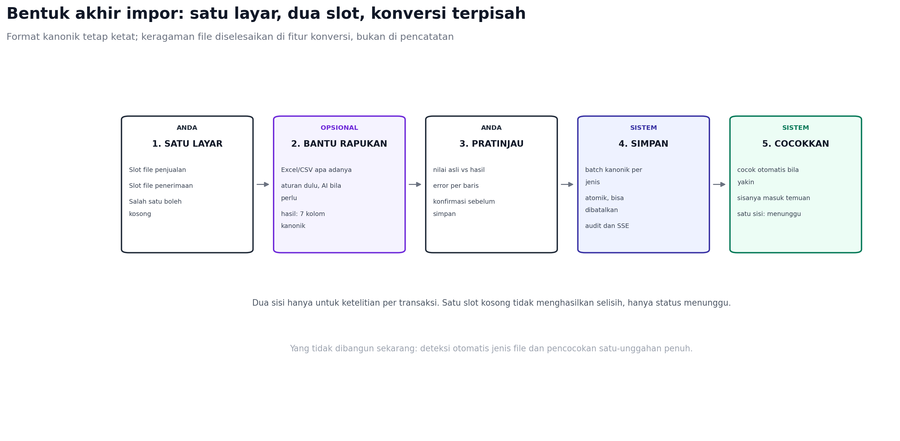

# Keputusan Akhir: Bentuk Impor yang Dibangun

Dokumen ini menetapkan satu keputusan agar tidak ada lagi perdebatan arah.



## Keputusan

1. Format kanonik tetap ketat: tujuh kolom, satu berkas untuk penjualan dan
   satu untuk penerimaan, dengan jenis yang sudah diketahui dari slotnya.
2. Layarnya satu. Pengguna melihat dua slot dalam satu halaman: penjualan dan
   penerimaan. Salah satu boleh kosong.
3. Keragaman file diselesaikan fitur terpisah bernama Bantu Rapikan, bukan di
   jalur pencatatan.
4. Deteksi otomatis jenis file tidak dibangun sekarang.
5. Pencocokan otomatis hanya untuk pasangan yang yakin; sisanya masuk temuan.

## Kenapa bukan satu unggahan pintar

Ide satu unggahan yang menebak jenis file terdengar lebih mudah bagi pengguna,
tetapi memindahkan seluruh keragaman Excel ke jalur utama. Setiap tambalan
pada deteksi langsung memengaruhi data keuangan. Untuk proyek ini, risikonya
tidak sepadan.

Dua slot membuat jenis data eksplisit sejak awal. Tidak ada tebakan, tidak ada
baris campur, dan pengujian jauh lebih sederhana. Pengguna tetap melihat satu
layar, bukan dua alur terpisah.

## Alur

```text
Layar Impor
  [ File penjualan ]   (opsional)
  [ File penerimaan ]  (opsional)
        |
        v
  Bantu Rapikan (opsional, bila file belum sesuai format)
        |
        v
  Pratinjau: nilai asli, hasil, error per baris
        |
        v
  Simpan batch kanonik
        |
        v
  Pencocokan otomatis dan antrean temuan
```

## Kontrak yang tidak berubah

```http
POST /api/v1/umkm/imports/preview
POST /api/v1/umkm/imports
```

Keduanya tetap menerima `kind` dan string CSV tujuh kolom. Frontend sekarang
tidak perlu diubah untuk memakai alur ini.

Perubahan hanya ditambahkan, bukan mengganti:

```http
POST /api/v1/umkm/imports/convert   (multipart file, kind)
```

Respons konversi berisi CSV kanonik, ringkasan, dan daftar koreksi. Pengguna
menyetujui, lalu frontend memanggil endpoint lama.

## Bantu Rapikan

| Lapisan | Tugas |
| --- | --- |
| Deteksi file | Signature file, bukan ekstensi; tolak file terenkripsi atau rusak |
| Pilih sheet | Jika lebih dari satu sheet berisi data, minta pengguna memilih |
| Deteksi header | Cari baris header dalam 30 baris pertama |
| Pemetaan kolom | Exact, sinonim, lalu fuzzy; AI hanya bila masih ragu |
| Normalisasi nilai | Rp, titik, koma, tanggal, kanal |
| Pratinjau | Tampilkan nilai asli dan hasil untuk setiap kolom |
| Keluaran | CSV tujuh kolom, siap dikirim ke endpoint lama |

Aturan penting: konversi tidak pernah langsung menyimpan transaksi. Selalu ada
pratinjau dan tombol setuju. File asli disimpan sementara lalu dihapus.

AI dipakai hanya untuk memilih kolom saat aturan gagal, dengan daftar kandidat
tertutup. Parsing nilai tetap deterministik.

## Edge case yang ditangani di mana

| Kasus | Tempat penanganan |
| --- | --- |
| Excel, CSV titik koma, encoding lain | Bantu Rapikan |
| Header di baris ke-5, banyak sheet | Bantu Rapikan |
| Nominal Rp1.250.000 atau (500.000) | Bantu Rapikan, dengan konfirmasi |
| File terenkripsi, rusak, zip bomb | Ditolak sebelum parsing |
| Baris error | Pratinjau, bisa diunduh |
| Hanya satu slot terisi | Bukan error; status menunggu |

## Yang tidak dibangun sekarang

- Deteksi otomatis jenis file pada satu unggahan.
- Pencocokan langsung dari file mentah tanpa format kanonik.
- PDF dan screenshot.
- Impor multi-sheet sekaligus tanpa pemilihan.

## Urutan implementasi

| Langkah | Isi | Estimasi |
| --- | --- | --- |
1 | Layar dua slot, memakai endpoint lama | 1-2 hari |
2 | Bantu Rapikan untuk CSV (delimiter, encoding, header) | 3-4 hari |
3 | Adapter XLSX dengan Excelize | 3-4 hari |
4 | Pratinjau koreksi per baris dan unduh error | 2-3 hari |
5 | AI pemetaan kolom untuk file yang tidak dikenali | 2-3 hari |
6 | Simpan otomatis pasangan yang yakin | 3-4 hari |

Langkah 1 bisa dirilis tanpa menunggu apa pun. Langkah 2 dan 3 menghapus
kebutuhan konversi manual. AI baru masuk di langkah 5.

## Kriteria selesai

- Pengguna bisa mengunggah satu atau dua file dalam satu layar.
- File Excel umum Indonesia lolos setelah pratinjau, tanpa konversi manual.
- Tidak ada transaksi tersimpan tanpa persetujuan pada pratinjau.
- Hanya satu slot terisi menghasilkan status menunggu, bukan selisih.
- Pasangan yakin tersimpan otomatis dengan audit dan tombol batal.

