# Panduan Pengguna EFA — Catatan dari Sudut Pandang Pemilik Usaha

Tanggal pengamatan: 2 November 2026

Frontend: `https://efa.madgo.my.id/app`

Akun yang dipakai: workspace demo `Roti Sore (Demo)`
Mode pengujian: read-only; preview impor tidak disimpan, modal tidak di-submit,
dan tidak ada data demo yang saya ubah.

Batasan pengujian: saya tidak membuat akun baru, tidak menyimpan alokasi, tidak
commit batch impor, tidak mengganti kata sandi, dan tidak memasang PWA. Flow
tulis dinilai dari formulir/modal serta test backend terpisah; flow baca dan
navigasi dinilai langsung di browser.

Dokumen ini bukan spesifikasi teknis. Ini catatan seorang pengguna yang ingin
menutup kas harian: apa yang saya pikirkan, apa yang saya lakukan, bagian mana
yang membantu, dan bagian mana yang masih membingungkan. Bagian akhir berisi
usulan alur panduan yang bisa dipakai untuk onboarding pengguna baru.

## 1. Gambaran pengalaman

EFA terasa seperti alat pemeriksaan kas, bukan aplikasi akuntansi lengkap. Saya
masuk ke satu workspace, melihat uang yang tercatat, mencari transaksi yang belum
cocok, lalu menyimpan keputusan. Kalimat "Cocokkan penjualan dengan uang yang
masuk" dan "Sisa tagihan bukan kehilangan uang" penting karena sejak awal saya
diingatkan bahwa selisih belum tentu berarti pelanggan belum membayar.

Pada data demo, ringkasan memperlihatkan 5 penjualan, 4 penerimaan, dan belum ada
pasangan yang selesai. Antrean selisih berisi 9 kartu. Ini konsisten dengan
penjelasan bahwa penjualan dan penerimaan dihitung sebagai dua sisi terpisah.

## 2. Peta fitur

| Fitur | Tujuan pengguna | Kondisi saat dicoba |
| --- | --- | --- |
| Masuk/Daftar | Membuka workspace usaha | Berhasil masuk dengan akun demo |
| Ringkasan | Melihat kondisi kas hari ini | Menampilkan total, sisa tagihan, penerimaan per kanal, dan tombol cocokkan |
| Transaksi | Mencari dan memeriksa seluruh catatan | Pencarian `INV-102` menyisakan 2 dari 10 transaksi; tabel memiliki filter dan pagination |
| Cocokkan kas | Melihat usulan pasangan unik | Menampilkan satu usulan INV-102; modal pasangan dapat dibuka |
| Perlu diperiksa | Menangani sisa dan kandidat ambigu | Menampilkan 9 kartu; filter status tersedia; pasangan unik muncul di dua sisi |
| Impor CSV | Memasukkan data penjualan/penerimaan | Contoh CSV dapat diunggah; preview menunjukkan 0 baris baru dan 5 baris identik dilewati |
| Riwayat | Melacak siapa melakukan apa | Menampilkan 9 aktivitas; tabel memiliki kolom "Terkait" |
| Laporan | Melihat rekap dan mengunduh CSV | Ringkasan tampil; ekspor `umkm-rekap.csv` berhasil diunduh |
| Pengaturan | Melihat akun, mengganti kata sandi, memasang PWA | Informasi akun, batas ruang kerja, dan modal kata sandi tampil |
| Navigasi mobile | Mengakses fitur dari HP | Menu berubah menjadi tombol Menu; tabel tetap dapat digeser |

## 3. Cerita penggunaan per fitur

### 3.1 Masuk dan orientasi

Saya membuka `#login`, mengisi email dan kata sandi, lalu menekan **Masuk**.
Setelah berhasil, saya langsung dibawa ke **Ringkasan** workspace, bukan ke
halaman kosong. Header menunjukkan nama usaha, peran "Pemilik usaha", dan status
"Data terhubung". Ini membuat saya tahu akun dan ruang kerja yang sedang dibuka.

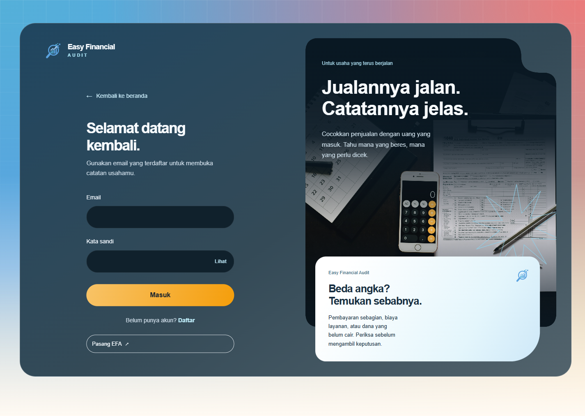

*Gambar 1. Halaman masuk dengan penjelasan singkat produk di samping form.*

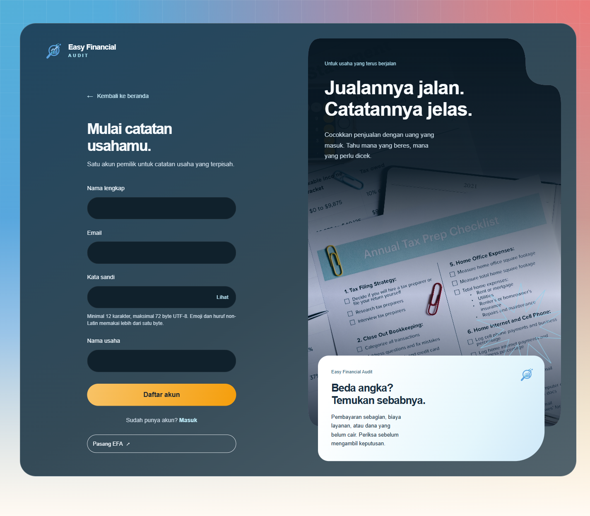

*Gambar 2. Halaman daftar: nama, email, kata sandi, dan nama usaha.*

**Langkah pengguna:**

1. Buka halaman aplikasi.
2. Isi email pemilik dan kata sandi.
3. Tekan **Masuk**.
4. Periksa nama usaha dan status koneksi di bagian atas.

**Catatan UX:** status koneksi berguna, tetapi saya tidak menemukan tombol
"lupa kata sandi". Untuk pengguna baru, petunjuk bahwa satu akun adalah satu
workspace sudah terlihat pada halaman daftar. Form daftar juga menjelaskan batas
kata sandi 12 karakter dan 72 byte UTF-8.

### 3.2 Ringkasan: "Apakah kas hari ini sudah jelas?"

Ringkasan menjawab pertanyaan pertama saya: berapa yang tercatat, berapa yang
sudah masuk, dan berapa yang masih perlu dicocokkan. Angka besar di kartu
pertama terasa sebagai fokus utama, sementara daftar "Perlu dicocokkan"
langsung menawarkan transaksi yang bisa saya buka.

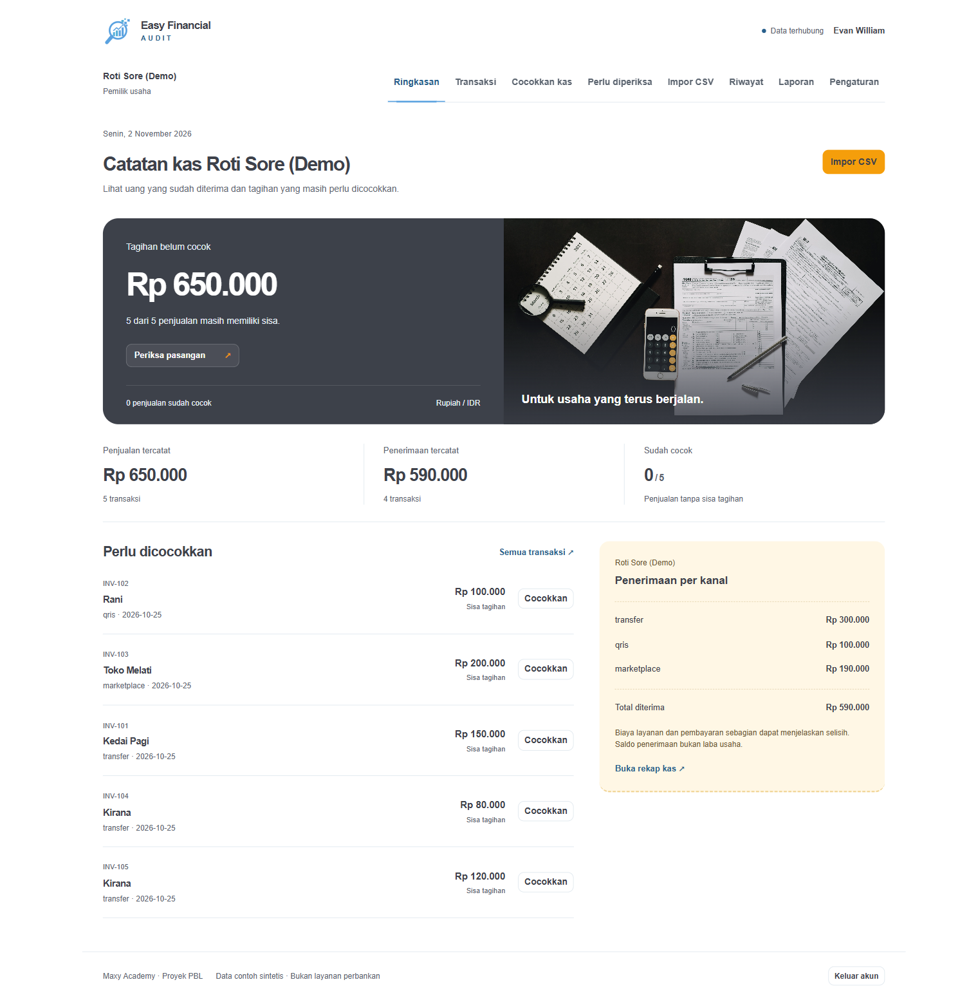

*Gambar 3. Ringkasan workspace demo: total penjualan, penerimaan, sisa tagihan,
dan daftar transaksi yang perlu dicocokkan.*

**Langkah pengguna:**

1. Buka **Ringkasan**.
2. Baca total penjualan, penerimaan, dan bagian "Sudah cocok".
3. Gunakan **Periksa pasangan** untuk masuk ke area pencocokan.
4. Gunakan tombol **Cocokkan** pada item tertentu, atau **Semua transaksi**
   untuk melihat daftar lengkap.

**Catatan UX:** istilah "Tagihan belum cocok" dan "Sisa tagihan" sudah
dijelaskan sebagai bukan kerugian, tetapi pemilik usaha tetap perlu memahami
bahwa total penerimaan bukan laba. Penjelasan ini sudah ada di panel kanal;
pertahankan pada semua tampilan yang menampilkan angka besar.

### 3.3 Transaksi: mencari jejak transaksi

Saya membuka **Transaksi** dan mencari `INV-102`. Hasilnya dua baris: satu
penjualan dan satu penerimaan dengan referensi yang sama. Saya juga dapat
memfilter Penjualan/Penerimaan/Dibatalkan dan memilih 20, 50, atau 100 baris.
Tabel menampilkan referensi, nama, jenis, nominal, sisa, dan status.

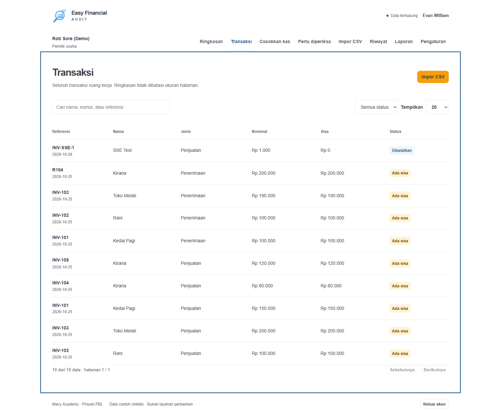

*Gambar 4. Transaksi dengan pencarian, filter status, pagination, dan kolom sisa.*

**Langkah pengguna:**

1. Buka **Transaksi**.
2. Ketik referensi, nama, atau nomor transaksi pada kolom pencarian.
3. Pilih **Filter status** bila hanya ingin melihat satu jenis data.
4. Gunakan pagination di bawah tabel untuk melihat data berikutnya.

**Catatan UX:** baris tabel tidak memiliki tombol tindakan langsung. Untuk
menindaklanjuti transaksi, saya harus pindah ke **Cocokkan kas** atau **Perlu
diperiksa**. Ini masih bisa dipahami, tetapi tombol kecil "Tindak lanjuti" di
baris yang memiliki sisa akan mengurangi perpindahan halaman.

### 3.4 Cocokkan kas: melihat usulan sebelum mengambil keputusan

Halaman **Cocokkan kas** menampilkan pasangan yang diusulkan beserta alasannya.
Pada data demo, pasangan INV-102 muncul dengan keterangan bahwa referensi, kanal,
dan nominal sama serta hanya ada satu kandidat di kedua sisi. Saya dapat menekan
**Periksa pasangan** untuk membuka modal.

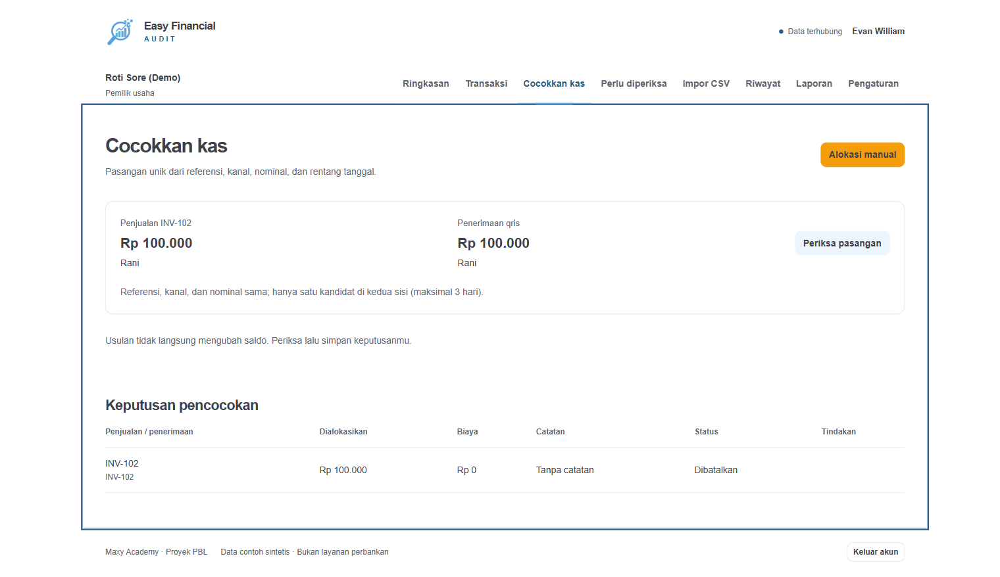

*Gambar 5. Satu usulan pasangan unik beserta alasan dan tombol pemeriksaan.*

Di modal, penjualan dan penerimaan sudah terpilih, nominal dan biaya dapat
diubah, dan ada ringkasan sisa tagihan. Tombol **Simpan pasangan** adalah
keputusan yang mengubah saldo; sebelum menekannya, saya bisa menutup modal
tanpa menyimpan.

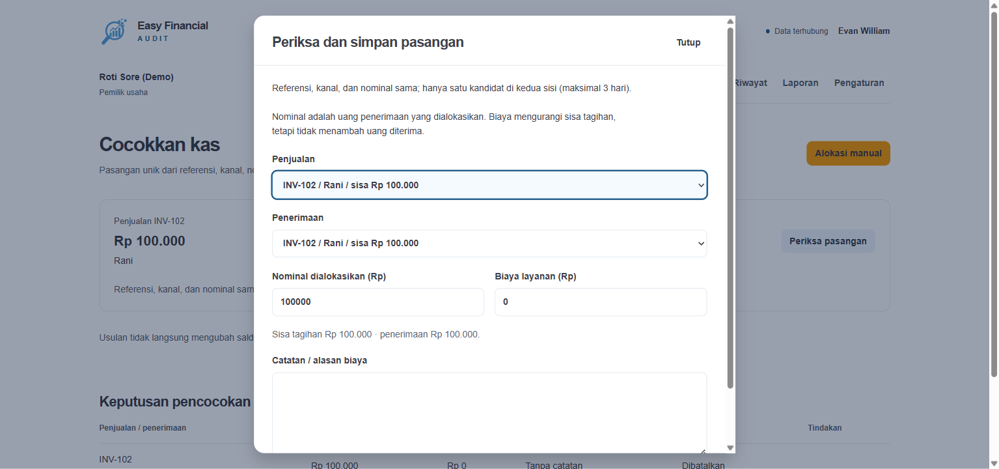

*Gambar 6. Modal konfirmasi pasangan: pemilihan penjualan/penerimaan, nominal,
biaya, catatan, dan tombol simpan.*

**Langkah pengguna:**

1. Buka **Cocokkan kas**.
2. Baca alasan pada kartu usulan.
3. Tekan **Periksa pasangan**.
4. Pastikan penjualan, penerimaan, nominal, dan biaya sudah benar.
5. Isi catatan bila ada biaya layanan.
6. Tekan **Simpan pasangan** hanya setelah yakin.

**Catatan UX:** alasan usulan sangat membantu. Namun, istilah "hanya satu
kandidat di kedua sisi" masih teknis. Untuk pemilik usaha, kalimat seperti
"hanya ada satu penerimaan yang cocok dengan pesanan ini" lebih mudah dipahami.

### 3.5 Perlu diperiksa: antrean yang harus dibereskan

Ini halaman yang paling terasa seperti daftar pekerjaan. Setiap kartu
menjelaskan apakah yang terlihat adalah penjualan atau penerimaan, berapa sisa
tagihannya, mengapa transaksi masuk antrean, dan berapa kandidat yang ditemukan.
Saya dapat memfilter **Belum cocok**, **Masih ada sisa**, atau **Kandidat perlu
dipilih**.

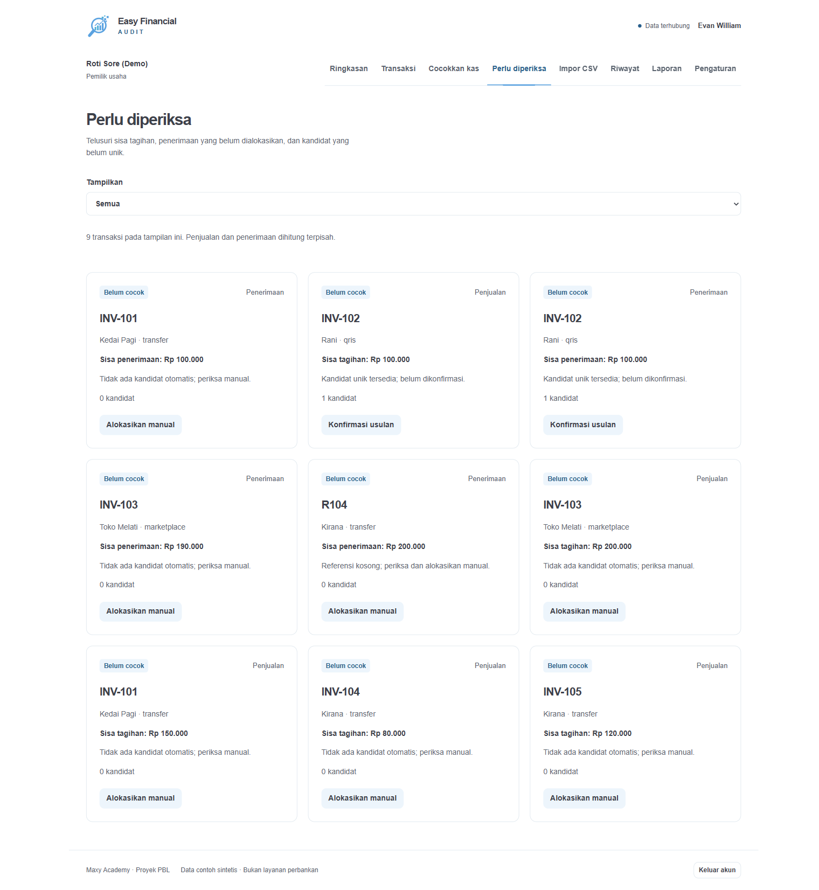

*Gambar 7. Antrean selisih. Satu pasangan unik INV-102 muncul sebagai dua kartu
karena penjualan dan penerimaan adalah dua sisi data.*

Pada data demo, pasangan INV-102 muncul dua kali: satu kartu untuk penjualan dan
satu kartu untuk penerimaan. Masing-masing memiliki tombol **Konfirmasi
usulan**. Ini bisa membingungkan karena saya sempat mengira ada dua transaksi
yang harus diselesaikan. Kenyataannya, keduanya adalah dua sisi dari satu
pasangan. Sebaiknya antrean menjelaskan: "Pasangan ini muncul di kedua sisi;
menyimpan sekali akan menyelesaikan keduanya."

**Langkah pengguna:**

1. Buka **Perlu diperiksa**.
2. Pilih filter sesuai pekerjaan yang ingin dibereskan.
3. Baca label penjualan/penerimaan, sisa, dan alasan.
4. Bila ada **Konfirmasi usulan**, periksa pasangan sebelum menyimpan.
5. Bila tidak ada kandidat, tekan **Alokasikan manual** dan pilih sisi lawan
   yang benar.

**Catatan UX:** kartu belum memperlihatkan nama/referensi kandidat lawan.
Menampilkan ringkasan kandidat di kartu akan menghemat satu klik dan mengurangi
rasa "kok saya harus memilih apa?". Untuk data lama, label **Catatan historis**
juga membantu menjelaskan mengapa tidak ada tautan entitas.

### 3.6 Impor CSV: menyiapkan data dengan aman

Halaman **Impor CSV** menyediakan contoh file penjualan dan penerimaan, batas
500 baris/1.048.576 byte, serta riwayat batch. Saya membuka modal, memilih file
contoh penjualan, lalu menekan **Periksa CSV**. Hasilnya: 0 baris baru, total
Rp 0, dan 5 baris identik dilewati; tidak ada batch baru karena tidak ada data
yang disimpan. Ini memberi rasa aman karena preview tidak mengubah saldo.

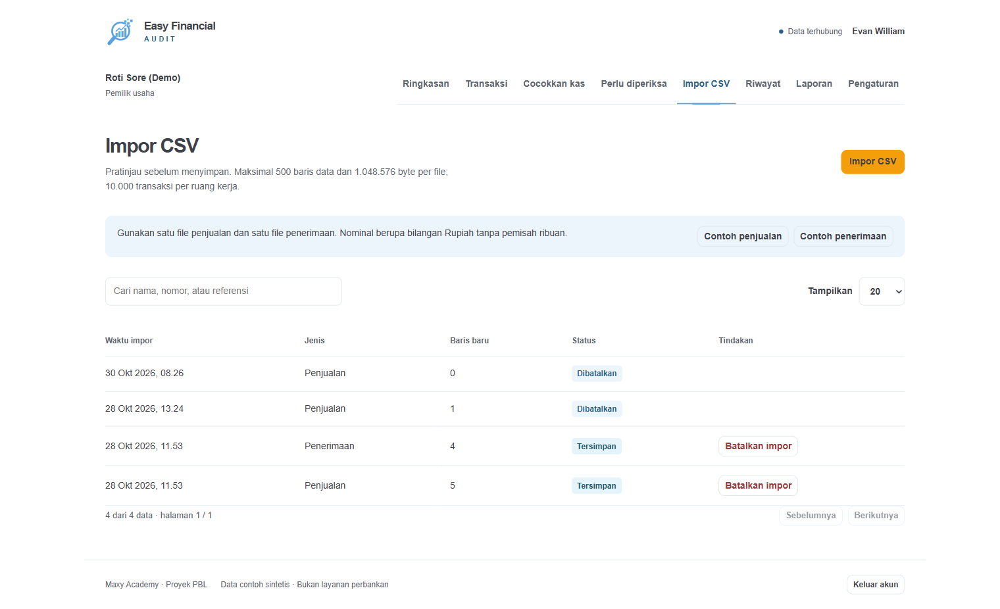

*Gambar 8. Halaman impor dan riwayat batch sebelum modal upload dibuka.*

**Langkah pengguna:**

1. Unduh **Contoh penjualan** dan **Contoh penerimaan** bila belum punya file.
2. Buka **Impor CSV** lalu pilih jenis transaksi.
3. Pilih file CSV UTF-8.
4. Tekan **Periksa CSV** dan baca jumlah baris baru serta baris yang dilewati.
5. Bila yakin, simpan batch; bila belum, tutup modal dan isian akan meminta
   konfirmasi untuk dibuang.

**Catatan UX:** preview duplikat sangat jelas. Namun, pengguna yang baru pertama
kali mungkin belum tahu format kolom sebelum mengunduh contoh. Tambahkan ringkasan
tujuh kolom (`id,tanggal,referensi,nama,nominal,kanal,catatan`) langsung di modal.

### 3.7 Riwayat: siapa mengubah apa

Halaman **Riwayat** menampilkan 9 aktivitas demo. Kolom **Terkait** berisi
"Catatan historis" untuk data lama karena record tersebut belum memiliki entity
link. Ini konsisten dengan kondisi data lama, tetapi pengguna baru bisa mengira
tautan ke detail transaksi tidak tersedia. Untuk event baru, kolom tersebut
seharusnya menjadi pintu masuk ke import atau allocation terkait.

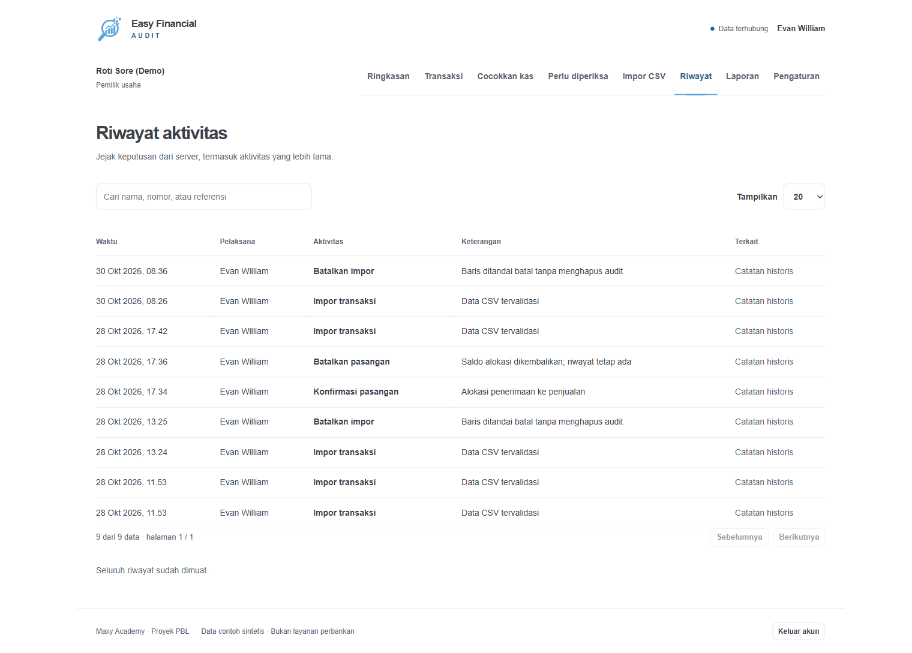

*Gambar 9. Riwayat aktivitas server dengan kolom Terkait; data lama memakai
label Catatan historis.*

**Langkah pengguna:**

1. Buka **Riwayat**.
2. Cari nama pelaksana, aktivitas, atau keterangan.
3. Gunakan kolom **Terkait** bila tersedia untuk membuka detail sumber.
4. Gunakan pagination bila riwayat bertambah panjang.

**Catatan UX:** tabel riwayat sudah memakai seluruh data server, bukan hanya
120 event dashboard. Ini perbaikan yang penting. Label **Catatan historis** masih
terlalu samar; tooltip seperti "event lama belum memiliki tautan entitas" akan
lebih menjelaskan.

### 3.8 Laporan: rekap dan ekspor

Halaman **Laporan** memberi ringkasan penjualan, penerimaan, sisa tagihan, dan
pasangan aktif. Tombol **Unduh rekap CSV** berhasil mengunduh `umkm-rekap.csv`
dengan header kolom yang jelas: id, jenis, tanggal, referensi, nama, nominal,
sisa, kanal, status, catatan.

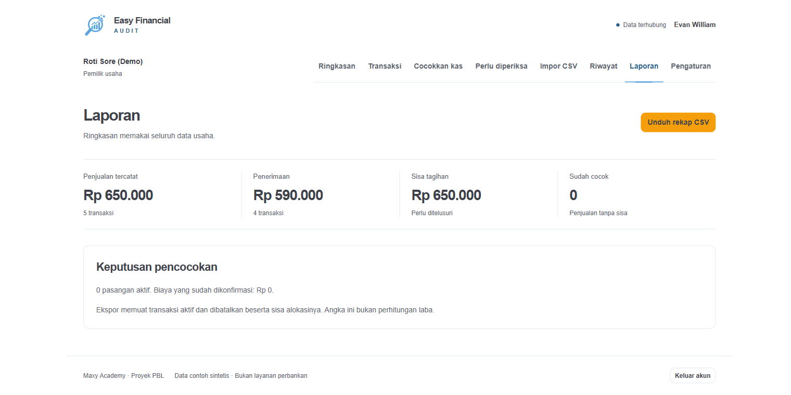

*Gambar 10. Ringkasan laporan dan tombol ekspor rekap CSV.*

**Langkah pengguna:**

1. Buka **Laporan**.
2. Baca ringkasan dan catatan "bukan perhitungan laba".
3. Tekan **Unduh rekap CSV**.
4. Buka file di spreadsheet dan periksa status/sisa per transaksi.

**Catatan UX:** angka "Sisa tagihan Rp 650.000" dapat disalahartikan sebagai
uang yang hilang. Label tambahan "nilai penjualan yang belum memiliki pasangan"
akan lebih tepat. Laporan juga belum memiliki filter periode atau ringkasan per
kanal di halaman ini; angka per kanal hanya terlihat di Ringkasan.

### 3.9 Pengaturan: akun dan batas penggunaan

Halaman **Pengaturan akun** menampilkan email, peran, workspace, penyimpanan,
batas impor, tombol ganti kata sandi, keluar, dan pasang EFA. Modal ganti kata
sandi meminta kata sandi lama dan baru serta menjelaskan bahwa semua sesi akan
berakhir. Saya membuka modal tanpa mengirim perubahan.

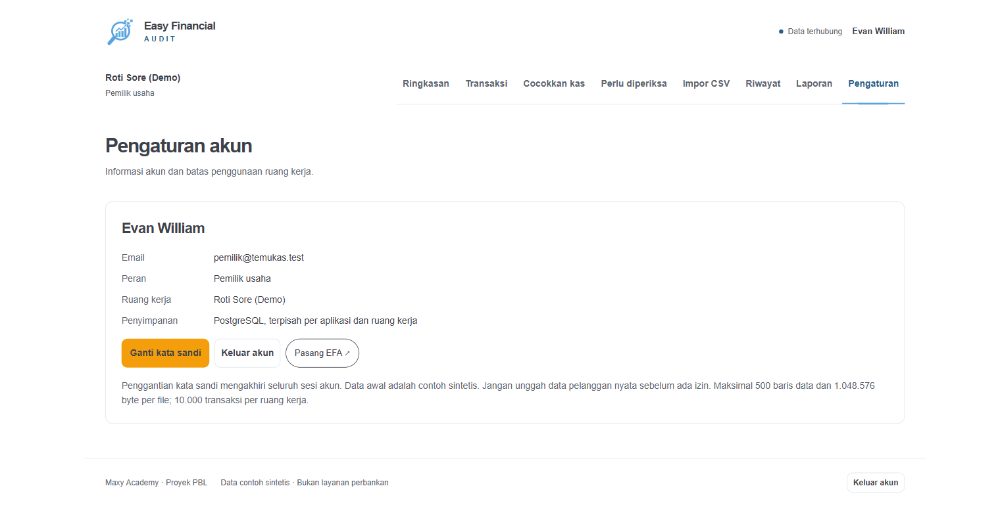

*Gambar 11. Pengaturan akun, batas ruang kerja, tombol keamanan, dan PWA.*

**Langkah pengguna:**

1. Buka **Pengaturan**.
2. Periksa email dan workspace.
3. Gunakan **Ganti kata sandi** bila perlu; siapkan login ulang setelahnya.
4. Gunakan **Pasang EFA** bila ingin memasang PWA.
5. Gunakan **Keluar akun** di akhir sesi.

**Catatan UX:** belum ada kontrol retensi, hapus workspace, atau unduh/hapus
data. Ini memang fitur yang belum tersedia, tetapi pengguna yang mencari
pengelolaan data perlu diberi penjelasan agar tidak mengira tombolnya rusak.

### 3.10 Pengalaman mobile

Saya mengubah viewport ke 390×844. Navigasi utama berubah menjadi tombol
**Menu** dan membuka dialog berisi seluruh menu. Kartu Ringkasan tetap terbaca,
tombol **Cocokkan** tetap dapat dijangkau, dan tabel transaksi diberi area
horizontal scroll. Untuk pengguna HP, pola ini cukup nyaman.

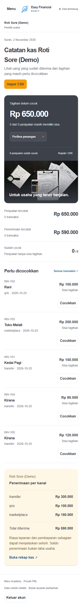

*Gambar 12. Tampilan Ringkasan pada lebar 390 px; navigasi berubah menjadi menu.*

**Catatan UX:** pada tabel di layar kecil, informasi kolom paling kanan tidak
langsung terlihat. Pertimbangkan tampilan kartu untuk Transaksi pada layar
sempit, atau pertahankan petunjuk "geser tabel" yang lebih terlihat.

## 4. Hal yang paling membantu

- Pemisahan yang konsisten: Ringkasan untuk kondisi, Transaksi untuk pencarian,
  Cocokkan kas untuk usulan, Perlu diperiksa untuk pekerjaan yang belum selesai.
- Preview impor tidak mengubah saldo dan menjelaskan baris yang dilewati.
- Modal alokasi menampilkan sisa tagihan dan menjelaskan bahwa biaya tidak
  menambah uang diterima.
- Riwayat memakai data server dan memiliki pencarian serta pagination.
- Ekspor menghasilkan CSV yang dapat dibuka dan memiliki kolom status/sisa.
- Navigasi mobile dan label formulir cukup jelas.

## 5. Hal yang perlu diperbaiki atau dijelaskan

1. **Pasangan muncul dua kali di Perlu diperiksa.** Jelaskan bahwa satu pasangan
   memiliki dua sisi dan satu penyimpanan menyelesaikan keduanya, atau kelompokkan
   menjadi satu kartu.
2. **Kandidat lawan tidak terlihat di kartu.** Tampilkan nama/referensi kandidat
   beserta alasan sebelum pengguna membuka modal.
3. **Tidak ada tindakan langsung dari tabel Transaksi.** Tambahkan tombol
   "Tindak lanjuti" pada baris dengan sisa, terutama untuk pengguna mobile.
4. **Istilah laporan mudah disalahartikan.** Tambahkan penjelasan bahwa Sisa
   Tagihan adalah nilai penjualan yang belum dipasangkan, bukan kerugian.
5. **Riwayat data lama terasa buntu.** Label "Catatan historis" perlu tooltip atau
   penjelasan singkat tentang event lama yang belum memiliki entity link.
6. **Impor belum menjelaskan format kolom secara langsung.** Tampilkan template
   tujuh kolom di modal sebelum file dipilih.
7. **Pengaturan belum memiliki pengelolaan retensi/hapus data.** Ini fitur yang
   memang ditunda; beri catatan eksplisit agar pengguna tidak mencari tombol yang
   tidak ada.
8. **Tidak ada alur lupa kata sandi.** Ini di luar scope MVP, tetapi perlu masuk
   daftar pertanyaan produk sebelum pilot dengan pengguna nyata.
9. **Ada noise data demo.** Baris `INV-SSE-1` yang dibatalkan muncul di tabel
   Transaksi; untuk presentasi, gunakan workspace demo yang hanya berisi data
   cerita utama.
10. **Status "Data terhubung" perlu diuji saat SSE gagal.** Saya melihat satu
    error SSE sementara di console saat pengujian, meskipun UI tetap dapat dipakai.
    Pastikan indikator koneksi berubah jujur saat fallback polling aktif.

## 6. Alur onboarding yang saya sarankan

Urutan ini bisa dipakai sebagai panduan pertama kali bagi pemilik usaha:

1. **Masuk dan kenali workspace.** Pastikan nama usaha dan peran sudah benar.
2. **Lihat Ringkasan.** Pahami tiga angka: penjualan tercatat, penerimaan
   tercatat, dan sisa tagihan. Ingat bahwa penerimaan bukan laba.
3. **Unduh dua contoh CSV.** Isi penjualan dan penerimaan dengan ID sumber yang
   stabil dan unik.
4. **Impor dan periksa preview.** Jangan menyimpan sebelum jumlah baris baru dan
   totalnya sesuai.
5. **Buka Cocokkan kas.** Periksa pasangan unik dan baca alasannya.
6. **Selesaikan Perlu diperiksa.** Konfirmasi pasangan unik; gunakan alokasi
   manual untuk referensi kosong atau kandidat yang tidak unik.
7. **Catat pembayaran sebagian atau biaya layanan.** Isi alasan agar keputusan
   dapat ditelusuri.
8. **Periksa Riwayat.** Pastikan keputusan dan pembatalan tercatat.
9. **Buka Laporan dan unduh CSV.** Simpan rekap untuk pemeriksaan di luar EFA.
10. **Akhiri sesi dengan Keluar akun.** Jangan gunakan data pelanggan nyata
    sebelum izin dan prosedur retensi disepakati.

Jika panduan ini dipakai di dalam aplikasi, tempat yang paling tepat adalah
panel bantuan di Ringkasan dan teks pengantar di Perlu diperiksa. Panduan panjang
sebaiknya tidak muncul sebagai modal pertama; tampilkan checklist singkat dan
tautan ke dokumen ini.

Rincian triage bug/UX dan pembagian pekerjaan frontend versus backend ada di
[UX_FINDINGS_ACTION_PLAN.md](UX_FINDINGS_ACTION_PLAN.md).
