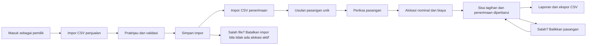

# PRD — Rekonsiliasi Kas UMKM (Temu Kas)

| Field | Nilai |
|---|---|
| Produk | Temu Kas — Rekonsiliasi Kas UMKM |
| Repositori | `D:/appwebsite/rekonsiliasi-kas-umkm` |
| Branch | `feat/pbl-sqlc-and-docs` |
| Tanggal | 26 Oktober 2026 |
| Status | Draft untuk implementasi MVP; acuan perilaku berasal dari prototipe |
| Sumber perilaku | `Tiga-Prototipe-PBL` (read-only) |
| Cakupan dokumen | MVP Rekonsiliasi Kas UMKM; Tilik dan Ruang sebagai konteks suite/modul masa depan |
| Dokumen terkait | [`FRD.md`](FRD.md) |

> Dokumen ini tidak menyalin kata sandi, token, API key, email akun demo, atau data pribadi dari prototipe. Seluruh angka dan perilaku di bawah berasal dari kode, dokumentasi, dan pengujian prototipe yang dapat diperiksa.

## 1. Ringkasan produk

Temu Kas membantu pemilik usaha kecil menjelaskan hubungan antara penjualan yang tercatat dan uang yang benar-benar diterima. Alih-alih menandai setiap selisih sebagai kehilangan uang, produk menyimpan keputusan pemilik: berapa nominal yang dialokasikan, biaya layanan apa yang mengurangi tagihan, dan berapa sisa yang masih perlu ditelusuri. Keputusan dapat dibalik tanpa menghapus riwayat, impor dapat diulang tanpa menggandakan transaksi, dan hasil akhir dapat diekspor sebagai CSV.

Prototipe membuktikan alur tersebut pada satu ruang kerja pemilik usaha: impor CSV penjualan dan penerimaan, usulan pasangan yang unik, alokasi sebagian atau penuh, biaya dengan alasan, pembalikan, pembatalan impor, audit, dan ekspor. Repositori ini sudah memiliki backend Go, migration/backfill, query sqlc, service auth/UMKM, API `/api/v1` untuk alur inti, serta unit dan integration test. Antarmuka web dan SSE events belum diimplementasikan.

Prototipe yang sama juga memuat dua aplikasi lain, Tilik (review karya berbasis rubrik) dan Ruang (laporan fasilitas dan SLA). Keduanya dibaca agar pembagian peran, autentikasi, isolasi ruang kerja, dan batasan platform tidak salah digambarkan. Keduanya adalah konteks suite/modul masa depan untuk repositori ini, bukan bagian dari komitmen MVP Rekonsiliasi Kas UMKM.

## 2. Masalah dan hasil yang ingin dicapai

Pemilik usaha biasanya melihat tiga sumber angka yang tidak otomatis sepakat: catatan penjualan, mutasi penerimaan dari transfer/QRIS/marketplace, dan biaya layanan yang dipotong di tengah jalan. Pencocokan manual di spreadsheet mudah menghasilkan dua kesalahan yang mahal: selisih dianggap uang hilang, atau satu penerimaan dipakai untuk menutup tagihan melebihi nilai yang benar-benar diterima.

Temu Kas mengambil posisi yang lebih sempit dan dapat diaudit: produk tidak menebak penyebab selisih, tidak mengakses rekening bank, dan tidak menghitung laba. Produk menunjukkan saldo yang masih tersisa, menyimpan alasan keputusan, dan menjaga agar keputusan lama dapat ditelusuri.

| ID | Hasil yang ingin dicapai | Metrik | Target pilot | Status bukti |
|---|---|---|---|---|
| OUT-01 | Sisa tagihan terlihat untuk setiap penjualan aktif | Persentase penjualan aktif yang memiliki saldo sisa terhitung | 100% data yang valid | Terverifikasi di prototipe melalui `remaining()` dan tampilan saldo |
| OUT-02 | Impor ulang tidak menggandakan transaksi | Jumlah baris baru pada impor file identik | 0 baris baru | Terverifikasi di pengujian integrasi |
| OUT-03 | Keputusan alokasi tidak melebihi saldo | Jumlah alokasi berlebih pada uji konkurensi | 0 | Terverifikasi di pengujian konkurensi prototipe |
| OUT-04 | Selisih dapat dijelaskan | Persentase alokasi berbiaya yang memiliki alasan minimal 5 karakter | 100% | Divalidasi oleh `Allocate()` dan pengujian domain |
| OUT-05 | Keputusan dapat dibalik | Persentase pembatalan yang mengembalikan saldo dan mempertahankan riwayat | 100% | Terverifikasi di pengujian domain dan integrasi |
| OUT-06 | Ekspor aman dibuka di spreadsheet | Jumlah sel yang lolos tanpa netralisasi formula | 0 | Terverifikasi di `TestCSVFormulaNeutralization` |
| OUT-07 | Pemilik dapat menyelesaikan alur dasar tanpa bantuan | Persentase partisipan uji kegunaan yang menyelesaikan impor, alokasi, dan ekspor | ≥80% (hipotesis pilot) | Belum diukur pada pengguna nyata |
| OUT-08 | Antarmuka dapat dipakai di layar kecil | Halaman uji tanpa overflow horizontal di 375/768/1440 px | 100% halaman yang diuji | Diuji di browser prototipe, bukan di repositori ini |
| OUT-09 | Data besar dalam batas MVP tetap dapat diproses | Waktu rantai API untuk dua file 500 baris dan 500 pasangan | Di bawah 5 detik pada lingkungan uji lokal | Prototipe mencatat sekitar 2,42 detik pada satu run; bukan SLA produksi |

Target di atas adalah hipotesis pilot sampai ada pengukuran pengguna dan beban kerja nyata. Angka “2,42 detik” adalah observasi pengujian prototipe, bukan janji performa.

## 3. Permukaan produk dan status implementasi

| Permukaan | Aplikasi | Peran utama | Status di prototipe | Status di repositori ini |
|---|---|---|---|---|
| Rekonsiliasi kas | Temu Kas (`umkm-rekonsiliasi`) | Pemilik usaha | MVP PBL lokal yang dapat dijalankan | **MVP saat ini**; backend Go sudah memiliki auth, session/CSRF, import, suggestions, allocation, undo, cancel, export, dan integration test |
| Review karya | Tilik (`ai-grader`) | Mentor, siswa | MVP PBL lokal yang dapat dijalankan | Konteks suite/modul masa depan; belum ada kode domain |
| Layanan fasilitas | Ruang (`facility-sla`) | Pengelola, penghuni, teknisi | MVP PBL lokal yang dapat dijalankan | Konteks suite/modul masa depan; belum ada kode domain |
| Platform bersama | `internal/platform` | Semua peran | Autentikasi, sesi, CSRF, state JSONB, audit, worker, aset | Sebagian: auth/session/CSRF + service UMKM sudah ada; worker dan frontend belum |

Status nyata repositori ini:

- Backend Go memakai Echo, pgx, sqlc, dan Viper. Endpoint health tetap tersedia, dan API domain memakai prefix `/api/v1`.
- Migration `000001_pbl_baseline` sudah memindahkan enam tabel `pblg_*` dan dua index dari prototipe.
- Migration `000002_umkm_normalized` menambahkan tabel domain `umkm_imports`, `umkm_entries`, dan `umkm_allocations`; migration `000003_backfill_umkm_state` memindahkan data UMKM lama dari JSONB.
- Query sqlc `auth.sql` dan `umkm.sql` sudah di-generate dan dipakai service.
- Auth, session/CSRF, import, suggestions, alokasi, undo, cancel import, export, dan ganti password sudah memakai PostgreSQL serta handler Echo.
- SSE events, worker, dan frontend belum dibuat di repositori ini.
- README root menyebut `frontend/` sebagai ruang kerja yang belum diisi; direktori tersebut belum ada pada checkout ini.
- CI backend menjalankan vet, test dengan race detector, build, dan lint.

Prototipe menunjukkan ketiga aplikasi dapat berjalan dalam satu proses suite dengan tiga port dan dua worker per aplikasi. Fakta itu menjelaskan arsitektur bersama, tetapi tidak mengubah cakupan MVP repositori ini.

## 4. Persona dan peran

| Persona | Konteks | Tujuan utama | Kewenangan yang terbukti | Status |
|---|---|---|---|---|
| Pemilik usaha UMKM | Menjalankan usaha harian dan menutup catatan kas | Mengimpor penjualan/penerimaan, memahami sisa tagihan, menyimpan keputusan, mengekspor rekap | Satu-satunya peran pada aplikasi Temu Kas; melihat seluruh data ruang kerjanya; melakukan impor, alokasi, pembalikan, pembatalan, dan ekspor | MVP saat ini |
| Mentor/guru | Mengelola kelas dan menilai karya | Membuat tugas/rubrik, memeriksa draf AI, menerbitkan nilai final, mengekspor rekap kelas | Membuat tugas, melihat seluruh karya kelas, menyetujui/menerbitkan nilai, mencoba ulang review, mengekspor | Konteks suite |
| Siswa | Mengirim karya dan menunggu keputusan mentor | Mengirim teks/kode/PDF/GitHub, melihat nilai final dan feedback | Mengirim karya untuk dirinya sendiri; hanya melihat karya dan nilai final miliknya; tidak melihat draf AI atau data mentor | Konteks suite |
| Pengelola properti | Mengelola layanan fasilitas | Menetapkan teknisi/tenggat, memantau SLA, menutup atau membuka ulang laporan, mengekspor rekap | Melihat seluruh tiket properti, menugaskan, mengonfirmasi, membuka ulang, dan mengekspor | Konteks suite |
| Penghuni | Melaporkan masalah unit | Membuat laporan, memantau progres, mengonfirmasi hasil | Membuat laporan; melihat dan mengonfirmasi/membuka ulang tiket miliknya | Konteks suite |
| Teknisi | Mengerjakan perbaikan | Menerima penugasan, mulai, mengirim bukti dan biaya | Melihat tiket yang ditugaskan kepadanya; mulai dan menyelesaikan; tidak dapat mengonfirmasi pekerjaannya sendiri | Konteks suite |

Perilaku autentikasi bersama yang terbukti di prototipe:

- Peran berasal dari database, bukan dari pilihan di halaman login. Login tidak mengubah kewenangan akun meskipun klien mengirim field peran.
- Satu email dapat memiliki akun terpisah pada aplikasi berbeda karena keunikan adalah `(app, email)`.
- Pemilik/mentor/admin dapat membuat ruang kerja baru; anggota bergabung dengan kode ruang kerja. Kode bergabung tidak memberikan peran pengelola.
- Kata sandi 12–72 byte; email divalidasi sebagai satu alamat; nama 2–100 karakter.
- Sesi berlaku 12 jam, disimpan sebagai hash token di server, dan dikirim melalui cookie `HttpOnly`, `SameSite=Strict`, serta `Secure` bila koneksi TLS.
- Setiap perubahan memerlukan token CSRF dan permintaan lintas situs ditolak.
- Penggantian kata sandi mengakhiri seluruh sesi akun; logout hanya mengakhiri sesi yang sedang dipakai.

## 5. Jobs-to-be-done dan journey utama

Jobs-to-be-done untuk Temu Kas:

1. Saat penjualan dan penerimaan periode baru tersedia, saya ingin mengimpornya dengan aman agar saya dapat melihat mana yang sudah cocok dan mana yang masih memiliki sisa.
2. Saat penerimaan lebih kecil daripada tagihan, saya ingin mencatat alokasi sebagian dan biaya layanan beserta alasannya agar sisa tagihan tidak salah dianggap piutang pelanggan.
3. Saat satu penerimaan menutup beberapa penjualan, saya ingin mengalokasikan bertahap agar total yang dialokasikan tidak melebihi uang yang benar-benar diterima.
4. Saat saya salah mencocokkan, saya ingin membalik keputusan dan mengembalikan saldo tanpa menghapus jejak audit.
5. Saat saya mengunggah file yang sama lagi, saya ingin sistem mengenali duplikat agar laporan tidak menjadi dua kali lipat.
6. Saat saya perlu memeriksa catatan di luar aplikasi, saya ingin mengekspor CSV yang aman dibuka di spreadsheet.

Journey utama Temu Kas:

1. Pemilik masuk ke ruang kerja. Ringkasan menampilkan penjualan tercatat, penerimaan, sisa tagihan, dan penjualan yang sudah cocok.
2. Pemilik membuka Impor CSV, memilih jenis penjualan atau penerimaan, mengunggah file, dan melihat pratinjau. Pratinjau belum mengubah data.
3. Setelah simpan, sistem memeriksa hash file dan ID sumber. File identik tidak menambah transaksi; ID yang sama dengan isi berbeda ditolak.
4. Pada Cocokkan kas, sistem hanya menampilkan pasangan yang referensi, kanal, nominal, dan rentang tanggalnya cocok serta unik di kedua sisi.
5. Pemilik dapat memakai alokasi manual untuk pembayaran sebagian, biaya layanan, atau pencairan gabungan. Saldo penjualan berkurang sebesar alokasi ditambah biaya; saldo penerimaan berkurang sebesar alokasi saja.
6. Jika keputusan salah, pemilik membalik pasangan. Riwayat tetap ada, saldo kembali, dan keputusan baru dapat dibuat.
7. Jika satu batch impor salah, pemilik membatalkannya hanya setelah tidak ada alokasi aktif pada batch tersebut.
8. Laporan menampilkan sisa dan biaya yang sudah dikonfirmasi. Ekspor CSV memuat transaksi aktif dan dibatalkan beserta sisa alokasinya, dengan netralisasi sel yang bisa dianggap formula spreadsheet.

Konteks suite singkat:

- **Tilik** menjalankan alur mentor membuat tugas dan rubrik, siswa mengirim karya, worker menyiapkan draf, mentor memeriksa dan menerbitkan nilai, lalu siswa melihat nilai final. Nilai tidak pernah berasal langsung dari AI tanpa persetujuan mentor. Rubrik lama tidak diedit; perubahan rubrik berarti tugas baru.
- **Ruang** menjalankan alur penghuni melapor, pengelola menugaskan teknisi dan tenggat, teknisi mulai dan mengirim bukti, penghuni/pengelola mengonfirmasi, dan tiket dapat dibuka ulang. Saran tenggat adalah saran jam kerja, bukan SLA kontraktual; teknisi tidak dapat menutup pekerjaannya sendiri.

## 6. Cakupan MVP repositori ini

| Cakupan | Termasuk | Bukti |
|---|---|---|
| Backend UMKM | Autentikasi sesi, CSRF, isolasi ruang kerja, endpoint domain, audit, ekspor | Perilaku prototipe di `internal/platform/auth.go`, `server.go`, `umkm.go`, `store.go` |
| Impor | CSV UTF-8, pratinjau, validasi seluruh file, deduplikasi, pembatalan batch | `umkm.go:27-89`, `umkm.go:204-276`, `umkm.go:332-364` |
| Pencocokan | Usulan unik, alokasi penuh/sebagian, biaya, pencairan gabungan | `umkm.go:93-203` |
| Rekonsiliasi | Pembalikan tanpa penghapusan, saldo sisa, audit | `umkm.go:317-331`, `store.go:87-118` |
| Rekap | Ekspor CSV, proteksi formula, status aktif/batal | `umkm.go:365-439` |
| Data | Baseline enam tabel `pblg_*`, state JSONB untuk kompatibilitas suite, tabel UMKM `umkm_imports`/`umkm_entries`/`umkm_allocations`, dan backfill dari state | `backend/scripts/postgres/migrations/000001_pbl_baseline.up.sql:8-79`; `backend/scripts/postgres/migrations/000002_umkm_normalized.up.sql:1-84`; `backend/scripts/postgres/migrations/000003_backfill_umkm_state.up.sql:1-83` |
| Kualitas | Unit, integrasi, keamanan, browser, dan batas 500 baris | `internal/platform/*_test.go`, `docs/pengujian.md` |

| Di luar cakupan MVP repositori ini | Alasan |
|---|---|
| Implementasi Tilik dan Ruang | Prototipe memilikinya, tetapi kontrak repositori ini adalah backend Rekonsiliasi Kas UMKM |
| Antarmuka web yang sudah dikomit | Prototipe adalah acuan perilaku; repositori ini belum memiliki `frontend/` |
| Akses rekening bank atau mutasi otomatis | Tidak ada integrasi bank di prototipe |
| Refund/transaksi negatif otomatis | Nominal wajib bilangan bulat positif; refund negatif sengaja ditolak |
| OCR PDF, RAG, video, repositori privat | Termasuk batasan Tilik, bukan UMKM |
| Pajak, laba, pembukuan lengkap | Produk hanya merekonsiliasi kas dan menampilkan sisa, bukan laporan laba |
| Banyak pemilik dalam satu ruang kerja | MVP prototipe memakai satu pemilik per ruang kerja UMKM |
| Billing/pembayaran vendor, IoT, penagihan IPL | Termasuk batasan Ruang |
| Reset kata sandi via email, MFA, penghapusan akun | Tidak ada di prototipe |
| Rate limit terdistribusi, object storage, multi-instance | Belum dibuktikan; pembatas login prototipe berbasis memori satu proses |
| Migrasi data lama suite Tilik/Ruang dan akun demo | Backfill UMKM disiapkan terpisah; data suite lain tidak disalin |

## 7. Inventaris halaman dan pemetaan API

Halaman di bawah adalah acuan perilaku dari prototipe. Status “Prototipe” berarti halaman dan interaksinya terbukti di prototipe, bukan berarti sudah ada di repositori ini.

| Halaman / dialog | Rute | Tujuan | Aksi utama | API utama | Peran | Status |
|---|---|---|---|---|---|---|
| Masuk | `#login` | Memulai sesi | Masuk dengan email dan kata sandi | `GET /api/config`, `POST /api/login`, `GET /api/me` | Semua | Prototipe |
| Daftar | `#register` | Membuat akun dan ruang kerja atau bergabung | Daftar sebagai pemilik atau anggota | `POST /api/register` | Semua | Prototipe |
| Ringkasan | `#overview` | Melihat kondisi kas harian | Impor CSV atau periksa pasangan | `GET /api/state` | Pemilik | Prototipe |
| Transaksi | `#entries` | Melihat seluruh transaksi dan sisa | Cari, filter, ganti ukuran halaman | `GET /api/state` | Pemilik | Prototipe |
| Cocokkan kas | `#reconcile` | Memeriksa usulan dan keputusan | Simpan pasangan, alokasi manual, balikkan | `GET /api/suggestions`, `POST /api/allocations`, `POST /api/allocations/{id}/undo` | Pemilik | Prototipe |
| Impor CSV | `#imports` | Mengimpor dan mengelola batch | Pratinjau, simpan, batalkan impor | `POST /api/imports/preview`, `POST /api/imports`, `POST /api/imports/{id}/cancel` | Pemilik | Prototipe |
| Riwayat | `#history` | Melihat jejak audit | Cari aktivitas | `GET /api/state` (events) | Pemilik | Prototipe |
| Laporan | `#reports` | Melihat rekap dan mengekspor | Unduh CSV | `GET /api/state`, `GET /api/export` | Pemilik | Prototipe |
| Pengaturan | `#settings` | Melihat akun dan batas | Ganti kata sandi, keluar | `GET /api/me`, `POST /api/password`, `POST /api/logout` | Pemilik | Prototipe |
| Dialog impor | Modal | Pratinjau sebelum simpan | Pilih file, periksa, simpan | `POST /api/imports/preview`, `POST /api/imports` | Pemilik | Prototipe |
| Dialog alokasi | Modal | Memutuskan pasangan | Isi nominal, biaya, alasan, simpan | `POST /api/allocations` | Pemilik | Prototipe |
| Dialog ganti kata sandi | Modal | Mengganti kata sandi | Verifikasi kata sandi lama dan baru | `POST /api/password` | Pemilik | Prototipe |
| Menu mobile | Modal | Navigasi di layar kecil | Pindah halaman | Tidak ada API khusus | Semua | Prototipe |

Pemetaan halaman ke API untuk suite (masa depan):

| Aplikasi | Halaman | API utama | Status |
|---|---|---|---|
| Tilik | Ringkasan, Tugas, Antrean review/Karya saya, Laporan kelas, Anggota, Pengaturan | `GET /api/state`, `POST /api/assignments`, `POST /api/submissions`, `POST /api/submissions/{id}/approve`, `POST /api/submissions/{id}/retry`, `POST /api/pdf/extract`, `GET /api/export` | Konteks suite |
| Ruang | Ringkasan, Laporan, Papan progres, Tim properti, Aktivitas SLA, Laporan, Pengaturan | `GET /api/state`, `POST /api/tickets`, `POST /api/tickets/{id}/action`, `POST /api/photos`, `GET /api/photos/{id}`, `GET /api/export` | Konteks suite |

## 8. Aturan produk yang tidak boleh dilanggar

Aturan rinci dan kasus uji ada di [`FRD.md`](FRD.md). Ringkasan keputusan produk:

- Impor bersifat semua-atau-tidak-sama-sekali. Satu baris tidak valid menggagalkan seluruh file; tidak ada setengah impor.
- Usulan pasangan tidak pernah mengubah saldo. Perubahan hanya terjadi setelah pemilik menyimpan alokasi.
- Usulan otomatis hanya untuk pasangan yang unik di kedua sisi, dengan referensi tidak kosong, nominal sama, kanal sama, dan penerimaan 0–3 hari setelah penjualan.
- Saldo penjualan berkurang sebesar nominal alokasi ditambah biaya; saldo penerimaan berkurang sebesar nominal alokasi saja.
- Biaya positif wajib memiliki alasan minimal 5 karakter. Biaya bukan pembayaran dan tidak menambah uang yang diterima.
- Pembalikan dan pembatalan adalah penandaan status, bukan penghapusan baris. Audit tetap tersimpan.
- Impor yang masih memiliki alokasi aktif tidak boleh dibatalkan.
- Ekspor harus menetralkan sel yang dapat dianggap formula spreadsheet dan tetap menampilkan status aktif/batal.
- Data selalu diambil dari ruang kerja pada sesi, bukan dari parameter workspace yang dikirim klien.

## 9. Kebutuhan nonfungsional

| Area | Kebutuhan | Bukti prototipe | Status repositori |
|---|---|---|---|
| Keamanan sesi | Cookie `HttpOnly`, `SameSite=Strict`, `Secure` saat TLS; token sesi disimpan sebagai hash; sesi 12 jam | `backend/internal/service/auth_service.go`; `backend/internal/echohttp/auth_handler.go` | Diimplementasikan; test integration login/logout/ganti password lulus |
| CSRF | Setiap non-GET pada route privat memerlukan `X-CSRF-Token`; token dibandingkan constant-time | `backend/internal/echohttp/auth_middleware.go` | Diimplementasikan; test menolak POST tanpa CSRF |
| Header keamanan | X-Frame-Options, X-Content-Type-Options, Referrer-Policy, CSP API | `backend/internal/echohttp/security_middleware.go` | Diimplementasikan |
| Pembatas login | 25 percobaan per IP per aplikasi dalam 10 menit, in-memory | `server.go:159-181`; `security_test.go:148-160` | Belum ada |
| Isolasi ruang kerja | Workspace dan app diambil dari sesi; data lintas ruang kerja tidak terlihat; foto memiliki pemeriksaan keterkaitan | `backend/internal/echohttp/auth_middleware.go`; `backend/internal/service/umkm_service.go` | Diterapkan pada query/service; RLS database belum |
| Audit | Setiap mutasi domain menulis `pblg_audit` dengan pelaku, aksi, detail, waktu; event terbaru 120. Login/register/logout/ganti kata sandi tidak diaudit | `backend/internal/service/umkm_service.go`; `pblg_audit` | Diimplementasikan dalam transaksi yang sama dengan version bump |
| Batas data | 500 baris/1 MB per impor; 10.000 transaksi per ruang kerja; field maksimal 400 karakter; ID sumber maksimal 80 karakter; nominal maksimal 1 triliun | `backend/internal/service/umkm_domain.go`; migration 000002 | Diimplementasikan dan diuji |
| Konkurensi | Satu baris workspace dikunci saat mutasi; saldo divalidasi di dalam transaksi | `backend/internal/service/umkm_service.go` | Diimplementasikan dengan `LockWorkspaceForUpdate` |
| Aksesibilitas | Skip link, fokus utama, dialog native, Escape, konfirmasi isian belum disimpan, live region, tabel dapat digeser, reduced motion | `index.html:22-33`; `app.js:121-135`, `app.js:813-827`; `style.css:202-215`, `style.css:507-509`, `style.css:1116` | Frontend belum ada |
| Responsif | Uji 375/768/1440 px; tabel bergulir di area tabel; navigasi mobile | `README.md:16-17`; `pengujian.md:38-58` | Frontend belum ada |
| Operasional | Satu proses menjalankan server dan worker; HOST default `127.0.0.1`; worker 2 detik; SSE 4 detik; shutdown 8 detik | `server.go:42-95`; `suite.go:18-90`; `flow.txt:152-171` | Scaffold Echo: port 8080, timeout 10/15/60 detik, shutdown 10 detik, DB nonaktif secara default |
| Body limit | JSON prototipe 2 MB; CSV maksimal 1 MB | `backend/internal/echohttp/http_server.go` | Echo memakai `BodyLimit("5M")` agar CSV 1 MB + amplop JSON muat |
| Error | Pesan JSON aman; 400/401/403/404/409/503/500; detail database tidak dikirim mentah | `backend/internal/echohttp/echohttp_error_handler.go`; `pkg/errors/errors.go` | Diimplementasikan dengan `DomainError` + central mapping |

Hal yang belum dibuktikan oleh prototipe: uji beban banyak pengguna, Safari/Firefox/iOS asli, pembaca layar, audit penetrasi independen, deployment cloud, dan pengukuran manfaat bagi pengguna nyata. Karena itu dokumen ini tidak menjanjikan kesiapan produksi.

## 10. Metrik keberhasilan dan cara pengukuran

| Area | Metrik operasional | Cara mengukur | Ambang awal |
|---|---|---|---|
| Impor | Rasio impor valid terhadap total percobaan | Hitung respons sukses dan error validasi per jenis file | ≥95% untuk file yang mengikuti template (target pilot) |
| Duplikasi | Jumlah transaksi baru pada impor file identik | Bandingkan jumlah baris sebelum/sesudah | 0 |
| Konflik | Jumlah konflik ID sumber yang tidak diselesaikan | Hitung 409 dan tindak lanjut | 0 konflik yang tidak dijelaskan |
| Alokasi | Jumlah alokasi berbiaya tanpa alasan | Validasi server dan audit | 0 |
| Pembalikan | Jumlah pembalikan yang berhasil mengembalikan saldo | Uji regresi dan audit | 100% |
| Ekspor | Jumlah sel formula yang tidak dinetralkan | Uji unit dan pemeriksaan manual sampel | 0 |
| Keandalan | Jumlah mutasi tanpa audit | Bandingkan jumlah mutasi dan event audit | 0 |
| Kegunaan | Waktu dan keberhasilan tugas impor–alokasi–ekspor | Uji kegunaan dengan pemilik usaha | Baseline belum ada |
| Aksesibilitas | Overflow halaman dan fokus keyboard | Uji 375/768/1440 px dan keyboard | 0 overflow; semua dialog dapat ditutup |

Metrik tidak boleh memuat data pribadi, isi karya, atau kredensial. Untuk MVP, pengukuran dapat memakai data sintetis dan log agregat.

## 11. Asumsi

| ID | Asumsi | Dampak bila salah |
|---|---|---|
| A-01 | MVP repositori ini adalah backend Rekonsiliasi Kas UMKM; frontend dan Tilik/Ruang belum menjadi komitmen | Perencanaan rilis dan prioritas berubah |
| A-02 | Nominal dalam Rupiah bulat positif; refund/negatif tidak termasuk | Skema dan validasi perlu diubah |
| A-03 | Satu pemilik per ruang kerja UMKM pada MVP | Kebutuhan kolaborasi/multi-user belum tercakup |
| A-04 | Perilaku prototipe adalah acuan sampai ada keputusan produk baru | Requirements dapat menyimpang dari niat pemilik produk |
| A-05 | Data prototipe sintetis; data nyata memerlukan izin dan kebijakan privasi | Tidak boleh memakai data pelanggan nyata sebelum izin |
| A-06 | Zona waktu bisnis adalah `Asia/Jakarta` | SLA/jam kerja dapat berbeda untuk wilayah lain |
| A-07 | Ekspor CSV adalah jalur integrasi awal; belum ada API mitra | Integrasi eksternal harus menunggu keputusan baru |
| A-08 | Deployment produksi, backup, retensi, dan monitoring belum dirancang | Jangan mengiklankan kesiapan produksi |

## 12. Keputusan produk terbuka

| ID | Pertanyaan | Mengapa penting | Pemilik keputusan |
|---|---|---|---|
| OD-01 | Setelah migrasi normalisasi dan backfill disiapkan, kapan cutover dilakukan dan kapan `pblg_workspaces.state` menjadi legacy/read-only untuk UMKM? | Memengaruhi performa, index, validasi backfill, dan audit jangka panjang | Tech lead + product owner |
| OD-02 | Apakah prefix `/api/v1` dipertahankan untuk klien baru, atau perlu alias `/api` untuk kompatibilitas prototipe? | Implementasi saat ini memakai `/api/v1`; prototipe memakai `/api` | Tech lead |
| OD-03 | Apakah body limit 5 MB cukup untuk semua klien, atau perlu route import khusus dengan limit lebih besar? | Implementasi saat ini memakai 5 MB | Tech lead |
| OD-04 | Apakah frontend dibangun di repo ini atau repo terpisah? | Menentukan struktur monorepo dan CI | Product owner |
| OD-05 | Apakah satu ruang kerja UMKM boleh memiliki lebih dari satu pemilik? | Mengubah model peran, undangan, dan audit | Product owner |
| OD-06 | Batch 0 baris tetap dibuat mengikuti prototipe; apakah perilaku ini dipertahankan setelah ada UI? | Bisa membingungkan pengguna | Product owner |
| OD-07 | Undo alokasi yang sudah reversed mengembalikan 200 dan tetap menulis audit/version; apakah dipertahankan? | Idempotensi vs audit noise | Engineer |
| OD-08 | Ekspor UMKM memeriksa peran owner secara eksplisit; apakah perlu peran lain nanti? | Keamanan bila peran bertambah | Engineer |
| OD-09 | Apakah SSE dipertahankan atau diganti polling? | SSE menambah kompleksitas sesi dan proxy | Tech lead |
| OD-10 | Apakah backfill data UMKM lama (`000003`) akan dijalankan dan diverifikasi pada database nyata? | Backfill sudah disiapkan; data Tilik/Ruang dan akun demo tetap di luar cakupan | Product owner + engineer |
| OD-11 | Apakah batas 10.000 transaksi/ruang kerja cukup untuk pilot? | Menentukan kebutuhan normalisasi/arsip | Product owner |
| OD-12 | Apakah audit lengkap terlihat oleh pemilik atau hanya petugas? | Memengaruhi UI Riwayat dan privasi | Product owner |

## 13. Traceability ringkas

Path prototipe tanpa prefix `backend/` ditulis relatif terhadap `Tiga-Prototipe-PBL/`; path yang diawali `backend/` merujuk repositori ini.

| ID PRD | Pernyataan | Sumber utama |
|---|---|---|
| PRD-01 | Masalah: selisih kas tidak boleh otomatis dianggap kerugian | `Tiga-Prototipe-PBL/umkm-rekonsiliasi/README.md:1-10`; `docs/flow.txt:57-80` |
| PRD-02 | Permukaan produk: Temu Kas MVP; Tilik/Ruang konteks suite | `Tiga-Prototipe-PBL/README.md:5-17`; `backend/README.md:8-11` |
| PRD-03 | Persona dan peran | `internal/platform/auth.go:25-50`; `models.go:13-20`; `docs/flow.txt:37-53` |
| PRD-04 | JTBD dan journey utama | `docs/demo.md:7-20`; `web/app.js:400-496` |
| PRD-05 | Cakupan dan non-goals | `docs/batasan.md:5-11`; `docs/batasan.md:27-46`; `backend/docs/DATABASE_FROM_PBL.md:11-149` |
| PRD-06 | Inventaris halaman dan pemetaan API | `web/app.js:187-227`, `web/app.js:400-729`; `docs/api.md:22-35` |
| PRD-07 | Kebutuhan nonfungsional | `server.go:147-306`; `auth.go:52-204`; `store.go:87-153`; `style.css:202-215`, `style.css:507-509`, `style.css:1116` |
| PRD-08 | Metrik dan pengukuran | `docs/pengujian.md:5-37`; `docs/batasan.md:9` |
| PRD-09 | Batasan dan kesiapan | `docs/batasan.md:35-46`; `docs/pengujian.md:65-70` |
| PRD-10 | Status repositori saat ini | `backend/README.md`; `backend/internal/echohttp/http_server.go`; `backend/internal/service/*_service.go`; `backend/scripts/postgres/migrations/000001..000003`; `backend/docs/PBL_QUERY_INVENTORY.md`; `backend/docs/TESTING_FROM_GO_CHAT.md` |

## 14. Catatan sumber dan batas dokumen

Dokumen ini membaca `README.md`, `BUILD_PLAN.md`, `docs/flow.txt`, `docs/api.md`, `docs/demo.md`, `docs/batasan.md`, `docs/pengujian.md`, tiga README aplikasi, `internal/platform/web/index.html`, `app.js`, `design.js`, `style.css`, dan handler Go `server.go`, `auth.go`, `store.go`, `jobs.go`, `models.go`, `umkm.go`, `grader.go`, `facility.go`, `sla.go`, `pdf.go`, `suite.go`, serta pengujian domain/integrasi/keamanan. Prototipe diperlakukan read-only.

Hal yang tidak boleh disimpulkan dari dokumen ini:

- Prototipe belum diaudit untuk data publik, belum diuji beban, dan belum memiliki audit penetrasi independen.
- Angka pengujian prototipe bukan SLA produksi.
- Baseline schema di repositori ini belum berarti domain, autentikasi, atau frontend sudah berjalan.
- Tilik dan Ruang tidak menjadi bagian MVP repositori ini hanya karena prototipe memuatnya.
