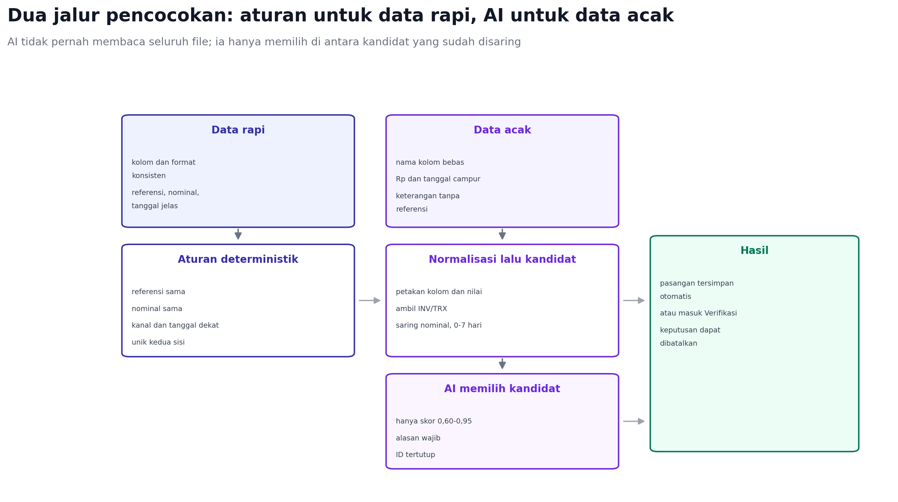

# Prakiraan Unggahan Pengguna dan Dasar Pencocokan

Dokumen ini menjawab dua hal: file seperti apa yang realistis diunggah, dan
atas dasar apa penjualan dicocokkan dengan penerimaan.

## 1. Tiga kelompok pengguna

| Kelompok | Contoh | Yang biasanya dimiliki |
| --- | --- | --- |
| Warung dan toko kecil | Kafe, warung makan, toko kelontong | Uang tunai harian, QRIS, catatan buku atau nota |
| Penjual online | Shopee, Tokopedia, TikTok Shop | Laporan pesanan dan pencairan dari dashboard |
| Jasa dan grosir | Servis, percetakan, distributor kecil | Faktur/nota, mutasi bank, transfer pelanggan |

## 2. Perkiraan distribusi unggahan

Angka ini perkiraan berbasis segmen, bukan hasil survei. Gunanya untuk
menentukan prioritas, bukan untuk klaim statistik.

| Bentuk masukan | Perkiraan porsi | Tingkat kerapian | Catatan |
| --- | --- | --- | --- |
| Tanpa file, catat angka harian | 30-40% | Rapi | Paling cepat; tidak perlu Excel |
| XLSX dari kasir/POS | 15-25% | Sedang | Header jelas, tetapi kolom banyak |
| XLSX/CSV mutasi bank | 20-30% | Sedang sampai buruk | Info rekening di atas tabel, saldo ikut |
| Laporan marketplace | 10-20% | Sedang | Satu pesanan bisa beberapa baris |
| Excel buatan sendiri | 15-25% | Buruk | Nama kolom bebas, angka bercampur teks |
| PDF atau screenshot | 10-15% | Buruk | Di luar scope fase pertama |

Yang penting: porsi terbesar justru pengguna tanpa file. Karena itu catat
harian harus tetap menjadi jalur utama, bukan fitur tambahan.

## 3. Bentuk yang paling sering dan masalahnya

| Bentuk | Masalah umum | Penanganan |
| --- | --- | --- |
| Mutasi bank XLSX | Header di baris 5-10, ada kolom saldo, debit/kredit terpisah | Deteksi header, blokir saldo, aturan arah dana |
| Mutasi bank PDF | Teks tidak konsisten, halaman berulang | ditunda; arahkan ke CSV/XLSX |
| Ekspor POS | Banyak kolom, diskon, pajak, ongkir | Petakan hanya tanggal, nominal, kanal |
| Laporan marketplace | Satu pesanan beberapa baris, fee terpisah | Agregasi per order, fee dilampirkan |
| Excel manual | Kolom “Tgl”, “Ket”, “Jumlah”, angka `Rp1.250.000` | Alias header dan parser nilai |
| Buku/nota difoto | Tidak terbaca mesin | Di luar scope; catat manual |

Tingkat kekacauan yang realistis: sekitar 60-70% file masih bisa diproses
setelah pemetaan otomatis, 20-30% butuh koreksi kolom, dan 10% harus ditolak
karena format, enkripsi, atau isi yang tidak bisa dibaca.

## 4. Yang berada di luar scope

| Kasus | Alasan | Perilaku sistem |
| --- | --- | --- |
| PDF dan screenshot | Rawan salah baca | Tolak dengan panduan ekspor |
| Struk difoto | Butuh OCR terpisah | Arahkan catat manual |
| Multi-mata uang | Butuh kurs dan akun terpisah | Tolak untuk sekarang |
| Jurnal akuntansi lengkap | Bukan tujuan produk | Hanya penjualan dan penerimaan |
| Pajak dan faktur pajak | Regulasi berbeda | Simpan sebagai catatan |
| Beberapa cabang dalam satu file | Butuh pemisahan dimensi | Minta satu file per cabang |
| Transfer antar rekening sendiri | Bukan penjualan | Tandai sebagai pindah dana |
| Setoran tunai ke bank | Bukan penjualan | Tandai sebagai pindah dana |
| Bunga, cashback, reversal | Bukan pembayaran pelanggan | Kategori non-operasional |

## 5. Dasar pencocokan

Penjualan dan penerimaan memang dua tabel terpisah. Yang menghubungkan keduanya
bukan satu kunci ajaib, tetapi kombinasi sinyal:

| Sinyal | Bobot | Contoh |
| --- | --- | --- |
| Referensi sama | 0,35 | `INV-102` di penjualan dan `TRF INV102` di mutasi |
| Nominal sama | 0,25 | Rp100.000 di kedua sisi |
| Kanal sama | 0,15 | QRIS dengan QRIS |
| Jarak tanggal | 0,15 | Beda 0-3 hari |
| Kemiripan nama | 0,10 | “Rani” dan “RANI S.” |

Aturan yang berlaku sekarang lebih ketat: referensi, kanal, nominal, dan
tanggal harus sama, dan hanya boleh ada satu kandidat di kedua sisi dalam
jarak tiga hari. Itu sebabnya banyak transaksi berakhir di antrean.

Skor akan dipakai untuk memutuskan:

- minimal 0,95: simpan otomatis, bisa dibatalkan;
- 0,60-0,95: masuk Verifikasi dengan alasan;
- di bawah 0,60: tidak dipasangkan.

Yang memaksa masuk Verifikasi: selisih nominal di luar fee, kandidat ganda,
referensi kosong, tanggal di luar jendela, atau sisa negatif.

## 6. Cara AI mencocokkan data acak



Ada tiga jenis "acak" yang harus dipisahkan:

| Jenis acak | Contoh | Penanganan |
| --- | --- | --- |
| Urutan baris | Baris tidak kronologis | Tidak masalah; identitas memakai ID, bukan posisi |
| Urutan dan nama kolom | "Tgl", "Ket", "Jumlah" | Normalisasi header dan alias |
| Isi bebas | "transferan bu rani 100rb" | Ekstraksi sinyal, lalu AI bila perlu |

Data rapi tidak melewati AI:

- referensi sama, nominal sama, kanal sama, tanggal dekat;
- unik di kedua sisi;
- skor minimal 0,95, langsung tersimpan.

Data acak melewati tiga tahap:

1. Normalisasi kolom dan nilai, termasuk mengambil `INV-102` dari keterangan.
2. Kandidat disaring: nominal sama dan jarak tanggal 0-7 hari.
3. AI hanya memilih di antara kandidat itu, dengan keluaran
   `{sale_id, receipt_id, pilih, alasan}`. ID di luar daftar dibuang.

Yang dibandingkan AI bukan seluruh file, melainkan pasangan calon: referensi,
nominal, tanggal, kanal, dan nama. Jika tidak ada kandidat, tidak ada
pencocokan. Jika skor sudah tinggi, AI tidak dipanggil.

Jika bentuk data tidak acak sama sekali, bagian yang dicocokkan hanya lima:
referensi, nominal, kanal, tanggal, dan nama. Referensi dan nominal adalah
penentu utama; kanal dan tanggal menyaring; nama hanya penguat.


## 7. Contoh perhitungan

Kasus mudah:

```text
Penjualan  INV-102  Rp100.000  qris  3 Nov
Penerimaan TRF INV102 Rp100.000 qris 4 Nov

referensi 0,35 + nominal 0,25 + kanal 0,15 + tanggal 0,13 + nama 0,05
skor 0,93 -> masuk Verifikasi dengan saran
```

Kasus yakin:

```text
Penjualan  INV-205  Rp250.000 transfer 5 Nov
Penerimaan INV-205  Rp250.000 transfer 5 Nov
skor 0,98 -> simpan otomatis
```

Kasus ambigu:

```text
Dua penjualan Rp100.000 di hari yang sama, referensi kosong
Dua penerimaan Rp100.000, tanpa referensi
skor di bawah 0,60 -> tidak dipasangkan, masuk Verifikasi
```

## 8. Pencocokan agregat

Kalau pengguna memakai catatan harian, pencocokan tidak per transaksi:

```text
3 Nov penjualan tunai Rp850.000  -> lunas otomatis
3 Nov penjualan QRIS  Rp1.200.000
4 Nov mutasi QRIS     Rp1.195.000
selisih Rp5.000 -> diusulkan sebagai biaya MDR
```

Ini yang membuat dua sisi tetap berguna walaupun datanya hanya total harian.

## 9. Yang tidak dijamin

- Semua file bisa dibaca. Sekitar 10% akan ditolak, dan itu wajar.
- Semua pasangan bisa otomatis. Yang ambigu selalu butuh manusia.
- Nominal selalu sama. Fee dan pembayaran sebagian memang menghasilkan selisih.
- Data historis lengkap. Kalau tidak pernah dicatat, tidak bisa dicocokkan.

