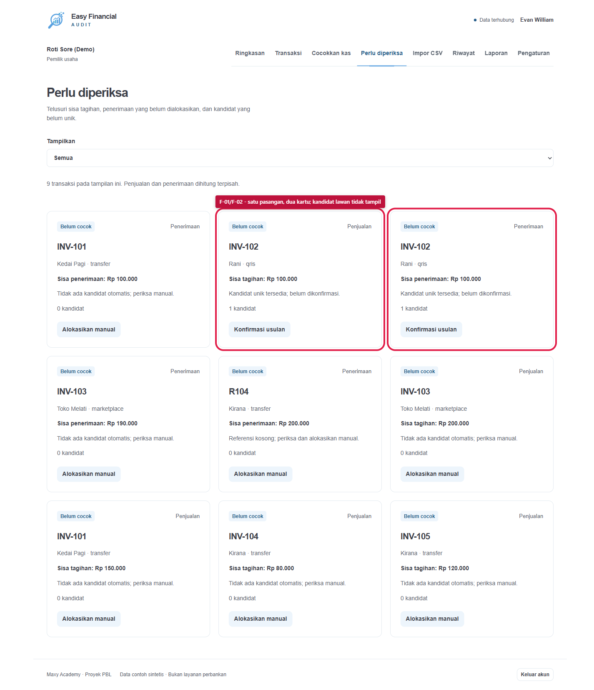
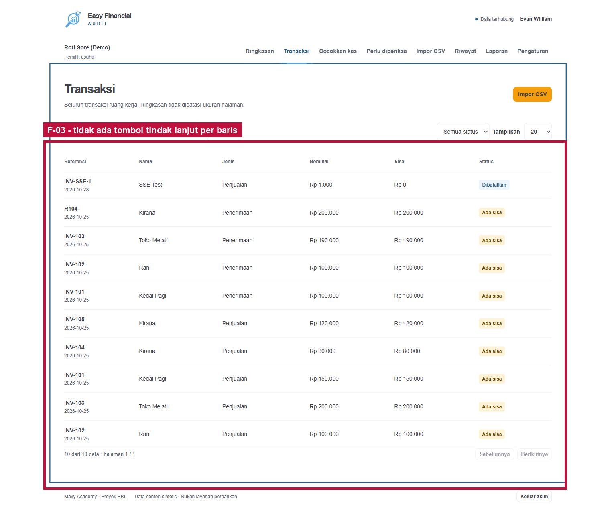
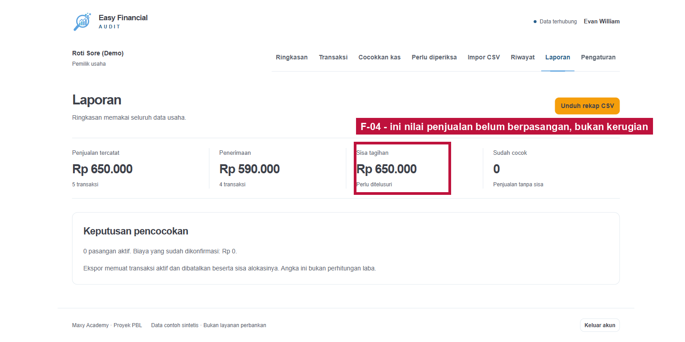
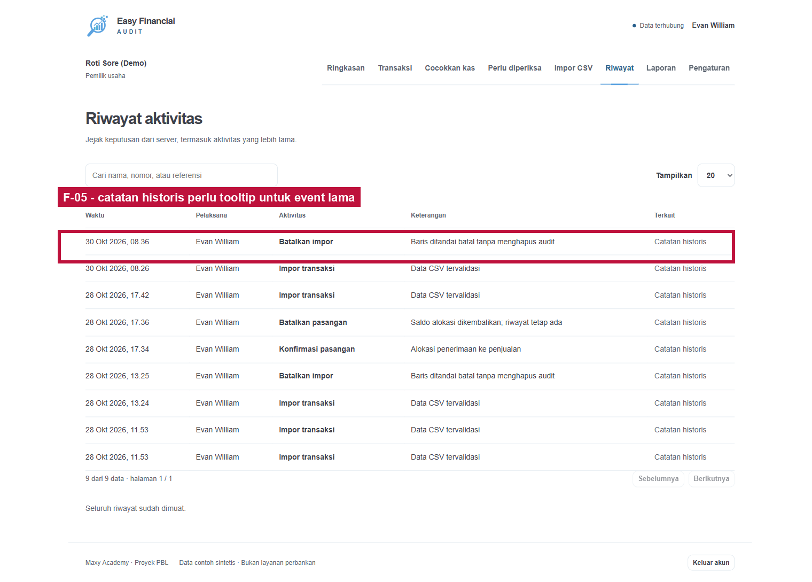
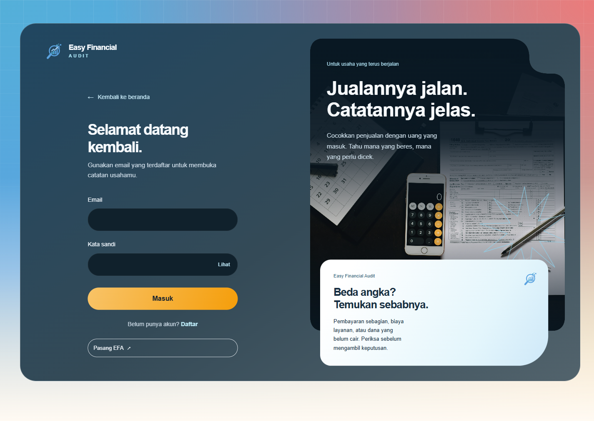
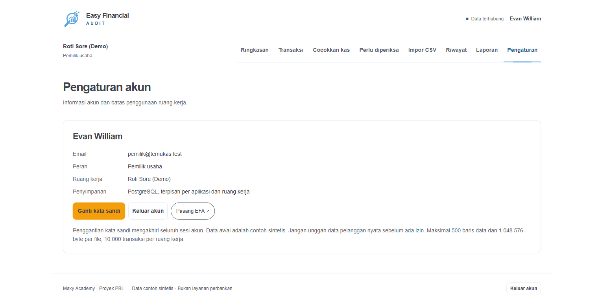
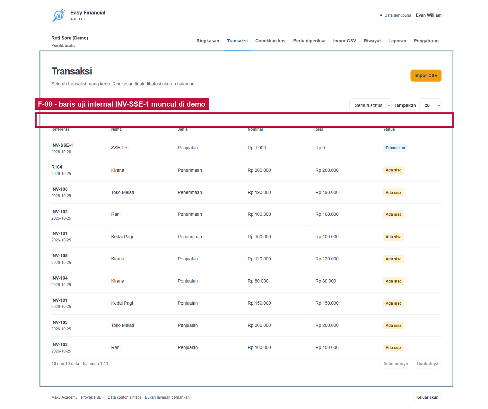

# Rincian Temuan UX dan Rencana Kerja Frontend/Backend

> Dokumen ini mencatat audit sebelum perbaikan. Status implementasi frontend dan bagian yang masih menunggu backend/data ada pada [tindak lanjut UX](UX_IMPLEMENTATION.md). Screenshot di bawah tetap menjadi bukti kondisi saat audit.

Tanggal: 2 November 2026
Acuan pengujian: `https://efa.madgo.my.id/app` dengan workspace demo
`Roti Sore (Demo)`. Pengujian UI dilakukan read-only: tidak ada alokasi, impor,
atau perubahan kata sandi yang disimpan.

Dokumen ini melengkapi `docs/PANDUAN_PENGGUNA_EFA.md`. Fokusnya adalah
memisahkan **bug fungsional**, **masalah UX frontend**, **keterbatasan data**, dan
**fitur yang belum tersedia di backend** agar pekerjaan hari ini tidak salah
pemilik.

## 1. Ringkasan keputusan

Tidak ada bug fungsional P0 pada alur yang saya uji. Login, ringkasan,
pencarian transaksi, suggestions, antrean exceptions, preview impor, riwayat,
ekspor, pengaturan, dan navigasi mobile berjalan.

Masalah yang terlihat sebagian besar adalah **UX frontend**, yaitu cara data
yang sudah benar disajikan kepada pengguna. Ada dua hal yang memang membutuhkan
backend/produk: reset kata sandi dan pengelolaan retensi/hapus data. Ada juga
risiko sinkronisasi source frontend lokal dengan bundle Vercel.

| Prioritas | Temuan | Pemilik utama | Jenis |
| --- | --- | --- | --- |
| P1 | Pasangan yang sama tampil dua kali di **Perlu diperiksa** | Frontend | UX, bukan bug saldo |
| P1 | Kandidat lawan tidak terlihat di kartu antrean | Frontend | UX; data backend sudah ada |
| P1 | Source frontend lokal tertinggal dari bundle live | Release/ops | Risiko regresi deploy |
| P2 | Tabel Transaksi tidak punya tindakan langsung | Frontend | UX |
| P2 | Label Sisa Tagihan mudah disalahartikan | Frontend/copy | UX |
| P2 | Riwayat lama hanya menampilkan "Catatan historis" | Frontend + data lama | UX/legacy |
| P1 fitur | Belum ada lupa kata sandi | Backend/produk | Fitur belum ada |
| P1 fitur | Belum ada retensi/hapus data | Backend/produk | Fitur/kebijakan belum ada |
| P2 | Data demo memuat baris uji `INV-SSE-1` | Seed/demo data | Kebersihan demo |
| P2 | Indikator koneksi perlu diuji saat SSE gagal | Frontend/observability | Perlu reproduksi |

### 1.1 Verifikasi database VPS

Pada 2 November 2026 saya menjalankan query read-only ke PostgreSQL VPS untuk
workspace `Roti Sore (Demo)`. Hasilnya:

- 10 baris: `P101`–`P105` penjualan, `R101`–`R104` penerimaan, dan `SSE-1`
  penjualan yang sudah dibatalkan.
- Duplikasi `source_id + kind`: **0**.
- Duplikasi isi transaksi aktif: **0**.
- Duplikasi checksum batch impor: **0**.
- Duplikasi alokasi aktif: **0**.

Tidak ada `source_id` bernama persis `P1`; yang ada adalah `P101` sampai `P105`,
masing-masing satu baris. INV-102 juga bukan duplikasi: database berisi `P102`
(sale) dan `R102` (receipt) dengan referensi dan nominal yang sama, karena
keduanya adalah dua sisi transaksi. Yang terlihat sebagai dua kartu di UI adalah
masalah presentasi, bukan duplicate row database.

## 2. Rincian temuan

### F-01 — Satu pasangan menghasilkan dua kartu

**Halaman:** [Perlu diperiksa](https://efa.madgo.my.id/app#exceptions)

**Apa yang saya lihat:** Di **Perlu diperiksa**, INV-102 muncul sebagai kartu
Penjualan dan kartu Penerimaan. Keduanya menyatakan "Kandidat unik tersedia"
dan masing-masing memiliki tombol **Konfirmasi usulan**. Jumlah tampilan adalah
9 kartu untuk 9 sisi transaksi.

*Gambar A. Dua kartu INV-102 adalah satu pasangan; kartu juga hanya menunjukkan
jumlah kandidat, bukan identitas transaksi lawan.*

**Penyebab:** Backend sengaja mengembalikan satu item per entry/sisi transaksi
(`umkm_service.go`/`exceptions`), bukan satu item per pasangan. Frontend
menampilkan array tersebut apa adanya. Ini bukan bug perhitungan saldo dan bukan
bug backend; endpoint memang kontrak per-entry. Query database VPS pada bagian
1.1 juga menunjukkan tidak ada duplicate row. Dampaknya adalah beban kognitif
dan kemungkinan pengguna mengira ada dua keputusan.

**Perbaikan yang disarankan:** Di frontend, kelompokkan item yang memiliki
`suggestion_available` dan `uniqueSuggestion` yang sama menjadi satu kartu
pasangan. Tampilkan kedua sisi dan satu tombol konfirmasi. Untuk item `partial`,
`ambiguous`, atau tanpa pasangan unik, tetap tampilkan per entry dengan label
"sisi pasangan" yang jelas.

**Pemilik:** Frontend. Backend tidak perlu diubah untuk perbaikan cepat ini.
Backend bisa menambahkan `pair_key`/`counterpart` nanti jika tim ingin grouping
yang lebih kaya untuk kasus ambigu.

**Acceptance test:** Pada data demo 9 item, pasangan unik INV-102 tampil satu
kartu, bukan dua; tombol konfirmasi hanya satu; setelah modal ditutup data tidak
berubah.

### F-02 — Kandidat lawan tidak terlihat sebelum modal dibuka

**Halaman:** [Perlu diperiksa](https://efa.madgo.my.id/app#exceptions)

**Apa yang saya lihat:** Kartu hanya menampilkan "1 kandidat" dan alasan. Saya
harus menekan tombol untuk mengetahui transaksi lawan yang akan dipasangkan.

**Penyebab:** Live frontend memakai `candidate_count`, `candidate_ids`,
`candidate_ids_truncated`, dan `reason`, tetapi kartu belum merender nama,
referensi, kanal, atau nominal kandidat dari `candidate_ids` ke state entries.
Backend sudah mengirim ID kandidat; tidak perlu endpoint baru.

**Perbaikan yang disarankan:** Buat lookup `entryById` dari
`state.data.state.entries`; untuk setiap kandidat tampilkan:

- referensi atau source ID;
- nama;
- jenis;
- kanal;
- nominal/sisa;
- status kandidat.

Jika `candidate_ids_truncated` benar, tampilkan `candidate_count` penuh dan
tombol **Cari manual**. Jangan menampilkan ID mentah.

**Pemilik:** Frontend. Backend hanya perlu memastikan `candidate_ids` tetap
tersedia dan dibatasi; itu sudah dilakukan.

**Acceptance test:** Kartu INV-102 menampilkan sisi lawan dan nominal sebelum
modal dibuka; `candidate_ids_truncated: true` menampilkan hint pencarian manual.

### F-03 — Transaksi tidak memiliki tindakan langsung

**Halaman:** [Transaksi](https://efa.madgo.my.id/app#entries)

**Apa yang saya lihat:** Pencarian `INV-102` berhasil, filter Penjualan/
Penerimaan berfungsi, tetapi tabel tidak menawarkan tombol untuk menindaklanjuti
baris. Pengguna harus pindah ke **Cocokkan kas** atau **Perlu diperiksa**.

*Gambar B. Tabel Transaksi tidak memiliki kolom/tombol tindakan per baris.*

**Penyebab:** `entriesPage()` hanya menyusun kolom referensi, nama, jenis,
nominal, sisa, dan status. Backend sudah menyediakan ID entry, balance, dan
endpoint alokasi; tidak ada endpoint baru yang dibutuhkan.

**Perbaikan yang disarankan:** Tambahkan kolom **Tindakan**. Untuk baris dengan
sisa, tampilkan **Tindak lanjuti**; untuk baris penjualan buka modal dengan
`sale_id` terisi, untuk penerimaan buka modal dengan `receipt_id` terisi. Untuk
baris tanpa sisa, tampilkan status **Sudah cocok** tanpa tombol.

**Pemilik:** Frontend.

**Acceptance test:** Dari pencarian `INV-102`, tombol membuka modal dengan entry
yang benar dan sisa yang sesuai; tidak mengubah data sampai pengguna menyimpan.

### F-04 — Label Sisa Tagihan mudah disalahartikan

**Halaman:** [Laporan](https://efa.madgo.my.id/app#reports)

**Apa yang saya lihat:** Laporan menampilkan Penjualan Rp650.000, Penerimaan
Rp590.000, dan Sisa Tagihan Rp650.000. Secara teknis angka ini benar untuk data
demo, tetapi pengguna bisa mengira Rp650.000 adalah kerugian atau uang hilang.

*Gambar C. Label “Sisa tagihan” perlu dijelaskan sebagai nilai penjualan yang
belum memiliki pasangan.*

**Penyebab:** Copy frontend. Angka backend sudah konsisten: sisa penjualan =
nominal penjualan - alokasi aktif - fee aktif. Ini bukan bug kalkulasi.

**Perbaikan yang disarankan:** Ubah label menjadi **Nilai penjualan yang belum
punya pasangan** atau tambahkan helper text di bawahnya: "Bukan kerugian; bisa
berarti belum dibayar, dibayar sebagian, atau menunggu pencairan."

**Pemilik:** Frontend/copy.

**Acceptance test:** Pengguna dapat membedakan penjualan tercatat, penerimaan,
sisa tagihan, dan laba; laporan tetap menyatakan bahwa ini bukan laba.

### F-05 — Riwayat lama terasa buntu

**Halaman:** [Riwayat](https://efa.madgo.my.id/app#history)

**Apa yang saya lihat:** Kolom **Terkait** berisi "Catatan historis" untuk data
lama. Tidak ada tooltip atau tombol detail. Event baru seharusnya memiliki
tombol **Lihat detail**.

*Gambar D. Baris lama hanya menampilkan “Catatan historis” tanpa penjelasan.*

**Penyebab:** Data historis di `pblg_audit` memiliki `entity_type`, `entity_id`,
dan `actor_user_id` bernilai `NULL`; frontend tidak bisa menebak ID dari teks
`detail`. Ini bukan bug backend yang bisa langsung diperbaiki tanpa data asal.

**Perbaikan yang disarankan:** Beri tooltip/label: "Event lama belum menyimpan
tautan ke import/allocation." Untuk event baru, pastikan tombol detail membuka
import/allocation yang tepat. Jangan membuat ID palsu atau menebak dari `detail`.

**Pemilik:** Frontend untuk penjelasan; backend/data lama hanya bisa diperbaiki
melalui backfill jika sumber relasi tersedia.

**Acceptance test:** Event baru menampilkan tombol detail yang valid; event lama
menampilkan alasan yang jelas tanpa error.

### F-06 — Belum ada alur lupa kata sandi

**Halaman:** [Masuk](https://efa.madgo.my.id/app#login)

**Apa yang saya lihat:** Halaman login hanya memiliki email, kata sandi, dan
tautan daftar. Tidak ada **Lupa kata sandi**. Pengaturan hanya menyediakan ganti
kata sandi dengan kata sandi lama.

*Gambar E. Halaman masuk tidak memiliki tautan lupa kata sandi.*

**Penyebab:** Backend belum memiliki endpoint reset token/email. Ini bukan bug
frontend; frontend tidak bisa membuat alur reset yang aman tanpa backend.

**Perbaikan yang disarankan:** Tunda sebagai fitur terpisah. Backend minimal
memerlukan endpoint request reset, token sekali pakai, expiry, rate limit,
pengiriman email, dan pencabutan sesi. Jangan menaruh tautan dummy di frontend
sebelum backend siap.

**Pemilik:** Backend/produk; frontend hanya menampilkan setelah endpoint ada.

### F-07 — Retensi, hapus data, dan backup belum ada di UI/API

**Halaman:** [Pengaturan](https://efa.madgo.my.id/app#settings)

**Apa yang saya lihat:** Pengaturan menjelaskan batas impor dan data sintetis,
tetapi tidak memiliki retensi, hapus workspace, atau kebijakan data.

*Gambar F. Pengaturan hanya menampilkan akun, batas, keamanan, dan PWA; belum
ada pengelolaan retensi atau penghapusan data.*

**Penyebab:** Fitur dan kebijakan belum disetujui. Backend belum memiliki
endpoint hapus/retensi/data-policy; ini bukan sekadar tombol yang lupa dipasang.

**Perbaikan yang disarankan:** Putuskan dulu durasi retensi, data yang dihapus,
audit penghapusan, dan prosedur restore. Setelah itu buat endpoint dan UI.
Jangan menampilkan tombol hapus palsu hanya untuk memenuhi tampilan.

**Pemilik:** Produk/backend, lalu frontend.

### F-08 — Data demo memiliki noise

**Halaman:** [Transaksi](https://efa.madgo.my.id/app#entries)

**Apa yang saya lihat:** Tabel Transaksi memuat `INV-SSE-1` dengan status
Dibatalkan. Baris ini tampak seperti data uji internal dan mengganggu cerita demo.

**Bukti database:** `SSE-1` adalah satu baris `sale` dengan `canceled_at` terisi;
bukan duplikasi dari transaksi demo utama.

*Gambar G. Baris uji `INV-SSE-1` ikut tampil di tabel Transaksi demo.*

**Penyebab:** Seed/test data demo, bukan bug aplikasi. Backend menyimpan baris
uji dengan benar; frontend hanya menampilkan data workspace apa adanya.

**Perbaikan yang disarankan:** Pisahkan workspace demo presentasi dari data uji
SSE, atau sembunyikan baris yang ditandai sebagai data uji pada seed demo.

**Pemilik:** Seed/demo dan data; bukan bug endpoint.

### F-09 — Status koneksi saat SSE gagal

**Halaman:** [Ringkasan](https://efa.madgo.my.id/app#overview)

**Apa yang saya lihat:** Console browser mencatat satu `ERR_QUIC_PROTOCOL_ERROR`
untuk stream SSE, sementara header aplikasi sempat menampilkan "Data terhubung".
Aplikasi tetap dapat digunakan dan REST state tetap termuat.

**Status:** Belum terkonfirmasi sebagai bug fungsional; bisa jadi gangguan
transien jaringan/QUIC. Perlu reproduksi dengan stream gagal terkontrol.

**Perbaikan yang disarankan:** Pastikan indikator berubah menjadi "Koneksi
terbatas" saat SSE gagal dan fallback polling aktif; jangan biarkan pengguna
mengira data real-time terus masuk. Uji reconnect dan state version.

**Pemilik:** Frontend/observability, dengan backend SSE sebagai sumber event.

### F-10 — Source frontend lokal dan bundle live berbeda

**Halaman:** [Aplikasi](https://efa.madgo.my.id/app)

**Apa yang saya lihat:** Bundle live memiliki `exceptionsPage`, pemuatan audit
berpaginasi, `limitDescription`, dan `audit-entity`. File
`frontend/assets/app.js` di workspace lokal masih kekurangan bagian-bagian itu.

**Risiko:** Jika frontend mengerjakan perubahan dari source lokal yang tertinggal,
perbaikan yang sudah live bisa hilang saat deploy berikutnya.

**Perbaikan yang disarankan:** Sebelum frontend mulai bekerja, sinkronkan source
yang menghasilkan bundle Vercel ke branch/repo kerja. Bandingkan daftar route,
`exceptionsPage`, `loadAudit`, `limitDescription`, dan `audit-entity`. Ini bukan
bug runtime, tetapi risiko rilis paling serius hari ini.

**Pemilik:** Frontend/release. Backend tidak perlu diubah.

## 3. Status bug per flow

| Flow | Status fungsional | Catatan |
| --- | --- | --- |
| Masuk | Berfungsi | 401 `/auth/me` sebelum login adalah ekspektasi; tidak ada lupa kata sandi |
| Ringkasan | Berfungsi | Angka benar; copy "Sisa tagihan" perlu diperjelas |
| Transaksi | Berfungsi | Pencarian/filter/pagination bekerja; tidak ada tindakan per baris |
| Cocokkan kas | Berfungsi | Suggestion dan modal bekerja; belum ada grouping pasangan |
| Perlu diperiksa | Berfungsi | Duplikasi dua sisi dan kandidat tersembunyi adalah UX, bukan bug saldo |
| Impor CSV | Berfungsi | Upload dan preview duplikat bekerja; tidak ada commit saat pengujian |
| Riwayat | Berfungsi | Audit server dan pagination tersedia; data lama `NULL` tidak bisa ditautkan |
| Laporan | Berfungsi | Ekspor CSV berhasil; copy angka perlu diperjelas |
| Pengaturan | Berfungsi | Akun, password, PWA, dan limits tampil; retensi/hapus belum ada |
| Mobile | Berfungsi | Menu dialog dan horizontal table scroll bekerja |
| SSE/reconnect | Belum terverifikasi penuh | Ada satu error QUIC transien; UI tetap berjalan |

## 4. Urutan kerja yang disarankan hari ini

### Frontend, bisa dikerjakan tanpa backend baru

1. Sync source live Vercel terlebih dahulu.
2. Group pasangan unik di **Perlu diperiksa**.
3. Render nama/referensi kandidat dari `candidate_ids` di kartu.
4. Tambah **Tindak lanjuti** pada baris Transaksi yang masih memiliki sisa.
5. Perjelas copy Sisa Tagihan dan tooltip event historis.
6. Bersihkan data demo `INV-SSE-1` dari workspace presentasi.

### Backend/produk, jangan dipaksakan sebagai pekerjaan UI hari ini

1. Rancang reset kata sandi beserta email/token/expiry/rate limit.
2. Sepakati retensi, hapus data, audit penghapusan, dan restore.
3. Setelah keputusan ada, buat endpoint dan UI-nya bersamaan.

## 5. Bukti pengujian yang sudah dilakukan

- Login demo berhasil dan workspace `Roti Sore (Demo)` terbuka.
- Ringkasan menampilkan 5 penjualan, 4 penerimaan, 0 pasangan selesai.
- Pencarian `INV-102` menyisakan 2 dari 10 transaksi.
- **Perlu diperiksa** menampilkan 9 kartu dan filter berfungsi.
- **Cocokkan kas** menampilkan satu usulan INV-102; modal dapat dibuka.
- Preview CSV contoh menghasilkan 0 baris baru dan 5 baris identik dilewati.
- Riwayat memuat 9 event dan menyatakan seluruh riwayat sudah dimuat.
- Ekspor menghasilkan `umkm-rekap.csv` dengan header dan 10 baris data.
- Tampilan mobile 390×844 menampilkan menu dialog dan tabel yang dapat digeser.

Catatan: pengujian ini tidak menyimpan alokasi, tidak commit impor, tidak
mengganti kata sandi, dan tidak memasang PWA. Kesimpulan bug fungsional tulis
tetap memerlukan regression test backend yang sudah ada; dokumen ini fokus pada
apa yang dialami pengguna di UI live.
